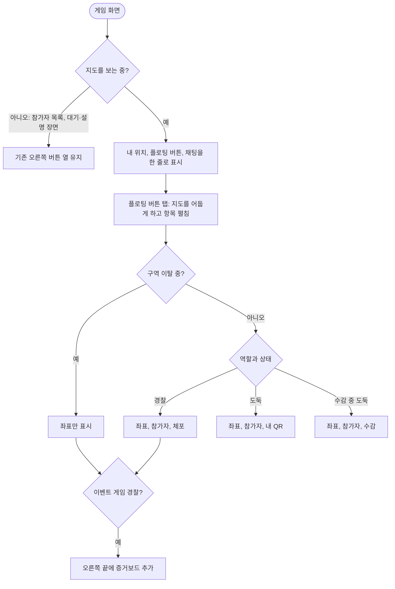

<!-- projectops:report -->
# 인게임 버튼 플로팅화

## 개요
지도 왼쪽과 오른쪽에 흩어져 있던 버튼을 가운데 아래 플로팅 메뉴로 모았습니다. 내 위치와 채팅은 지도에 그대로 두고, 좌표, 참가자, QR, 증거보드는 메뉴로 옮겼습니다. 술래잡기와 무전이 들어올 자리를 먼저 만드는 작업이고(DEC-0124), 서버 변경은 없습니다.

## 기능 흐름

## 변경 사항

### 메뉴
- `lib/features/game/domain/game_menu_entries.dart`: 역할, 수감, 구역 이탈, 이벤트 여부로 항목을 정하는 순수 계산
- `lib/features/game/presentation/widgets/game_fab_menu.dart`: 플로팅 버튼과 부채꼴 메뉴. #655 시험 구현에서 AR 전용 `highlighted`를 빼고 아이콘 색, 켜짐 상태, 스크린리더 문구를 넣음

### 게임 화면
- `lib/features/game/presentation/pages/game_page.dart`: 지도 모드의 왼쪽, 오른쪽 버튼을 메뉴로 교체. 새 메시지 말풍선을 채팅 버튼 바로 위로 이동

### 문구
- `lib/l10n/app_*.arb`: 메뉴 문구 3개 언어 추가. 쓰지 않게 된 `gameGridToggle` 삭제. 수감 항목은 기존 `statusJailed` 재사용
- `docs/i18n/glossary.md`: 좌표, 내 QR, 증거보드 추가

### 테스트
- `test/features/game/domain/game_menu_entries_test.dart`, `test/features/game/presentation/widgets/game_fab_menu_test.dart`: 추가
- `test/features/game/presentation/pages/game_page_auto_escape_test.dart`: 옛 버튼 위치를 찾던 12개를 새 배치에 맞게 수정

## 수정 전후 화면

왼쪽이 수정 전, 오른쪽이 수정 후입니다. iPhone 16 Pro 시뮬레이터의 더미 게임입니다.

| 역할 | 수정 전 | 수정 후 |
|---|---|---|
| 경찰 |  |  |
| 도둑 |  |  |

영상에서 확인한 것은 메뉴 열기와 닫기, 좌표 켜고 끄기, 참가자 이동입니다. 오른쪽 위 벌레 버튼은 디버그 빌드에만 보입니다. 더미 게임이라 타이머가 `--:--`이고, 구역이 없어 격자선이 그려지지 않습니다.

### 언어별 메뉴

iPhone 16 Pro 시뮬레이터의 더미 게임에서 메뉴를 연 화면입니다. 언어마다 실행 언어를 지정해 띄웠고, 항목 이름은 화면 접근성 정보로도 확인했습니다.

| 언어 | 경찰 | 도둑 |
|---|---|---|
| 한국어 |  |  |
| 영어 |  |  |
| 일본어 |  |  |

## 주요 구현 내용
- **지도를 볼 때만 메뉴를 씁니다.** 대기·설명 장면에서는 가운데 아래 규칙 문구와 겹치고, 참가자 목록에는 지도로 돌아갈 버튼이 필요해서 오른쪽 열을 유지합니다. 그래서 이 두 화면의 QR은 메뉴로 옮기지 않았습니다.
- **열린 메뉴도 게임 상태를 따릅니다.** 메뉴를 연 사이 구역을 벗어나면 펼쳐진 항목은 그대로이므로, 참가자와 QR은 누르는 시점에 이탈 여부를 다시 확인합니다. 체포되거나 게임이 끝나면 기존 팝업 닫기 로직이 메뉴도 함께 닫습니다.
- **말풍선 자리:** 예전 위치는 플로팅 버튼과 겹치므로 메뉴를 쓰는 동안 채팅 버튼 바로 위에 둡니다.

검증: `flutter analyze`와 전체 테스트 1593개 통과, 문구 톤 검사 통과.

## 주의사항
- **확인하지 못한 것:** Android의 일본어 글꼴, 실제 게임 판(실기기), 달리면서 2탭 조작, 수감과 구역 이탈 상태의 메뉴 화면, 말풍선 위치(위젯 테스트로만 확인).
- **QR 2탭:** QR이 2탭으로 늘어나 #377에서 줄인 1탭이 되돌아갑니다. 실제 판에서 확인이 필요합니다.
- **플로팅 아이콘:** `Icons.add`(Material 아이콘)를 임시로 씁니다. 머지 전에 SVG로 바꿀지 정해야 합니다.
- **라벨 대비:** 밝은 지도 위 어두운 배경과 흰 라벨의 대비가 약 3.7:1입니다. 야외 가독성을 확인해야 합니다.
- **증거보드 아이콘:** 기존 도둑 캐릭터 그림을 그대로 씁니다.
- **#655와 겹침:** `game_fab_menu.dart`와 그 테스트가 #655 브랜치에 다른 내용으로 있어, 나중에 머지하는 쪽에서 충돌합니다. #656 버전을 기준으로 맞추고 AR 코드에서 `highlighted`를 다시 처리해야 합니다.
