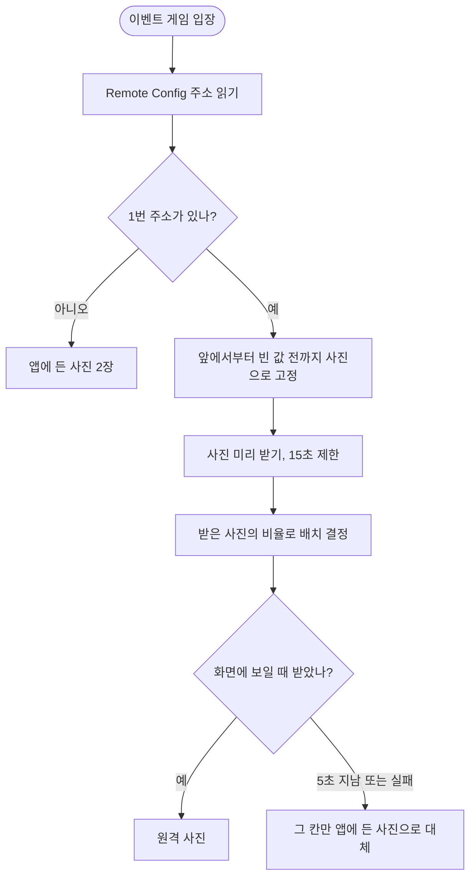

<!-- projectops:report -->
# 🚀[기능개선][이벤트] 이벤트 사진 Firebase Storage 전환

## 개요

이벤트 증거 사진을 앱에 넣어 두면 행사마다 앱을 배포해야 했습니다. Remote Config의 주소로 사진을 불러오게 바꿔 어드민에서 교체할 수 있게 했습니다. 사진은 1장에서 3장까지 고를 수 있고, 사진 수와 비율에 맞춰 결과 보드 배치가 달라집니다.

이슈에서는 2장 고정을 제안했지만, 행사마다 수를 바꾼 적이 있어 개수를 조절할 수 있게 했습니다.

## 기능 흐름

## 변경 사항

### 값
- `remote_config_keys.dart`, `remote_config_service.dart`: `event_evidence_image_1_url`부터 `3_url`까지 추가. 개수 값은 두지 않아 개수와 주소가 어긋날 수 없습니다.

### 배치
- `event_evidence_layout.dart` (신규): 사진 수와 비율로 배치를 계산합니다. 한 보드의 칸은 모두 같은 크기입니다.

| 경우 | 배치 |
|---|---|
| 1장 | 가운데 한 장 |
| 2장, 세로 사진 | 나란히 |
| 2장, 정사각형이나 가로 사진 | 위아래 |
| 3장, 세로 사진 | 한 줄 |
| 3장, 정사각형이나 가로 사진 | 위 2장 + 아래 1장 |

사진 영역은 화면 높이의 45%를 넘지 않고, 비율은 9:16에서 16:9 사이로 계산합니다.

### 사진 받기
- `event_evidence.dart`, `event_evidence_provider.dart` (신규): 게임마다 한 번 주소를 고정하고 미리 받습니다. 게임 중에 값이 바뀌어도 팝업과 보드의 사진이 달라지지 않습니다. 앱을 끄고 다시 들어오면 새 값을 읽습니다.
- `event_evidence_image.dart` (신규): 받는 동안 회색 면, 5초가 지나거나 실패하면 앱에 든 사진을 보여 줍니다.

### 화면
- `event_result_board.dart`: 고정 2칸을 배치 계산 결과로 교체했습니다.
- `event_arrest_success_dialog.dart`: 정사각형 칸은 그대로 두고 공개 번호만 사진 수까지로 제한했습니다.
- `game_page.dart`: 입장 때 준비하고 세 호출부에 사진을 넘깁니다.

## 참고할 점

- 새 패키지를 넣지 않아 디스크 캐시가 없습니다. 앱을 다시 켜면 다시 받으므로 어드민에서 사진을 1MB까지로 막습니다.
- 앱에 든 사진은 2장이라 3번 칸을 못 받으면 2번 사진으로 대신합니다.
- 앱에 든 사진은 대학 축제 이야기라 다른 행사에서 사진을 못 받으면 내용이 어긋납니다. 어떤 행사에도 맞는 그림이 준비되면 파일만 바꾸면 됩니다.
- 2번 사진(1.2MB)을 색 수 압축으로 줄여 봤지만 색이 깨져서 그대로 두었고, 앱 용량은 아직 줄지 않았습니다.
- 사진 수보다 많이 검거하면 팝업에 마지막 사진이 다시 나옵니다.

## 운영 설정

- Remote Config 값 3개를 빈 값으로 게시했습니다(버전 96). 값이 비어 있으면 앱에 든 사진을 쓰므로 동작은 지금과 같습니다.
- 사진 주소는 아직 넣지 않았습니다. 어드민 앱 설정의 "이벤트 게임" 탭(dongsim-web#196)이 배포되면 그곳에서 올립니다.
- 이 기능이 없는 옛 버전 앱에는 앱에 든 사진 2장이 나옵니다. 행사에서 다른 사진을 쓰려면 행사 전에 최소 버전을 올려야 합니다.

## 테스트

- 신규: 배치 계산, 사진 묶음과 미리 받기, 사진 수별 보드, 받기 실패 시 대체, 작은 폰과 태블릿에서 넘치지 않는지
- 실기기 확인과 실제 저장소 사진으로 받아 보는 확인은 아직 하지 않았습니다.
