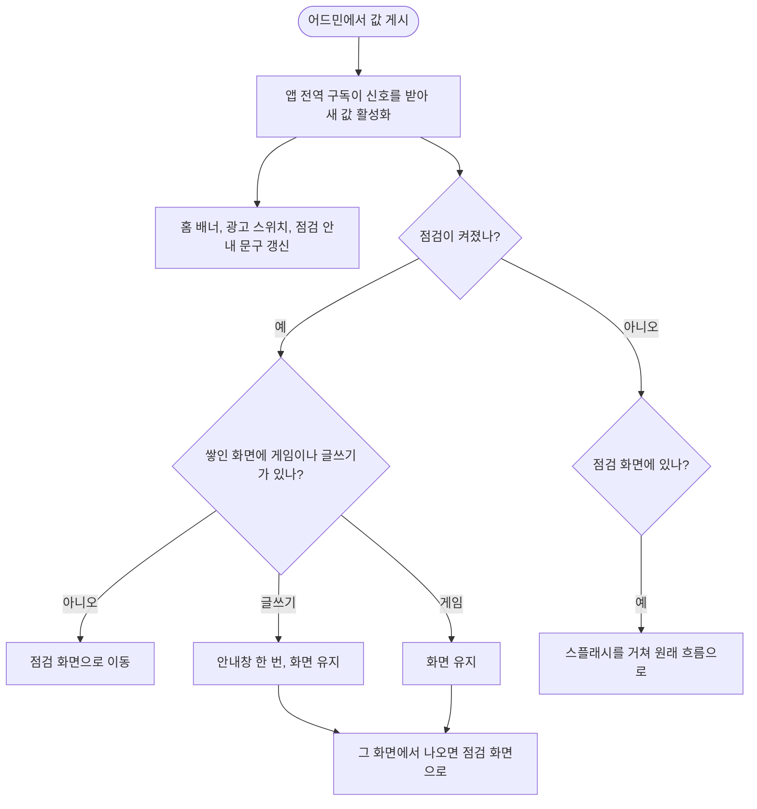

<!-- projectops:report -->
# 🚀[기능개선][Remote Config] 게시한 값을 앱에 바로 반영

## 개요

어드민에서 Remote Config 값을 게시해도 앱에 늦게 반영되던 문제를 고쳤습니다. 앱이 켜져 있는 동안 어느 화면에서든 게시 신호를 받고, 점검 모드는 실행 중인 앱에도 바로 적용됩니다. 게임과 글쓰기 화면은 끊지 않고 그 화면에서 나올 때 막습니다.

## 기능 흐름

## 변경 사항

### 값 받기
- `remote_config_service.dart`: 실시간 구독을 초기화 때 한 번만 만들고, 새 값을 활성화한 뒤 홈과 광고에 알립니다. 화면이 사라져도 구독이 끊기지 않습니다. `maintenance`와 `maintenanceMessage`는 초기화 전에 빈 값을 돌려줍니다.
- `minimumFetchInterval` 1시간은 그대로 둡니다. 공식 문서가 짧은 간격을 개발용으로 안내하고, 실시간 신호는 이 값과 상관없이 옵니다. SDK 코드를 보면 연결할 때 마지막 버전을 보내므로, 놓친 게시도 연결되면 따라잡을 것으로 봅니다. 실제 시간은 재 보지 않았습니다.

### 점검 이동
- `maintenance_gate.dart` (신규): 어디로 보낼지 정하는 규칙과, 화면 변화와 값 변화를 함께 보는 `MaintenanceGuard`가 있습니다.
- `app_router.dart`: 가드를 릴리스 빌드에서만 붙입니다. 디버그 빌드는 `AppVersionChecker`처럼 점검으로 막지 않습니다. 점검 화면은 약관이나 닉네임이 남은 사용자도 그대로 보여 줍니다.
- 라우터의 redirect와 refresh를 쓰지 않은 이유: redirect는 뒤로 가기에 돌지 않아 글쓰기에서 나온 사용자를 놓치고, refresh는 쌓인 화면의 `extra`와 결과 Future를 잃어 게임 위 신고 화면이 깨집니다.

### 스플래시 재진입
- `splash_page.dart`: 점검이 끝나면 스플래시가 다시 열립니다. 콜드 스타트 목적지는 앱이 켜진 동안 남아 있어서, 초대로 켠 앱이 스플래시에서 멈추거나 예전 글로 다시 가던 문제를 막았습니다. 점검 때문에 처리되지 못한 초대는 초대 화면으로 이어 줍니다.

### 화면과 문구
- `maintenance_page.dart`: 점검 중에 고친 끝나는 시각이 바로 나오고 스크린 리더도 읽어 줍니다.
- 글쓰기 안내창 (한국어, 영어, 일본어): "점검이 시작됐어요 / 점검이 끝나면 다시 시도해 주세요".

## UX 판단

| 판단 | 근거 |
|---|---|
| 게임과 글쓰기는 끊지 않고 나올 때 막기 | 일이 끝나는 지점까지 미루면 불편과 반응 시간이 줄어든다는 연구 ([Iqbal & Bailey, CHI 2008](https://www.interruptions.net/literature/Iqbal-CHI08.pdf)), 입력을 잃지 않게 하라는 지침 ([W3C](https://www.w3.org/WAI/WCAG2/supplemental/patterns/o4p09-data-loss/)) |
| 안내창은 스낵바 대신 다이얼로그 | 앱 스낵바는 화면 아래에 떠서 글을 쓸 때 키보드에 가립니다 |
| 안내창에 "복사", "사라져요"를 쓰지 않기 | 글이 짧고 화면 깊이가 얕아 경고보다 할 일만 알리는 편이 낫다고 담당자와 정했습니다 |
| 점검 화면 문구를 바꾸지 않기 | 사용자는 시각을 보거나 나중에 다시 오면 됩니다. 자동 복귀는 몰라도 되는 동작입니다 |
| 채팅과 댓글 입력은 보호하지 않기 | 내용이 짧고, 화면 경로만으로 입력 중인지 알 수 없습니다 |

점검은 적어 둔 시각이 되어도 풀리지 않고 어드민에서 "점검 끝내기"를 눌러야 풀립니다. 서버 작업이 늦어졌을 때 먼저 열리지 않도록 이 방식을 유지합니다.

## 테스트

| 구분 | 내용 |
|---|---|
| `remote_config_service_test` | 화면이 없어도 활성화, 구독 1회, 알림 순서, 초기화 전 구독, 활성화 실패와 연결 오류 뒤 유지, 첫 받기 실패 |
| `maintenance_gate_test` | 이동 규칙, 실제 라우터에서 점검 시작과 해제, 저장된 값으로 들어간 점검 해제, 쌓인 화면 제거, 값이 바뀌어도 `extra`와 결과 유지, 게임 위 신고 화면, 글쓰기 안내 한 번, 뒤로 나올 때 막기 |
| `maintenance_page_test` | 작은 폰 세 언어와 큰 글자에서 넘침 없음, 안내창 표시와 닫기 |
| `splash_cold_deeplink_timeout_test` | 재진입 때 예전 글로 가지 않음, 초대로 켠 앱이 멈추지 않음 |

전체 1671개 통과, 실패 2개는 이번 변경과 무관한 가드 테스트 `app_icons`, `device_location_fallback`입니다.

## 확인하지 못한 것

- **실기기:** 테스트는 가짜 신호로 돌렸습니다. 점검 이동은 디버그 빌드에서 꺼져 있어, 릴리스 빌드에서 값을 실제로 게시해 봐야 합니다. Remote Config 프로젝트가 운영 하나뿐이라 시간을 맞춰야 합니다.
- **안드로이드 연결 오류:** 플러그인이 오류를 메인 스레드로 옮기지 않고 넘기는 코드가 있습니다. 이 경로로 앱이 죽는지는 확인하지 못했습니다. 기존에도 홈이 떠 있으면 같은 구독을 썼고, 이번에 게임 중으로 범위가 넓어집니다. 비행기 모드 시험이 필요합니다.
- **점검 중 초대 링크로 처음 실행:** 코드로 처리했지만 자동 테스트가 없습니다. 앱이 켜진 상태에서 점검 중에 누른 초대 링크는 사라집니다.
- **실시간 연결이 계속 실패할 때:** 대신할 경로가 없어 점검 화면 사용자가 다시 열어야 하고, 저장된 값은 최대 1시간 남을 수 있습니다.

## 남은 일

- 옛 버전 앱은 계속 늦으므로, 어드민의 "최대 1시간" 안내는 이 버전이 퍼진 뒤에 바꿉니다.
- 어드민 설명 "이미 앱을 쓰고 있는 사용자의 화면은 바뀌지 않아요"도 그때 함께 바꿉니다.
- 강제 업데이트는 앱을 열 때만 판단합니다. 받아 둔 값이 저장되므로 다음 실행부터 적용됩니다.
