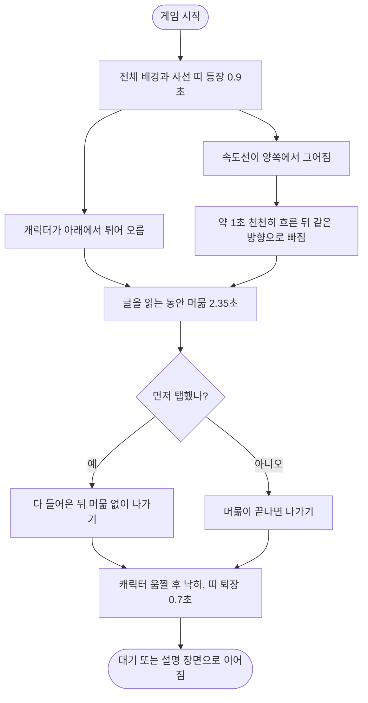

<!-- projectops:report -->
# 게임 시작 전 역할 안내 훅

## 개요

게임 시작 직후 나오는 역할 배너를 피그마 완성본으로 교체했습니다. 작은 파랑·초록 띠에 역할 이름을 적던 화면을, 큰 사선 띠와 제목, 화면 아래로 크게 잘린 캐릭터로 바꿨습니다. 경찰과 도둑 모두 393×852 export와 대조해 토큰으로 맞췄습니다. 문구만 시안의 명령형 대신 앱 말투(토스체)로 바꿨고, 이번 커밋에 당겨서 새로고침 파동을 연하게 하는 조정도 함께 넣었습니다.

오른쪽 시안의 손전등 화면은 이번 범위에 넣지 않았습니다.

## 기능 흐름

## 변경 사항

### 역할 배너
- `lib/features/game/presentation/widgets/start/start_banners.dart`: `RoleBanner`를 시안 구조로 다시 작성했습니다. 속도선 4개, 캐릭터 등장·퇴장, 제목 일부만 강조하는 글자 처리가 들어 있습니다.
- `lib/features/game/presentation/widgets/start/stripe_banner.dart`: 역할 배너용 기울기, 위치, 전체 배경, 띠 아래 두께, 글·장식 층을 선택 값으로 추가했습니다. 출동 배너는 기본값을 그대로 씁니다.
- `lib/features/game/presentation/widgets/start/band_transition.dart`: 다음 장면이 새 띠 모양에서 펼쳐지도록 `RoleBanner`의 띠 값을 따라가게 했습니다.

### 토큰과 폰트
- `lib/core/constants/app_colors.dart`: `pureBlack`(#000000)을 추가했습니다. 도둑 띠 색이며, 기존 `black`은 #080A0C입니다.
- `lib/core/constants/text_styles.dart`: 제목 전용 `scoreDreamExtrabold_45`를 추가했습니다.
- `assets/fonts/SCDream7.otf`, `pubspec.yaml`: S-Core Dream 7 ExtraBold를 등록했습니다.

### 문구
- `lib/l10n/app_{ko,en,ja}.arb` 및 생성 파일: `startMissionPolice`, `startMissionRobber`를 지우고 `startTitlePolice`, `startTitleRobber`, `startTitlePoliceAccent`, `startTitleRobberAccent`, `startRoleSentence`를 추가했습니다.

| 자리 | 시안 | 적용 문구 |
|---|---|---|
| 경찰 제목 | 도둑을 찾아 / 모두를 체포하라! | 도둑을 찾아 / 모두 체포해요! |
| 도둑 제목 | 경찰을 피해 / 끝까지 도망쳐라! | 경찰을 피해 / 끝까지 도망쳐요! |
| 설명 | 당신의 역할은 경찰입니다 | 이번 판은 경찰이에요 |

### 당겨서 새로고침
- `lib/core/widgets/loading/app_refresh_control.dart`: 파동이 가장 진할 때의 불투명도를 0.3에서 0.18로 낮췄습니다.

### 테스트
- `test/features/game/presentation/widgets/start/start_banners_test.dart`, `band_transition_test.dart`: 속도선 방향과 흐름, 캐릭터 등장·퇴장, 제목 강조, 언어별 강조 문구 일치, 작은 폰의 영어 화면, 띠 모양을 검증합니다.

## 수정 전후 화면

위젯을 393×852로 렌더해 만든 GIF입니다. 실기기 녹화가 아닙니다.

| | Before | After |
|---|---|---|
| 경찰 |  |  |
| 도둑 |  |  |

## 주요 구현 내용

**시안 값**

| 자리 | 경찰 | 도둑 |
|---|---|---|
| 전체 배경 | `black700` #485665 | `black700` #485665 |
| 띠·속도선 | `white` #FFFFFF | `pureBlack` #000000 |
| 띠 아래 두께 | `black100` #EDF0F2 | `black800` #333D48 |
| 라벨 (`label16Medium`) | `black600` #5D6F83 | `black200` #CFD6DD |
| 제목 (`scoreDreamExtrabold_45`) | `black800` + `blue` #0088FF | `white` + `green` #38F55B |
| 설명 (`heading_24`) | `black800` + `blue` | `white` + `green` |
| 캐릭터 | 왼쪽 29 · 폭 427 · 보이는 높이 317 | 왼쪽 23 · 폭 493 · 보이는 높이 305 |

띠는 기울기 -9.5°, 세로 폭 약 298, 화면 가운데에서 위로 약 63입니다. export와 다른 픽셀은 경찰 3.07%, 도둑 3.11%이고(상태바 제외) 대부분 글자 테두리 차이입니다.

**캐릭터의 탄력 표현.** SVG를 부위별로 움직이지 않고, 그림 전체에 `Transform.translate`와 가로세로를 따로 주는 `Transform.scale`을 걸었습니다. 제자리를 지나쳤다가 돌아오고, 올라갈 때 늘어나고 내려앉을 때 눌리며, 축을 화면 아래쪽(`Alignment(0, .25)`)에 둬 바닥을 딛고 눌리는 것처럼 보이게 했습니다. 부위별 움직임이 필요해지면 SVG를 나누거나 Rive·Lottie가 필요합니다.

**속도선을 배너와 분리한 이유.** 속도선은 글을 읽는 동안 먼저 빠져야 해서 배너의 머묾과 별개인 자기 시간표(2.1초)로 움직입니다. 탭으로 배너가 먼저 나가면 시간표를 기다리지 않고 함께 빠집니다.

**줄무늬 틈 제거.** 띠를 이루는 줄 7개가 맞닿으면 안티앨리어싱 틈이 비쳐서 세로로 4% 겹쳤습니다. 그래서 띠 가장자리가 export보다 최대 1~2px 바깥에 있습니다.

## 주의사항

- **실기기 미확인:** 모션과 파동 세기는 시뮬레이터나 실기기에서 아직 보지 못했습니다. 파동의 0.18은 임의로 잡은 값이라 조정될 수 있습니다.
- **강조 문구 키:** `startTitle*Accent`는 같은 언어의 제목 안에 글자 그대로 있어야 합니다. 어긋나면 강조만 사라지고 오류는 나지 않아서, 언어별 일치를 테스트로 막았습니다.
- **문구:** 시안의 명령형과 달리 토스체로 넣었습니다. 영어·일본어는 초안입니다. 한국어 제목의 "QR로" 안내가 시안에 없어 이 배너에서 빠졌습니다.
- **용어:** 용어집은 게임 1회를 "라운드"로 정했습니다. 영어·일본어는 이를 따르고, 한국어 설명만 "이번 판"을 씁니다.
- **등장 시작 위치:** 세로로 늘어난 만큼 윗변이 올라가므로 시작 `y`를 1.12로 둡니다. 1.0으로 되돌리면 튀어 오르기 전 약 0.3초 동안 머리가 화면 아래에 보입니다.
- **일본어 글꼴:** S-Core Dream과 Pretendard에 없는 한자는 시스템 폰트로 나와 굵기가 섞여 보입니다. 깨지지 않아 그대로 두기로 했습니다.
- **토큰과 export 차이:** 경찰 띠 아래 두께는 export가 #EAEAEA인데 토큰이 없어 `black100`을 썼습니다.
- **폰트 라이선스:** 크레딧 표기 여부는 아직 정하지 않았습니다.
- **남은 작업:** 손전등 화면, 술래잡기 역할 화면은 이번 범위가 아닙니다.
