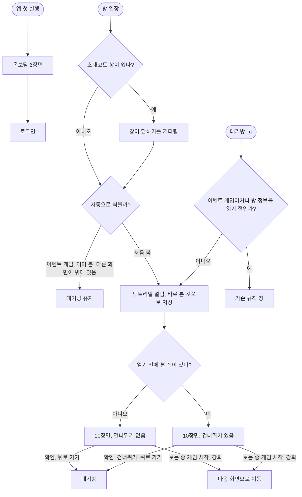

<!-- projectops:report -->
# ⚙️[기능추가][온보딩] 모드별 튜토리얼 생성

## 개요

첫 실행 온보딩을 소개 4장에서 3D 지도 6장면으로 바꾸고, 방에 들어왔을 때 게임 규칙을 보여 주는 튜토리얼 10장면을 추가했습니다. 온보딩은 앱이 뭔지만 보여 주고, 규칙은 그 모드를 하러 들어온 방에서 알려 줍니다. 술래잡기 튜토리얼 6장면도 만들어 두었고, 앱에 모드 값이 생기면 연결합니다(DEC-0127).

## 기능 흐름

## 변경 사항

### 공통 엔진 (`lib/core/widgets/tutorial/`)
- `tutorial_timeline.dart`: 값 옮기기와 예약 실행을 한 시간축에서 돌립니다. 연출이 남아 있으면 다음 버튼을 잠급니다. 앱이 백그라운드에서 돌아와도 한 번에 50ms까지만 진행해 연출이 건너뛰어지지 않습니다.
- `tutorial_camera.dart`, `tutorial_map_painter.dart`: 지도를 원근 계산으로 직접 그립니다. 구글 지도를 쓰지 않아 지도 비용, 로딩, 위치 권한이 필요 없습니다.
- `tutorial_stage.dart`, `tutorial_script.dart`: 장면 상태와 장면별 연출입니다. 시간과 좌표는 승인된 시안 값입니다.
- `tutorial_player.dart`, `tutorial_overlays.dart`: 화면입니다. 라이트와 다크를 겹쳐 원형으로 전환합니다.
- `assets/onboarding/tutorial_map.json`: 세종대 일대 OpenStreetMap을 앱 좌표로 구운 지도입니다. 지도가 보이는 동안 OSM 표기를 띄웁니다.
- 온보딩(`auth`)과 튜토리얼(`session`)이 함께 쓰고 기능 간 직접 참조가 금지라 `core`에 뒀습니다.

### 화면 연결
- `game_tutorial_page.dart` (신규): 방 입장 튜토리얼입니다. 대기방 하위 라우트로 올라갑니다.
- `waiting_room_page.dart`: 초대코드 창이 닫힌 뒤 자동으로 띄우고, 앱바 ⓘ를 튜토리얼로 연결합니다.
- `tutorial_prefs.dart` (신규): 모드별 기기당 1회 저장과 자동 표시 판단입니다.
- `onboarding_page.dart`: 새 엔진으로 교체했습니다. 로그인 또는 마이페이지로 나가는 길은 그대로입니다.

### 문구와 자원
- 튜토리얼과 온보딩 문구를 한국어, 영어, 일본어로 추가했습니다. 초대코드 창, 이탈 배너, 내 QR은 기존 문구를 재사용합니다.
- 쓰이지 않게 된 온보딩 문구 6개와 그림 4개(`onboarding1.svg`, `onboarding2_1.svg`, `onboarding2_2.svg`, `onboarding3.svg`)를 지웠습니다.
- `sensors_plus`와 iOS `NSMotionUsageDescription`을 추가했습니다. 튜토리얼에서 카메라 권한을 묻지 않으려고 스캔 장면은 폰 움직임으로 QR을 옮깁니다. 센서는 그 장면에서만 켜고, 센서가 없으면 끌어서 옮깁니다.

## 수정 전후 화면

실제 Flutter 화면을 테스트에서 프레임 단위로 렌더링한 GIF입니다. 시뮬레이터 녹화가 아니고, 움직임은 실제 속도와 다를 수 있습니다.

| 온보딩 수정 전 | 온보딩 수정 후 | 튜토리얼 (신규) |
|---|---|---|
|  |  |  |

### 언어별 화면 (시안)

앱과 같은 장면을 시안으로 찍은 캡처입니다. 앱에서 언어별로 찍은 화면이 아닙니다. 일본어 글꼴은 실기기 확인이 필요합니다.

**온보딩**

**경찰과 도둑**

**술래잡기 (아직 앱에서 열리지 않음)**

## 주요 구현 내용

| 판단 | 근거 |
|---|---|
| 튜토리얼을 대기방 하위 라우트로 띄움 | 대기방이 게임 시작과 강퇴 때 부르는 `context.go`가 튜토리얼까지 걷어 냅니다. 따로 닫는 코드가 필요 없습니다 |
| 열리는 순간 본 것으로 저장 | 나가는 경로마다 저장 여부를 나누면 분기가 늘어납니다. 보는 중 게임이 시작되거나 강퇴돼도 다음 입장 때 자동으로 뜨지 않고, ⓘ로 볼 수 있습니다 |
| 처음 볼 때는 건너뛰기 없음 | 규칙을 한 번은 보게 합니다. 뒤로 가기까지 막으면 끝까지 볼 때까지 대기방으로 못 돌아가므로 막지 않습니다 |
| 지도 장면을 2번으로 | 구역을 보고, 위치를 확인하고, 쫓아가 터치하는 게임 순서에 맞췄습니다 |
| 위에서 본 지도도 3D와 같은 방향 고정 | 장면이 바뀔 때 화면이 돌면 어지럽습니다 |
| 튜토리얼 마지막은 커뮤니티 안내 대신 "이제 시작하러 가볼까요?" | 이미 방에 들어온 사람이 보는 화면입니다. 버튼은 게임이 시작되는 것으로 오해하지 않도록 "확인"입니다 |
| 트윈을 키 단위로 대체 | 시안처럼 트윈 전체를 지우면 장면 정리가 도중에 멈춰 초대코드 창이 다음 장면에 남습니다 |
| 마지막 장면은 그림이 다 나온 뒤에 문구를 보여 줌 | 원이 화면을 채우는 동안 문구가 먼저 보이면 그림보다 글을 먼저 읽게 됩니다. 버튼도 문구가 나온 뒤에 켜집니다 |
| 다음 버튼 비활성 색 | 대기방 게임 시작 버튼과 같은 토큰입니다 |
| 다크 지도 색은 상수, 페이드는 `withValues` | 도둑 지도색(`MapStyles.dark`) 값이고, 연속으로 변하는 투명도라 토큰으로 표현할 수 없습니다 |

## 테스트

| 구분 | 내용 |
|---|---|
| `tutorial_timeline_test` | 재생 중 판단, 백그라운드 복귀, 키 단위 대체, 예약 실행 |
| `tutorial_camera_test` | 시안과 같은 투영 값 |
| `tutorial_script_test` | 장면 순서, 다크 장면 목록, QR 체포, 힌트 유지, 스캔 건너뛰기, 초대코드 창 정리, 이탈 배너, 대기 중 그리기 중단, 마지막 장면 문구 순서 |
| `tutorial_player_test` | 다음 잠금, 건너뛰기, 작은 폰 일본어 넘침, 센서 오류 때 끌어서 체포, 키 큰 폰 무대 비율 |
| `game_tutorial_navigation_test` | 보는 중 게임 시작과 강퇴, 첫 시청 건너뛰기 숨김, 다시 볼 때 건너뛰기, 뒤로 가기, 자동 표시 판단, 마지막 문구와 버튼 |
| `onboarding_page_test` | 나가는 길(로그인, 마이페이지), 마지막 장면, 초대코드 창 내용 |

- `flutter analyze` 이상 없음, `flutter test` 1714개 통과.
- iPhone 17 Pro 시뮬레이터(iOS 26)에서 앱이 뜨는 것과 튜토리얼 화면을 담당자가 확인했습니다.
- 내비게이션 테스트는 대기방과 같은 구조로 만든 테스트용 라우터에서 돌립니다. 실제 대기방에서 게임이 시작될 때의 동작은 아직 확인하지 않았습니다.

## 주의사항

- **실기기 확인 필요:** 전환 어지러움, 자이로 조작감과 방향, iOS 동작 권한 창, 저사양 폰 성능, 보는 중 게임 시작.
- **구역 축소 장면:** 앱에 아직 없는 #668 기능을 안내합니다. 튜토리얼이 먼저 나가면 없는 기능을 설명하게 되므로 출시 순서를 맞춰야 합니다. `tutorial_script.dart`의 장면 목록에서 한 줄로 뺄 수 있습니다.
- **술래잡기 연결:** 앱에 모드 값이 생기면 `app_router.dart`의 `TutorialMode.classic`과 `waiting_room_page.dart`의 자동 표시 판단을 함께 바꿉니다. 잡는 방법이 미정이라(DEC-0119) 터치로 잡는다고 가정한 장면입니다.
- **문구:** 새 문구는 초안입니다. 영어와 일본어는 원어민 검수 전이고, 술래·도망자 표기는 용어집에 없습니다.
- **연출 값을 고칠 때:** 시간과 좌표가 서로 맞물려 있습니다. 탈옥 곡선 값은 지도 방향에 맞춰 돌린 값이라, 방향을 바꾸면 도둑이 화면 밖으로 나갑니다.
- **알려진 한계:**
  - 태블릿에서는 글자가 커서 일부 문구가 두 줄로 넘어갑니다.
  - 방 설정 조회가 실패하면 이벤트 방에서도 튜토리얼이 뜰 수 있습니다.
  - 자이로가 없는 기기에서도 힌트는 폰 움직임만 보여 줍니다.
  - `NSMotionUsageDescription`의 한국어·일본어 번역이 없습니다.
