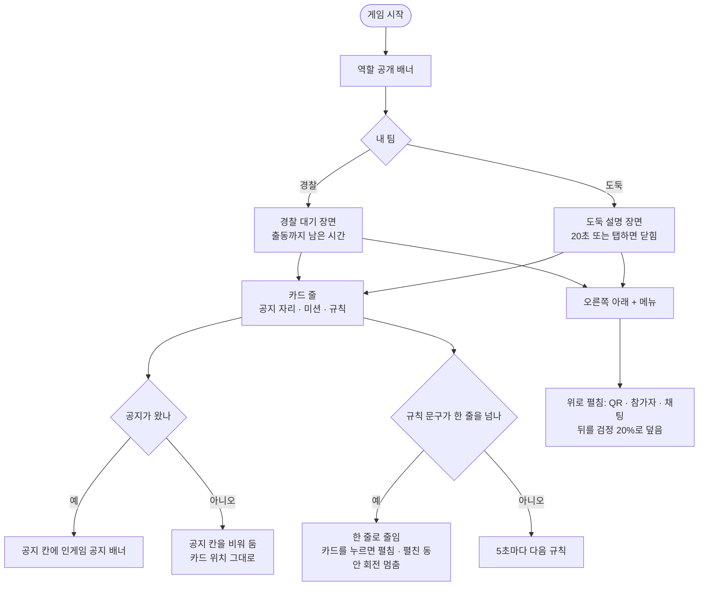

<!-- projectops:report -->
# 🚀[기능개선][게임] 게임 시작 장면 새 시안 적용

## 개요

경찰 대기 장면과 도둑 설명 장면을 새 시안(Figma 9085:24154 경찰, 9085:24058 도둑)으로 교체했습니다. ⓘ 규칙 다시 보기도 같은 장면을 쓰므로 함께 바뀌었습니다. 캐릭터가 달리던 배경을 낮·밤 그림 두 장과 지나가는 경찰차로 바꾸고, 그 위에 공지·미션·규칙 카드를 놓았습니다. 장면의 플로팅 메뉴에는 채팅을 넣었습니다(DEC-0133). 지도 화면의 채팅 전용 버튼은 그대로입니다(DEC-0124). 글꼴·간격·색은 Figma 노드 값으로 맞췄습니다. 일반 게임에서도 시작 공지 넷을 공지 배너로 띄웁니다(DEC-0138, DEC-0096 대체). 시작 공지가 장면에서 두 번 나오던 문제와 CodeRabbit 리뷰 지적도 함께 고쳤습니다.

## 기능 흐름

## 변경 사항

### 장면
- `lib/features/game/presentation/widgets/start/chase_scene.dart`: 장면을 다시 짰습니다.
  - 위쪽: 팀 이름, 출동까지 남은 시간, 안내 문구
  - 가운데: 카드 줄. 공지 칸은 항상 비워 둡니다. 미션 카드(깃발)와 규칙 카드(전구)가 이어집니다.
  - 아래쪽: 지나가는 경찰차
  - 캐릭터는 장면에서 뺐고, "탭하면 지도로 돌아가요" 문구도 지웠습니다.
  - 규칙 회전·도둑 설명 20초 자동 닫힘·진행 막대가 같은 읽기 시계를 씁니다. 카드를 펼친 동안 셋 다 멈춥니다.
  - 규칙을 펼치거나 접을 때 화면을 그린 시각(`_now`) 기준으로 계산합니다. 규칙이 막 바뀐 직후 눌러도 보이던 규칙이 펼쳐지고, 접어도 이전 규칙으로 돌아가지 않습니다.
  - 펼친 미션은 늘 접을 수 있습니다. 카드 열은 큰 글씨·짧은 화면에서 넘칠 때만 스크롤됩니다.
  - 동작 줄이기를 켜면 카드 크기를 애니메이션 없이 바로 바꿉니다. 시간 0짜리 `AnimatedSize`는 레이아웃 오류를 냅니다.
- `lib/features/game/presentation/widgets/start/band_transition.dart`: 띠가 다 펼쳐지거나 접히기 시작할 때 `ClipPath` 틀을 빼고 넣던 것을, 틀은 두고 자르기만 끄도록 바꿨습니다. 틀을 빼면 장면이 새로 만들어져 공지·규칙·남은 시간 막대가 처음부터 다시 돌았습니다.
- `lib/features/game/presentation/widgets/start/police_car_drive.dart` (새 파일): 경찰차가 7초에 한 번 왼쪽 화면 밖에서 오른쪽 화면 밖으로 지나가며 3px씩 튑니다. 기기에서 움직임 줄이기를 켜면 한 자리에 멈춥니다.
- `lib/features/game/domain/start_flow.dart`, `lib/core/constants/character_assets.dart`: 게임마다 배경 6장 중 하나를 고르던 `StartScene` 관련 코드를 지우고, 낮·밤 두 장 경로만 남겼습니다.

### 메뉴
- `lib/features/game/domain/game_menu_entries.dart`: 장면 메뉴 항목에 채팅을 더했습니다(위에서부터 QR, 참가자, 채팅). 지도 메뉴에는 채팅이 없습니다.
- `lib/features/game/presentation/widgets/game_fab_menu.dart`
  - 장면용 `stacksUp` 모드를 추가했습니다. 오른쪽 아래 버튼 위로 항목이 한 줄로 쌓입니다(버튼과 첫 항목 사이 16, 항목끼리 8).
  - 장면 메뉴를 열면 뒤 화면을 순수 검정 20%로 덮습니다. 지도 메뉴는 예전처럼 검정 50%입니다. 처음엔 장면에 흐림 8도 넣었지만 끊겨 보여 뺐습니다.
  - + 버튼은 `icon_plus.svg`로 바꿨습니다. 도둑 화면은 검정 원에 초록 +입니다.
  - 여러 색 아이콘을 원본 색 그대로 그릴 수 있게 `iconColorMapper`를 추가했습니다.
  - 항목 크기: 장면 메뉴와 지도 메뉴 모두 원 48·아이콘 24입니다(예전 지도 메뉴는 64·32). 펼친 항목이 가운데 버튼(56)보다 작아야 위계가 맞습니다. 지도 부채꼴 반지름은 150에서 132로 줄였습니다.
  - 그림자: 장면·지도, 경찰·도둑의 메뉴 버튼과 항목 원 모두 `AppShadows.soft`(피그마 `shadow`, 1·1·8 검정 10%)입니다. 도둑 화면에서 쓰던 흰색 20%는 메뉴에서 없어졌습니다.
- `lib/features/game/presentation/pages/game_page.dart`
  - 장면이 떠 있으면 채팅 전용 버튼과 화면 위쪽 공지 배너를 숨기고, 공지는 장면 카드 줄에 넣습니다.
  - 장면 메뉴 버튼은 오른쪽 16, 아래 28 + 안전 영역에 둡니다.
  - 참가자 아이콘을 `icon_headcount`(앞사람 팀 색, 뒷사람 옅은 팀 색)로 바꿨습니다.
  - 좌표 아이콘도 다른 메뉴 아이콘처럼 켜짐 여부와 상관없이 팀 색(경찰 `blue`, 도둑 `green`)입니다.
  - 시작 공지: 일반 게임에서도 10초 "잠시 후 게임이 시작돼요"와 30초 "게임 시작!"을 공지 배너로 띄웁니다(DEC-0138). 경찰 출동은 계속 출동 배너가 알립니다.
  - 역할 배너 동안에는 위쪽 공지 배너를 띄우지 않습니다. 장면이 열리는 순간 남은 공지의 표시 시간을 다시 잡아 장면에서 8초를 다 보여 줍니다.
- `lib/core/widgets/tutorial/tutorial_overlays.dart`: 튜토리얼에서 메뉴 버튼을 흉내 낸 그림도 새 + 버튼 모양으로 맞췄습니다.

### 공지 배너
- `lib/features/game/presentation/widgets/marquee_alert_banner.dart`
  - 양옆 여백을 바꿀 수 있게 `horizontalMargin`을 추가했습니다.
  - 배경색을 `red900`으로 바꿨습니다. 지도 위 인게임 공지도 같은 위젯이라 함께 바뀝니다.
  - 글자가 흐를 거리를 화면 폭이 아니라 실제 글자 칸 너비로 계산합니다. 장면에서 글자가 32px 늦게 들어오던 문제가 없어졌습니다.
  - 배너 높이를 `MarqueeAlertBanner.heightFor()`로 꺼내, 장면 공지 칸이 키 큰 화면에서도 실제 배너 높이만큼 자리를 잡습니다.

### 토큰·에셋
- `lib/core/constants/app_colors.dart`: `red900` 값을 #E64C4F에서 #F64C4F로 바꿨습니다(Figma `red_900`).
- `lib/core/constants/text_styles.dart`: `scoreDreamExtrabold_80`(남은 시간 숫자)과 `paragraph14Semibold116`(Figma `paragraph_14px_Semibold`, 카드 본문)을 추가했습니다. 위젯에서 `copyWith(height:)`로 줄 높이를 바꾸지 않습니다.
- `lib/core/constants/spacing_and_radius.dart`: `vertical44`를 추가했습니다.
- `lib/core/constants/app_icons.dart`: `bulb`, `flag`, `plus`, `policeCar`를 추가했습니다.
- `assets/backgrounds/start_wait/`: 낮·밤 배경 두 장을 넣고 예전 배경 6장을 지웠습니다.
- `assets/icons/`: `icon_bulb`, `icon_flag`, `icon_plus`, `icon_police_car`를 넣었습니다. 도둑 내 QR(`icon_qr_code.svg`)과 경찰 체포(`icon_qr_scan.svg`)는 이름을 그대로 두고 ver3 시안(`icon_qr`, `icon_scan`)으로 내용을 바꿨습니다. 인게임 메뉴·지도 QR 버튼·튜토리얼이 같은 아이콘을 씁니다.

### 문구 (ko · en · ja)
- `lib/l10n/app_*.arb`
  - 안내 문구를 바꿨습니다: 경찰 "도둑이 도망치는 중이에요!", 도둑 "경찰에게서 멀어지세요!"
  - 미션 라벨·문구 4개를 추가했습니다. 영어·일본어는 초안입니다.
  - 지운 키: `startTapToMap`

### 테스트
- `test/features/game/presentation/widgets/start/chase_scene_test.dart`
  - 미션 카드, 공지 위치, 경찰차 이동·멈춤, 배경 그림을 확인합니다.
  - 긴 규칙이 한 줄이었다가 누르면 펼쳐지는지, 펼친 동안 규칙이 넘어가지 않는지 확인합니다.
  - Figma 세로 간격(48 / 14 / 14 / 44 / 18, 공지 y376)과, 공지가 있든 없든 미션 카드 위치가 같은지 확인합니다(키 큰 화면 포함).
  - 규칙이 바뀐 직후 펼치거나 접어도 보이던 규칙이 유지되는지, 펼친 동안 도둑 설명이 닫히지 않는지 확인합니다.
- `test/features/game/presentation/widgets/start/band_transition_test.dart`: 띠가 다 펼쳐질 때와 접히기 시작할 때 장면이 다시 만들어지지 않는지 셉니다.
- `test/features/game/presentation/widgets/marquee_alert_banner_test.dart` (새 파일): 카드 줄 안에서도 공지 글자가 칸 오른쪽 끝에서 바로 들어오는지 확인합니다.
- `test/features/game/presentation/widgets/game_fab_menu_test.dart`: 장면 메뉴의 쌓이는 순서와 간격(16 / 8, 버튼 56)을 확인합니다. 지도 메뉴는 항목이 3개·4개일 때 모두 원 48·아이콘 24인지 확인합니다.
- `test/features/game/domain/game_menu_entries_test.dart`: 팀별 장면 메뉴 항목을 확인하고, 지도 메뉴에 채팅이 없는지 확인합니다.
- `test/features/game/presentation/pages/game_page_auto_escape_test.dart`: 장면에서 채팅은 메뉴로 엽니다. 장면을 닫는 탭은 카드가 아닌 빈 배경을 누릅니다. 시작 공지가 역할 배너 동안 뜨지 않고 장면에서 끝까지 보이는지, 일반 게임에서 10초·30초 공지가 뜨는지 확인합니다. ⓘ 규칙 안내 시점(38.8초)도 맞췄습니다.

## 수정 전후 화면

위젯을 393×852로 렌더한 화면입니다(아이폰 16 Pro 안전 영역). 실기기 녹화가 아닙니다. Before는 #660 리포트에 올린 GIF입니다.

| | Before | After |
|---|---|---|
| 경찰 |  |  |
| 도둑 |  |  |

**공지가 사라진 뒤에도 카드 위치가 같습니다**

| 경찰 | 도둑 |
|---|---|
|  |  |

**언어별 화면** — 테스트 환경에는 한자 글꼴이 없어 일본어는 모든 글자를 Arial Unicode로 찍었습니다. 기기에서는 Pretendard와 시스템 한자, 숫자는 S-Core Dream으로 나옵니다. 공지는 흘러 들어오는 중이라 잘려 보입니다.

| | 한국어 | English | 日本語 |
|---|---|---|---|
| 경찰 |  |  |  |
| 도둑 |  |  |  |

## 주요 구현 내용

**Figma 노드 값으로 맞춘 자리**

| 자리 | 토큰 · 값 |
|---|---|
| 팀 이름 | `heading_20`, 아이콘 24(글자와 같은 색으로 칠함), 간격 `horizontal6`. 경찰 `blueVer2Rich`, 도둑 `green800` |
| 경찰 출동까지 | `label_16`(SemiBold). 경찰 `black500`, 도둑 `black200` |
| 남은 시간 | `scoreDreamExtrabold_80`. 경찰 `blue`, 도둑 `green` |
| 안내 문구 | `subHeading_18`. 경찰 `black700`, 도둑 `white` |
| 세로 간격 | 팀 줄 top 118 → 48 → 라벨 → 14 → 숫자(80) → 14 → 안내 → 44 → 공지(y376) → 18 → 미션 → 18 → 규칙 |
| 공지 | 인게임 `MarqueeAlertBanner`, `red900` #F64C4F, 칸 높이 = 실제 배너 높이(시안 44) |
| 카드 | 경찰 `blueVer2_50`, 도둑 `black`. `AppRadius.large` 12, 그림자 `AppShadows.vague`. 패딩 `horizontal16` / `vertical18`, 높이 76 |
| 카드 글 | 라벨 `paragraph_14`(Medium, 줄 높이 1.4), 간격 `vertical4`, 본문 `paragraph14Semibold116`(줄 높이 1.16, 접힘·펼침 공통). 아이콘 20, 아이콘~글 `horizontal6` |
| 메뉴 버튼 | 56, 그림자 `AppShadows.soft`(장면·지도 공통), + 24. 경찰은 파란 원에 흰 +, 도둑은 검정 원에 초록 + |
| 메뉴 항목 | 원 48 · 아이콘 24 (장면·지도 공통), 지도 부채꼴 반지름 132. 그림자 `AppShadows.soft` |

**왜 이렇게 했는지**
- **숫자 글꼴:** S-Core Dream은 숫자 폭이 모두 50으로 같습니다. 그래서 1초마다 숫자가 바뀌어도 글자가 좌우로 흔들리지 않습니다. 흔들림 없는 MM:SS 표시는 사용자 요구 사항입니다.
- **공지 칸:** 공지는 왔다가 8.8초 뒤 사라집니다. 칸을 비워 두지 않으면 그때마다 미션·규칙 카드가 62px씩 오르내렸습니다(레이아웃 시프트).
- **긴 규칙:** 예전에는 가장 긴 규칙 높이로 카드를 고정해서 카드가 96으로 커졌습니다. 시안은 76입니다. 그래서 한 줄로 줄이고, 누르면 펼치게 했습니다. 펼친 동안 규칙이 넘어가면 읽던 문장이 사라지므로 회전을 멈춥니다.
- **흐림을 뺀 이유:** 처음엔 장면 메뉴에만 흐림 8을 넣었습니다. 흐림 세기를 매 프레임 바꾸다가 세기 고정·투명도 애니메이션으로 바꿨는데도 실기기에서 끊겨 보였습니다. 그래서 검정 20%만 남겼습니다.
- **시작 공지가 두 번 나오던 이유:** 원인이 둘이었습니다. 역할 배너 동안 위쪽에 배너가 먼저 생겼다가 장면에 새로 생긴 것, 그리고 띠 전환 틀을 빼고 넣어 장면 자체가 다시 만들어진 것입니다. 첫 수정의 테스트는 배너가 "있는지"만 봐서 두 번째 원인을 놓쳤습니다. 그래서 생성 횟수를 세는 테스트로 막았습니다.
- **시작 공지 넷을 배너로:** 대기·설명 장면의 공지 칸에서 시작 안내를 빠짐없이 보여 주려고 DEC-0096을 DEC-0138로 대체했습니다.
- **채팅을 장면 메뉴에만:** 출동 전 장면에는 "뛰는 중 한 번에 채팅 열기"라는 DEC-0124의 근거가 해당하지 않습니다. 지도 화면은 그대로 둡니다(DEC-0133).

**역할 공개 배너 대조:** 역할 공개 배너(9062:19973 경찰, 9062:20010 도둑)는 렌더해서 Figma 출력과 겹쳐 봤습니다. 글자 줄 위치가 1~2px 안이라 바꾸지 않았습니다.

## 주의사항

- **`red900` 값 변경:** 이 토큰을 쓰는 구역 이탈 경고(도둑 화면)와 커뮤니티 위치 선택 화면의 빨강도 아주 조금 밝아졌습니다. 예전 색이 필요하면 토큰을 따로 정해야 합니다.
- **공지 배너는 지도와 장면이 같은 위젯입니다.** 배너를 고치면 둘 다 바뀝니다. Figma와 다른 곳이 남아 있습니다.
  - 안쪽 여백·간격: Figma는 왼쪽 18, 아이콘~글 10이고 지금은 16, 8입니다.
  - 도둑 화면 글꼴: Figma는 Pretendard인데 지금은 Moneygraphy입니다.
  - 글자 위치: Figma는 왼쪽에 멈춰 있는데 지금은 흘러 들어옵니다.
- **공지는 한 칸뿐입니다.** 여러 공지가 연달아 오면 마지막 것만 남습니다. 지도와 같은 동작입니다.
- **카드 아이콘 정렬:** 아이콘(20)과 라벨 줄(14 × 1.4 = 20)이 같은 높이라 위를 맞추면 가운데가 맞습니다. 라벨 스타일의 줄 높이를 바꾸면 아이콘이 어긋납니다.
- **배경 해상도:** 배경 PNG는 393×852 1배 원본이라 3배 화면에서 흐릴 수 있습니다. 1179×2556 파일을 받으면 같은 이름으로 바꾸면 됩니다.
- **번역 초안:** 미션 문구 영어·일본어는 초안입니다.
- **안 쓰는 코드:** `recede.dart`와 `start_flow.dart`의 `waitProgress`는 이번 변경으로 쓰는 곳이 없어졌지만 아직 지우지 않았습니다.
- **시작 공지와 출동 배너:** 경찰 대기가 30초 안팎인 방에서는 30초 "게임 시작!" 배너와 출동 배너가 비슷한 때에 뜰 수 있습니다. ⓘ 규칙 안내는 마지막 시작 공지 뒤라 38.8초에 뜹니다.
- **좌표 아이콘:** 색이 늘 팀 색이라, 켜짐·꺼짐은 지도 위 좌표선과 스크린리더로만 구분됩니다.
- **기기 미확인:** 시뮬레이터·실기기에서 경찰차 움직임, 카드 펼치기, 시작 공지 한 번 표시는 아직 다 보지 않았습니다.
- Figma 대조 결과물 폴더 `docs/projectops/figma/`는 루트 `.gitignore`로 git에서 뺐습니다.
- 전체 테스트 1751개 통과, `flutter analyze` 이상 없음.
