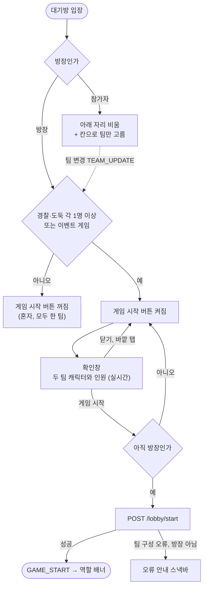

<!-- projectops:report -->
# 🚀[기능개선][대기방] 준비 완료 제거, 시작 확인 모달

## 개요

대기방에서 참가자의 준비 단계를 없앴습니다. 이제 참가자는 팀만 고르고, 방장이 시작하면 바로 게임이 시작됩니다. 서버(BE #230, v3.0.0)가 먼저 준비 확인을 지웠고, 앱은 그 조건에 맞춰 준비 버튼과 준비 상태 표시, 준비 요청, 준비 이벤트 처리를 걷어 냈습니다.

방장 시작 버튼은 서버와 같은 조건(경찰·도둑 각 1명 이상, 이벤트 게임은 조건 없음)일 때만 켜집니다. 누르면 두 팀 캐릭터와 인원을 보여 주는 확인창이 뜨고, 확인창의 「게임 시작」을 누르면 바로 시작합니다. 참가자 화면은 디자이너 시안(Figma 9085:24787)대로 아래 자리를 비우고, + 칸에 「역할 바꾸기」를 붙이고, 인원 표기를 「현재 인원 N명」으로 바꿨습니다.

이슈의 3-2-1 확인창(DEC-0117)은 근거 조사 뒤 사용자 결정(2026-11-07)으로 기다림 없이 바로 시작하는 확인창으로 바꿨습니다. 버튼을 몇 초 막는 장치는 반복할수록 효과가 아무 장치 없는 창 수준으로 떨어진다는 연구(Bravo-Lillo 외, SOUPS 2014)와, 확인한 파티 게임(Among Us, Jackbox, Kahoot)에 시작을 늦추는 확인창이 없다는 점을 근거로 삼았습니다.

## 기능 흐름

## 변경 사항

### 준비 상태 제거
- `lib/features/lobby/data/models/lobby_event_dto.dart`: `LobbyParticipantInfo`에서 `isReady`를 지웠습니다. 서버가 1단계에서 보내는 `isReady: true`는 읽지 않고, 2단계에서 필드가 지워져도 파싱이 깨지지 않습니다. `READY_UPDATE` 상수도 지웠습니다.
- `lib/features/session/data/models/ready_request.dart`와 생성 파일 2개를 지웠고, `PATCH /lobby/ready` 호출(`session_remote_datasource.dart`, `session_provider.dart`, `api_endpoints.dart`)도 지웠습니다.
- `lib/core/i18n/error_message_mapper.dart`: `NOT_ALL_READY`, `HOST_CANNOT_UNREADY` 매핑과 문구를 지웠습니다. 서버 3.0.0에서 두 코드가 사라졌습니다.
- `waiting_room_participants_provider.dart`: 준비 이벤트 처리와 더미 모드 준비 토글을 지웠습니다.
- `participant_card.dart`: 대기방 캐릭터는 준비 여부와 상관없이 같은 모습입니다.
- `assets/characters/police/default/not_ready.svg`: 더 이상 쓰지 않아 지웠습니다. 도둑 `not_ready.svg`는 술래잡기 튜토리얼의 탈락 장면(`tutorial_overlays.dart` `_outed`)이 써서 남겼고, 번들 테스트에 쓰임새를 주석으로 적었습니다.

### 방장 시작
- `WaitingRoomParticipantsState.canStart(isEventGame:)`: 서버 시작 검사와 같은 조건입니다. 혼자 있을 때와 모두 한 팀일 때 꺼집니다.
- `waiting_room_page.dart`의 `_confirmStartGame`: `AppDialog`에 `StartGameTeamPreview`를 넣은 확인창입니다. 확인창이 떠 있는 동안 누가 들어오거나 나가면 인원이 따라 바뀝니다. 그 사이 방장이 넘어갔으면 시작 요청을 보내지 않습니다.
- `start_game_team_preview.dart` (새 파일): 두 팀 캐릭터를 나란히 두고 아래에 인원을 적습니다. 0명인 팀은 흐리게 그립니다(이벤트 게임).
- 준비한 사람이 팀을 바꾸지 못하게 막던 조건과, 방장이 됐을 때 준비를 풀던 처리를 지웠습니다. 이제 누구나 언제든 팀을 바꿀 수 있습니다.

### 참가자 화면 (Figma 9085:24787)
- 아래 자리를 비웠습니다. 높이는 시작 버튼과 같게 잡아 방장이 바뀌어도 목록이 들썩이지 않습니다.
- + 칸(`AddSlotCard`)에 「역할 바꾸기」 라벨을 붙였습니다. 아이콘은 시안 SVG와 경로가 같은 `icon_change`, 색은 시안과 같은 `black400`입니다. 큰 글씨에서도 한 줄로 두고 넘치면 줄입니다.
- `AppTextStyles.tag10Semibold`를 추가했습니다(시안 `tag_10px_semi`).

### 게임 중 참가자 목록
- `participant_overlay.dart`: 준비 필드를 수감 표시로 빌려 쓰던 것을 `isRobberJailed` 직접 판정으로 바꿨습니다. 낙관적 체포·탈옥 반영, 탈옥 탭 판정, 도주 중 도둑 수는 예전과 같습니다.

### 문구 (ko·en·ja)
- 새 문구: `dialogStartGameTitle`(게임을 시작할까요?), `dialogStartGamePoliceCount`·`dialogStartGameRobberCount`(경찰 N명, 도둑 N명), `addSlotChangeRole`(역할 바꾸기)
- 바꾼 문구: `teamSectionCurrentCount` 「현재 N명」 → 「현재 인원 N명」 (en 「Players: N」, ja는 그대로)
- 지운 문구: `buttonReady`, `buttonCancelReady`, `errorCodeNotAllReady`, `errorCodeHostCannotUnready`
- 새 문구와 en·ja는 Codex 검토를 거쳤습니다. 확인창 버튼은 저장소 문구 기준(왼쪽은 「닫기」)과 동작을 말하는 버튼 원칙에 따라 「닫기」, 「게임 시작」으로 뒀습니다.

### 문서
- `docs/api-docs.json`: dev 서버 3.0.0 명세로 동기화했습니다. 오류 코드 매핑 검사 테스트가 이 파일을 봅니다.
- `.claude/skills/realtime-spec/SKILL.md`: 준비 이벤트와 준비 API 설명을 지우고 3.0.0 기준으로 고쳤습니다.

### 테스트
- `waiting_room_can_start_test.dart` (새 파일): 혼자, 모두 경찰, 모두 도둑, 양 팀 1명 이상, 이벤트 게임, 로딩 전, 소문자 팀 이름
- `lobby_participant_info_test.dart` (새 파일): 서버가 `isReady`를 보낼 때와 안 보낼 때 모두 같은 결과로 읽힘
- `participant_overlay_test.dart`: 체포된 내 도둑 카드를 누르면 탈옥 창이 뜨고, 탈옥이 이미 반영됐으면 뜨지 않음. 수감 판정을 일부러 뒤집어 두 테스트가 실패하는 것을 확인했습니다.
- 기존 테스트 3개에서 `isReady` 인자를 지웠습니다.

## 수정 전후 화면

| 화면 | 수정 전 | 수정 후 |
|---|---|---|
| 참가자 (경찰) | | |
| 방장, 시작할 수 있음 | | |
| 방장, 모두 한 팀 | | |
| 시작 확인창 (경찰·도둑·이벤트) | | |

화면 사진은 이슈 댓글에 따로 붙입니다. 수정 후 사진은 위젯 테스트 렌더(393×852, 앱 글꼴 적용)이고, 에뮬레이터·실기기에서 찍은 것은 아닙니다.

## 주요 구현 내용

### 서버와 맞춘 것 (BE dev 3.0.0 코드 대조)
- **시작 조건**: 서버 `LobbyService.validateGameStart`는 방장 권한과 팀 구성(`countByGameIdAndTeam`)만 보고, 이벤트 게임은 팀 검사를 건너뜁니다. 서버가 세는 대상(그 방 참가자 전부)과 앱이 세는 대기방 목록(`GET /lobby`, `findAllByGameIdWithUser`)이 같아 버튼 상태와 서버 판단이 어긋나지 않습니다.
- **시작 거절**: `NOT_HOST`(403), `INVALID_TEAM_COMPOSITION`(400), `GAME_ALREADY_STARTED`, `LOBBY_ACTION_NOT_ALLOWED`는 모두 매핑된 안내가 뜹니다. `PARTICIPANT_NOT_FOUND`(404)는 기존대로 참여 불가 창 뒤 홈으로 갑니다.
- **로비 이벤트**: 서버가 보내는 종류는 ENTER, EXIT, TEAM_UPDATE, HOST_CHANGED, GAME_START, AREA_UPDATED, SETTINGS_UPDATED, KICKED입니다. 키 이름(`newParticipant`, `participant`, `newHost`, `exitedParticipantId`, `kickedParticipantId`, `startTime`)이 앱 처리와 같습니다.
- **라운드 종료 뒤**: 서버는 참가자 상태만 WAITING으로 돌리고 팀은 유지합니다(`resetAllParticipantsForNextRound`). 대기방으로 돌아오면 다시 준비할 필요 없이 방장이 바로 시작할 수 있습니다. 게임 중 나간 사람은 지워져 목록과 서버 인원이 같습니다.
- **방장 이동**: 방장이 나가면 서버가 가장 먼저 들어온 사람에게 넘기고 HOST_CHANGED를 보냅니다. 앱은 이벤트나 대기방 재조회로 시작 버튼을 새 방장에게 보여 줍니다.

### `isReady`를 모델에서 아예 뺀 이유
서버는 1단계에서 `isReady: true`를 계속 보내고, 앱 강제 업데이트 뒤 2단계에서 필드를 지웁니다. 필드를 필수 값으로 남겨 두면 2단계 응답에서 그 값이 없어 대기방 조회와 로비 이벤트 파싱이 깨집니다. 읽지 않는 값이라 모델에서 빼는 것이 가장 안전하고, `isReady`가 있을 때와 없을 때 모두 같은 결과로 읽히는지 테스트로 묶었습니다.

### 구버전 호환
- 구버전 앱 + 새 서버: 서버가 `isReady`를 늘 true로 보내 구버전 방장의 시작 버튼이 켜지고, 구버전 참가자의 준비 요청은 204로 아무 일도 하지 않습니다(BE #230).
- 새 앱 + 구버전 서버(운영 2.41): 시작이 `NOT_ALL_READY`로 거절됩니다. 아래 주의사항을 보세요.
- 2단계(서버가 `/ready`, `isReady`, DB 컬럼 삭제): 새 앱은 둘 다 쓰지 않아 영향이 없습니다.

## 주의사항

- **운영 서버가 3.0.0이 된 뒤에 출시해야 합니다.** 운영 서버(현재 2.41.0)는 아직 준비를 확인합니다. 이 앱이 먼저 나가면 일반 게임은 시작할 수 없고, 방장에게는 원인 없는 「일시적인 오류」 안내만 뜹니다. 심사 제출 전에 `https://api.copsandrobbers.app/v3/api-docs`의 버전을 확인해야 합니다.
- **시작 조건을 고칠 때는 서버와 함께 보세요.** `WaitingRoomParticipantsState.canStart`는 서버 `LobbyService.validateGameStart`(방장 권한, 팀별 인원, 이벤트 게임 예외)를 그대로 옮긴 것입니다. 한쪽만 바뀌면 "버튼은 켜졌는데 서버가 거절"하거나 "시작할 수 있는데 버튼이 꺼진" 상태가 생깁니다.
- **앱 버전**: DOC-0104에 따라 이 변경이 들어간 앱은 4.0.x로 올리기로 했습니다. 버전 올림은 배포 때 정합니다.
- **이벤트 게임 시작 버튼 (원래 있던 문제)**: 앱은 대기방에 들어올 때 게임 정보를 한 번만 불러 이벤트 게임인지 정합니다. 그 조회가 실패하거나, 방장이 들어온 뒤 어드민에서 이벤트 스위치를 켜면(서버가 로비 이벤트를 보내지 않음) 방장 혼자인 이벤트 방에서 시작 버튼이 꺼진 채 남습니다. 방을 나갔다 들어오면 풀립니다. 예전에도 같았고, 따로 고칩니다.
- **피그마와 다르게 둔 것**: 닉네임 글자색(시안은 방장 진한 검정, 나머지 회색)과 캐릭터 줄 간격은 이번 범위 밖이라 그대로 뒀습니다.
- **DEC-0117**: 확인창이 3-2-1에서 바로 시작으로 바뀌어 결정 노트 갱신이 필요합니다.
- 실기기·에뮬레이터에서는 아직 확인하지 않았습니다. 화면은 위젯 렌더로, 서버 흐름은 dev 서버 코드 대조와 로그인 없는 요청(대기방 API 모두 401, 명세 3.0.0)으로 확인했습니다.

## 검증

- `dart format`: 바꾼 파일 변경 없음
- `flutter analyze`: 이번 변경에서 문제 없음. 커밋하지 않은 로컬 파일 `lib/main_rescue_preview.dart` 1건만 걸립니다.
- `flutter test`: 1,763개 중 1,761개 통과. 실패 2건(`app_icons_test` 경로 리터럴, `device_location_fallback_test` 좌표)은 main에서도 실패하는 Windows 경로 구분자 문제입니다.
- 문구 톤 검사: 이번에 추가하거나 바꾼 문구에서는 위반이 없습니다. 원래 있던 위반 2건(`pageMaintenanceWritingMessage` en·ja 끝 마침표)은 그대로입니다.
- 독립 코드 검토 1회: 동작을 깨는 문제 없음. 지적된 옛 주석, 확인창 중 방장 이동, 큰 글씨 라벨 넘침, 빠진 테스트를 반영했습니다.
