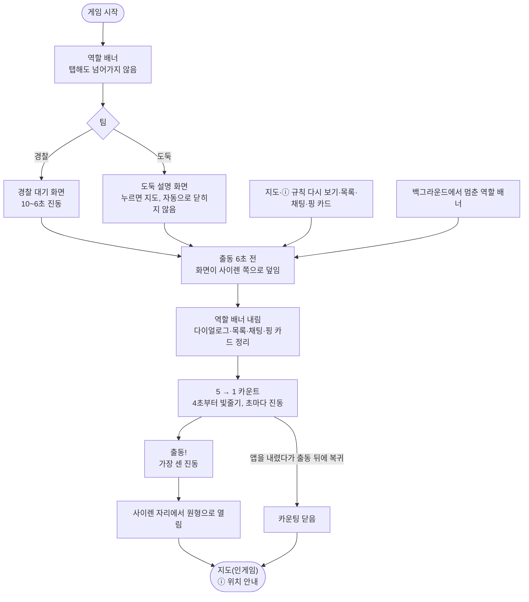

<!-- projectops:report -->
# ⚙️[기능추가][인게임] 출동 카운팅 화면 추가

## 개요

경찰 출동 순간에 뜨던 출동 배너(팀색 사선 띠 + 쥐·고양이)를 사이렌 카운팅 화면으로 바꿨습니다. 출동 6초 전에 대기 화면이나 지도 위로 화면이 덮이고 5, 4, 3, 2, 1, "출동!"을 센 뒤, 사이렌 자리에서 원형으로 열리며 지도(인게임)로 넘어갑니다. 경찰·도둑 모두 같은 화면과 같은 진동을 받습니다.

함께 바꾼 것:
- 대기·설명 장면의 공지를 "게임 안내" 카드로 합쳤습니다.
- 역할 배너와 카운팅은 탭으로 넘기지 못하게 했습니다.
- 도둑 설명 화면의 20초 자동 닫힘을 없앴습니다.
- 코드래빗 리뷰(PR #682)에서 실제 문제로 확인된 4건을 고쳤습니다.
- 참가자 목록 앱바의 나가기를 뒤로가기로 바꿨습니다.

## 기능 흐름

## 변경 사항

### 출동 카운팅
- `lib/features/game/presentation/widgets/start/dispatch_countdown.dart` (새 파일): 카운팅 화면.
  - 검은 바탕에 사이렌과 숫자(SCDream 80)를 띄웁니다.
  - 4초부터 빨강·파랑 빛줄기, 화면 물듦, 사이렌 빛남이 시작되고, 1초 구간에는 사이렌·숫자만 떨립니다.
  - "출동!"을 1.2초 보여 준 뒤 원형으로 열립니다.
- `lib/features/game/domain/start_flow.dart`: `dispatchCountdownFrame()`
  - 출동 시각과 지금 시각만으로 숫자·덮기·효과 세기·원형 열림을 계산하는 순수 함수입니다.
  - 시간 상수(`dispatchOverlayLead` 6초, `dispatchCountdownLead` 5초 등)도 여기 둡니다.
- `lib/features/game/presentation/helpers/start_intro_controller.dart`:
  - 출동 배너 상태를 카운팅 상태(`showDispatchCountdown`·`dispatchCountdownStarted`·`dispatchCountdownDone`)로 바꿨습니다.
  - 카운팅이 시작되면 남아 있는 역할 배너를 내립니다.
  - 백그라운드 때문에 카운팅이 잘려도 ⓘ 안내를 띄울 때로 봅니다.
- `lib/features/game/presentation/pages/game_page.dart`:
  - 출동 6초 전 타이머로 카운팅을 시작합니다.
  - 카운팅이 뜨는 순간 한 번, 게임 화면 위 다이얼로그(ⓘ 규칙 다시 보기 등)를 닫고 목록·채팅·핑 카드를 접습니다.
  - 백그라운드에서 출동 시각을 넘기면 카운팅 없이 장면만 닫습니다.
- `lib/core/constants/vibration_patterns.dart`, `lib/core/services/vibration_service.dart`:
  - 카운팅 진동(5→1 점점 세게)과 "출동!" 진동을 추가했습니다. 경찰·도둑이 같습니다.
  - 옛 팀별 출동 진동은 지웠습니다.
- `assets/icons/icon_siren_counting.svg`, `lib/core/constants/app_icons.dart`: 사이렌 아이콘.
- `lib/l10n/app_*.arb`: `dispatchCountdownGo`(출동! / Let's go! / いくぞ！)를 추가하고, 옛 출동 배너 문구 4개를 지웠습니다.

### 대기·설명 장면
- `lib/features/game/presentation/widgets/start/chase_scene.dart`:
  - 위쪽 공지 줄과 그 자리를 비워 두던 칸을 지웠습니다. 첫 카드는 제목 아래 50입니다(피그마 9164:20378).
  - 공지를 "게임 안내"에 합쳤습니다. 공지가 먼저, 이어서 규칙이 나옵니다.
    - 공지는 번호 없이 "게임 안내", 규칙만 "게임 안내 1/4"처럼 셉니다.
    - 공지는 서버 이벤트라 개수를 미리 알 수 없어서입니다.
  - 펼친 규칙을 읽는 동안 온 공지는 보류했다가, 카드를 접을 때 넣습니다.
  - 도둑 카드 색을 `black900`으로 바꿨습니다.
  - 도둑 설명 화면·ⓘ 규칙 다시 보기 맨 아래에 "화면을 누르면 지도로 가요"를 넣었습니다.
  - 도둑 설명 화면의 20초 자동 닫힘과 남은 시간 막대를 지웠습니다.
  - 대기 화면 진동은 10~6초만 울립니다. 5~1초는 카운팅이 울립니다.
- `lib/l10n/app_*.arb`: `startRulesCounter`를 "게임 안내 n/m"으로 바꾸고, `startGuideLabel`·`startExplainerTapHint`를 추가했습니다.

### 역할 배너
- `lib/features/game/presentation/widgets/start/stripe_banner.dart`, `start_banners.dart`:
  - 탭으로 넘기기를 지웠습니다. 약 4초를 끝까지 보여 줍니다.
  - 출동 배너 전용 옵션(지도 터치 통과, 접힌 자리에서 시작)과 아무것도 그리지 않던 `content` 인자를 지웠습니다.

### 참가자 목록
- `lib/features/game/presentation/pages/game_page.dart`:
  - 앱바 왼쪽 버튼을 나가기에서 공용 뒤로가기(`PreviousButton`, 채팅 화면과 같은 버튼)로 바꿨습니다.
  - 오른쪽 아래의 지도 버튼은 뒤로가기와 같은 일을 해서 뺐습니다. QR·채팅 버튼은 그대로 둡니다.

### 정리
- 삭제: `DispatchBanner`, `BandTransition`의 띠 접기, `run_cycle.dart`(+테스트), `startChaseCharacterAssetPath`.
- `game_page.dart`:
  - 카운팅 표시를 따로 추적하던 `_countdownShown` 필드를 없앴습니다. 카운팅을 켜는 `_startDispatchCountdown()`에서 직접 판정합니다.
  - "앱이 화면에 보이는지" 검사 세 군데를 `_appVisible` 하나로 모았습니다.
- `lib/test_widget_page.dart`: 개발용 미리보기를 카운팅으로 바꿨습니다.

## 코드 리뷰 반영 (PR #682 코드래빗)

14건을 코드와 대조해 실제 문제인 4건만 고쳤습니다.

| 지적 | 상황 | 처리 |
|---|---|---|
| 펼친 안내 유지 | 규칙을 펼쳐 읽는 중 공지가 오면 읽던 칸이 공지로 바뀜 | 접을 때까지 공지 보류 |
| 핑 카드 정리 | 핑 카드를 연 채 출동하면 카운팅 뒤에도 카드와 전체 화면 탭 영역이 남음 | 카운팅이 뜰 때 함께 닫음 |
| 백그라운드 출동 뒤 안내 | 카운팅 중 앱을 내렸다가 출동 뒤에 돌아오면 ⓘ 안내가 이번 게임에 안 뜸 | 잘린 카운팅도 안내를 띄울 때로 보고, 앱이 보일 때까지 3초마다 다시 시도 |
| 역할 배너가 카운팅을 가림 | 시작 직후 앱을 내렸다가 출동 6초 전에 돌아오면 멈췄던 배너가 다시 재생됨 | 카운팅 시작 시 배너를 내림 |

반영하지 않은 지적과 이유:
- **기기 시계가 6초 넘게 느린 경우**: 카운팅은 여러 폰이 같은 숫자를 보이도록 일부러 기기 시계 기준입니다. 서버·기기 시계를 맞추는 문제라 화면에서 고치지 않습니다.
- **출동 시각이 지나면 대기 장면도 닫기**: 두 타이머는 경과 시간 기준이라 순서가 바뀌지 않습니다.
- **재연결 모달 보류**: 연결이 끊기면 모달이 카운팅 위에 다시 뜨는 게 맞는 우선순위입니다.
- **게임 종료 후 카운팅 막기**: 이미 막혀 있습니다.
- **만료 공지 제거**: 공지를 안내에 남겨 계속 돌리는 것은 의도한 동작입니다.
- **영어 탭 안내 문구**: 한·일 문구와 표현이 같습니다.
- **카운트다운 높이 맞춤**: 앱은 세로 고정이라 넘칠 일이 없습니다.
- 선택 사항 3건(다이얼로그 정리 전 카운팅 확인, 끝난 프레임 진동, 탭 차단 테스트)은 실익이 작아 넘겼습니다.

## 수정 전후 화면

| 구분 | 수정 전 | 수정 후 |
|---|---|---|
| 출동 순간 | 팀색 사선 띠 출동 배너(쥐·고양이, 1.7초) — 코드에서 삭제되어 화면 첨부 없음 |  |
| 대기·설명 장면 |  |  |

- **대기·설명 장면**
  - 수정 전: 카드 위 빨간 공지 줄, 도둑 카드 `black`, "게임 규칙 n/4", 도둑 아래쪽 남은 시간 막대가 있었습니다.
  - 수정 후(왼쪽부터 도둑 공지 → 도둑 규칙 → 경찰 규칙): 공지 줄이 없고, 공지는 "게임 안내", 규칙은 "게임 안내 1/4"로 셉니다. 도둑 카드는 `black900`이고 맨 아래에 탭 안내가 있습니다.
- 카운팅 GIF는 iOS 시뮬레이터 디버그 빌드로 녹화했고, 아래 바탕은 지도 자리 표시입니다.
- 리뷰 반영 4건과 참가자 목록 뒤로가기는 아직 화면 캡처가 없습니다.

## 주요 구현 내용

- **모든 폰이 같은 순간에 같은 숫자**
  - 시작 메시지를 받은 시점이 아니라 출동 시각(서버 시작 시각 + 대기 시간)과 기기 시계로 계산합니다.
  - 늦게 들어온 폰도 남은 숫자부터 보입니다(예: 3초 전 → 3).
- **출동 뒤엔 항상 지도**
  - 카운팅이 뜨는 순간 게임 화면 위의 다이얼로그를 닫고(`popUntil(route is! PopupRoute)`) 목록·채팅·핑 카드를 접습니다.
  - ⓘ 규칙 다시 보기를 열어 둔 채 출동하면 카운팅이 끝난 뒤 그 화면이 다시 보이던 문제를 이렇게 막았습니다.
  - 정리는 카운팅을 켜는 `_startDispatchCountdown()`에서 막 켜졌을 때만 합니다. 이미 떠 있으면 바로 돌아가서, 앱으로 돌아올 때마다 다이얼로그가 다시 닫히지 않습니다.
- **펼친 규칙 위 공지 보류**: 펼친 동안 넣으면 안내 목록 순서가 바뀌어 읽던 칸 내용이 달라집니다. 그래서 `_heldNotices`에 모아 두었다가 접을 때 넣습니다.
- **ⓘ 안내를 못 보고 넘어가지 않게**: 안내는 실제로 띄웠을 때만 본 것으로 저장됩니다. 앱이 백그라운드면 띄우지 않고 3초 뒤 다시 시도해서, 아무도 못 본 안내가 본 것으로 남지 않습니다.
- **효과 세기**
  - 4초 시점부터 1초 끝까지 세기는 e^1.6입니다(e는 0→1로 커지는 진행도). 앞은 조용하고 끝에 몰아칩니다.
  - 빛줄기는 `CustomPainter`(SweepGradient + 방사형 마스크)로 그립니다.
  - 사이렌 빛은 빨갛게 칠한 사이렌을 흐려 뒤에 깔아, 사이렌 모양을 따라 번지게 했습니다.
  - 동작 줄이기 설정이면 효과·원형 열기 없이 숫자만 보입니다.
- **진동**
  - 화면이 켜져 있을 때만 울립니다.
  - 5→1로 갈수록 세집니다(2초는 두 번, 1초는 세 번). "출동!"은 0.5초 길게 + 짧게 두 번입니다.
  - 대기 화면과 카운팅이 같은 초에 두 번 울리지 않게 나눴습니다.
- **공지**: 장면에는 구역 이탈 줄이 없으므로 구역 밖이어도 공지를 넘깁니다. 이전에는 구역 밖이면 공지가 빠졌습니다.

## 주의사항

- **기기 시계 오차**
  - 서버 시각 보정이 없어, 폰 시계가 몇 초 틀리면 카운팅이 서버 출동과 어긋납니다.
  - 서버 출동 신호가 먼저 와도 카운팅은 자기 시계대로 끝까지 갑니다.
  - 6초 넘게 느린 폰은 카운팅을 보지 못하고 장면만 닫힙니다(코드래빗이 지적했고, 서버 시각 보정 문제로 남겼습니다).
  - 영상 촬영 시 모든 폰의 "날짜 및 시간 자동 설정"을 켜 주세요. 어긋나는 사례가 나오면 서버 이벤트 `timestamp`로 보정하는 방식을 검토합니다.
- **출동 순간의 다이얼로그 정리**
  - 카운팅이 뜨면 게임 화면 위 다이얼로그는 나가기 확인까지 전부 닫히고, 출동 6초 전부터 지도 터치도 막힙니다.
  - 연결이 끊긴 상태라면 재연결 모달은 닫혔다가 바로 다시 뜹니다(의도한 동작).
- **`_clearForDispatch` 테스트 없음**: 다이얼로그·핑 카드 정리는 `game_page` 상태라 직접 검증하는 테스트가 없습니다. 이 부분을 고칠 때는 실기기에서 다이얼로그·핑 카드를 연 채 출동시켜 확인해야 합니다.
- **구역 밖 공지**: 테스트 도구가 놀이 구역 밖 위치를 만들지 못해 자동 테스트가 없습니다. 실기기에서 구역 밖에 둔 채 확인이 필요합니다.
- **성능**: 카운팅 동안 매 프레임 흐림 효과와 레이어를 그립니다. 저사양 안드로이드에서 끊기면 흐림 크기를 고정하는 쪽으로 줄입니다.
- **결정 변경**: "장면이 떠 있으면 공지는 카드 줄 위 칸에, 없어도 자리를 비워 둔다"(DEC-0136)를 이번에 바꿨습니다. 볼트에 새 결정으로 남겨야 합니다.
- **검증**
  - 전체 테스트 1773개 통과, `flutter analyze` 경고 0.
  - 실기기(iOS 26.6) 릴리스 빌드 설치·실행을 확인했습니다. 진동은 실기기에서만 확인할 수 있습니다.
