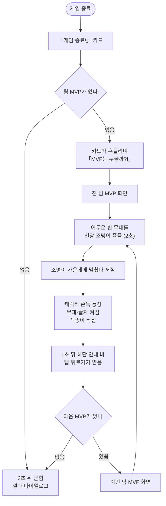

<!-- projectops:report -->
# 🚀[기능개선][게임결과] MVP 화면 개선

## 개요

게임이 끝난 뒤 팀 MVP를 보여 주는 화면을 디자인 시안(Figma 9085:21586 도둑, 9085:21639 경찰)으로 바꾸고, 시상식처럼 나오는 연출을 넣었습니다. 임시로 쓰던 홈 전신 그림 대신 MVP 전용 캐릭터를 넣었습니다. 「게임 결과」 제목, 원형 빛 무대, 팀 아이콘이 붙은 닉네임, 「OO 팀 최고의 활약」 문구, 하단 안내 바를 시안 위치에 놓았습니다. 화면에 들어서면 어두운 빈 무대를 천장 조명이 훑다가 가운데에 멈춥니다. 조명이 꺼지는 순간 캐릭터가 쫀득하게 튀어나오고 무대가 켜지며, 양옆에서 색종이가 터져 화면 폭에 고르게 퍼져 떨어집니다. 색과 글꼴은 시안 스타일 이름에 맞는 앱 토큰을 썼습니다.

## 기능 흐름

## 변경 사항

### 에셋
- `assets/characters/{robber,police}/mvp/default/mvp.svg`: 시안의 MVP 캐릭터입니다. Figma에서 내보낸 SVG에 딸려 온 페이지 배경, 화면 프레임 배경, 회색 사각형을 지웠습니다.
- `assets/backgrounds/mvp/glow_{robber,police}.svg`: 캐릭터 뒤 원형 빛 무대입니다. 도둑은 초록빛, 경찰은 노란빛입니다.
- `assets/backgrounds/mvp/confetti_1~6.svg`: 파티클 시안(9085:24542)의 색종이 6개입니다.
- `pubspec.yaml`: 위 폴더 세 개를 등록했습니다.
- `lib/core/constants/character_assets.dart`: `mvpCharacterAssetPath`가 MVP 에셋을 가리키게 바꿨고, `mvpGlowAssetPath`를 추가했습니다.

### 문구 (ko·en·ja)
- 새 문구: `mvpRevealTitle`(게임 결과), `mvpRevealPoliceSubtitle`·`mvpRevealRobberSubtitle`(OO 팀 최고의 활약)
- 하단 안내 `mvpRevealTapToContinue`: 「탭하면 넘어가요」에서 「화면을 누르면 다음 결과로 넘어가요」로 바꿨습니다. 해요체로 맞췄습니다.
- en·ja는 초안입니다.

### 화면
- `lib/features/game/presentation/widgets/game_over_intro_modal.dart`
  - `_MvpStage`를 연출 시간표를 가진 위젯으로 다시 짰습니다. 배치는 시안 393×852 기준 세로 위치를 그대로 씁니다.
  - 경찰 화면 배경을 연한 파랑에서 시안의 흰색으로 바꿨습니다.
  - 하단 안내를 둥근 바(팀별 색, 불투명도 15%)로 바꿨습니다.
  - 탭을 받기 시작하는 시점(`entranceDuration`)을 1초에서 3.05초로 늘렸습니다. 조명이 훑는 2.05초에 캐릭터 등장 후 1초를 더한 값입니다.
- `lib/features/game/presentation/widgets/mvp_spotlight.dart` (새 파일): 천장 조명을 그립니다. 바닥 웅덩이는 가운데에서 멀수록 넓고 조금 높게 그려 원근을 냅니다. 조명 머리도 웅덩이 쪽으로 조금 기웁니다.
- `lib/features/game/presentation/widgets/mvp_confetti.dart` (새 파일): 색종이입니다. 한쪽 16개로, 양옆에서 터진 뒤 화면 폭에 고르게 퍼져 떨어집니다.

### 테스트
- `test/features/game/presentation/widgets/game_over_intro_modal_test.dart`: 탭이 가능해지는 시점이 4.05초에서 6.1초로 늦어져 대기 시간을 맞췄습니다. 하단 안내 문구도 새 문구로 바꿨습니다.

## 수정 전후 화면

| 수정 전 · 도둑 | 수정 전 · 경찰 | 수정 후 (전체 흐름) |
|---|---|---|
|  |  |  |

수정 후 GIF는 「게임 종료!」 카드부터 도둑 MVP, 탭, 경찰 MVP까지를 0.1초 간격으로 찍은 실제 렌더입니다.

### 언어별 (수정 후, 등장 직후)

| | ko | en | ja |
|---|---|---|---|
| 도둑 |  |  |  |
| 경찰 |  |  |  |

ja 화면의 한자가 줄무늬 칸으로 보이는 것은 테스트 렌더에 한자 글꼴을 넣지 않았기 때문입니다. 기기에서는 시스템 글꼴로 나옵니다. 화면 사진은 위젯 테스트 렌더(393×852, Pretendard 적용)이고, 시뮬레이터에서 찍은 것은 아닙니다.

## 주요 구현 내용

### 연출 시간표
한 MVP 화면 안에서 시간은 이렇게 흐릅니다. 시작부터 어둡고, 앞 화면이 걷히는 0.35초 동안 그대로 어둠으로 이어집니다.

| 시각 | 일 |
|---|---|
| 0.3초 | 조명이 켜지며 왼쪽 → 오른쪽 → 왼쪽 조금 → 가운데를 훑습니다 |
| 2.0초 | 가운데를 살짝 지나쳤다 돌아와 멈춥니다 |
| 2.05초 | 조명이 꺼지며 캐릭터 등장, 무대·글자가 0.25초 동안 켜지고 색종이가 터집니다 |
| 3.05초 | 하단 안내 바가 뜨고 탭을 받습니다 |

조명이 훑는 동안에는 빛 원과 글자를 숨깁니다. 빈 무대만 보여야 조명이 찾는 느낌이 나고, 원형 그라데이션이 미리 비치면 어색하다는 검토 의견을 반영했습니다.

### 쫀득한 등장
캐릭터는 발끝을 기준으로 커집니다. 처음 0.22초 안에 크기를 갖추고, 그 사이 납작하게 눌렸다가(넓고 낮게) 쭉 늘어나고 출렁이며 자리를 잡습니다. 가로세로 배율을 반대로 움직여 부피가 유지되는 것처럼 보이게 했고, 앞쪽에서 살짝 튀어 오릅니다.

### 색종이: 혼돈 속의 질서
터진 직후에는 어지럽게 엇갈리지만 떨어질 때는 화면 폭에 고르게 퍼지게 했습니다.
- 화면 폭을 조각 수(32칸)로 나눠 조각마다 한 칸씩 줍니다. 왼쪽 조각은 짝수 칸, 오른쪽 조각은 홀수 칸으로 가서 서로 엇갈려 지나갑니다. 칸 안에서는 위치를 조금씩 흔들어 자로 잰 줄이 생기지 않습니다.
- 솟는 높이를 32단계로 나눠 섞었습니다. 같은 높이에 몰려 한 줄로 떨어지지 않습니다.
- 공기 저항으로 금방 느려진 뒤 좌우로 살랑이며, 종이가 뒤집히듯 세로가 납작해졌다 펴지며 떨어집니다.
- 크기는 시안 그대로(30~40px)이고, 조각마다 ±25%씩 다릅니다. 3.6초 동안 보이고 마지막 0.8초에 사라집니다.
- 고정 시드라 매번 같은 모양으로 터집니다.
- 그리는 순서는 빛 원 → 색종이 → 글자 → 캐릭터입니다. 색종이가 라벨이나 닉네임을 가리지 않습니다.

### 토큰
시안의 스타일 이름을 앱 토큰으로 옮겼습니다.

| 시안 스타일 | 코드 |
|---|---|
| sub heading_18px, black_400 | `subHeading_18`, `black400` |
| green / BLUE_button | `green` / `blue` |
| heading_24px | `heading_24` |
| label_16px_medium, black_300 / black_600 | `label16Medium`, `black300` / `black600` |
| paragraph_14px, black_300 / black_400 | `paragraph_14`, `black300` / `black400` |
| 하단 바 모서리 12 | `AppRadius.large` |
| 좌우 16, 아이콘과 닉네임 사이 6 | `horizontal16`, `horizontal6` |

시안과 다르게 둔 것:
- 하단 바 그림자(shadow_vague)는 넣지 않았습니다. 시안에서는 바 전체에 불투명도 15%가 걸려 그림자도 1.5% 수준으로 흐려지는데, `AppShadows.vague`를 그대로 넣으면 시안보다 진해집니다.
- 빛 무대 위치는 두 시안이 247과 253으로 달라 가운데 값 250을 썼습니다. 라벨 위아래 여백은 시안 7px 대신 간격 토큰 6을 썼습니다.
- 조명은 시안에 없어 직접 그렸습니다. 색은 `AppColors.white`, 어둠은 `AppColors.black`입니다. 흰 무대(경찰)에서는 빛줄기 밝기를 45%로 낮춰 하얗게 날아가지 않게 했습니다.

## 주의사항

- **탭 시점과 테스트가 묶여 있습니다.** `entranceDuration`은 `_MvpStage.popAtMs + 1000`에서 나옵니다. 조명 시간을 바꾸면 탭을 받기 시작하는 시점이 함께 바뀌고, 모달 테스트의 대기 시간(현재 6.1초 기준)도 같이 고쳐야 합니다.
- **색종이를 글자 위로 올리지 마세요.** 무대를 한 덩어리로 묶으면 색종이가 라벨과 닉네임을 덮습니다. 실제로 그랬던 것을 렌더로 찾아 빛 원과 글자를 따로 그리게 고쳤습니다.
- **조명은 `saveLayer` 안에서 구멍을 뚫습니다.** 어둠을 칠한 레이어에 원뿔을 `dstOut`으로 지우는 방식이라, `saveLayer`를 빼면 아래 무대까지 지워집니다.
- **MVP 캐릭터 SVG는 Figma 내보내기에서 배경 세 겹을 지운 것입니다.** 시안 캐릭터가 바뀌어 다시 받으면 같은 정리를 해야 합니다. 그대로 넣으면 캐릭터 뒤에 불투명한 상자가 생깁니다.
- 실기기·시뮬레이터에서는 아직 확인하지 않았습니다. 특히 저사양 안드로이드에서 색종이 32조각과 조명 흐림 효과가 매끄러운지 봐야 합니다.

## 검증

- `flutter analyze`: 문제 없음
- `flutter test`: 1,751개 모두 통과
- 문구 톤 검사: 이번에 추가하거나 바꾼 문구에서는 위반이 없습니다. 원래 있던 위반 2건(`pageMaintenanceWritingMessage` en·ja 끝 마침표)은 그대로입니다.
- Figma 시안과 픽셀을 대조했습니다. 위치 밀림은 도둑 0px, 경찰 가로 2px이었습니다. 경찰 쪽 2px은 시안에서 캐릭터가 가운데보다 살짝 오른쪽에 있어서 생긴 차이입니다.
