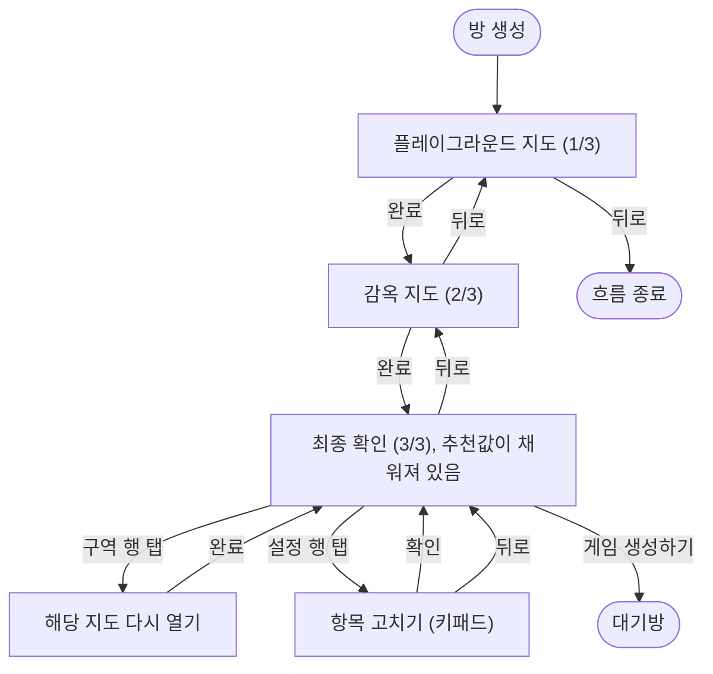

<!-- projectops:report -->
# 방 생성 정보 위계 개편

## 개요

방 생성을 "플레이그라운드 → 감옥 → 기본 정보 → 최종 확인"에서 **"플레이그라운드 → 감옥 → 최종 확인"** 3단계로 줄였다(이슈의 B안, 기본값 후 수정). 참가 인원·게임 시간·위치 공유 간격·경찰 시작 시간은 묻지 않고 추천값(10명, 30분, 5분, 5분)으로 채워 둔다. 바꾸고 싶은 항목만 최종 확인에서 눌러 고친다.

세 단계를 라우트 세 개로 따로 띄우던 방식을 페이지 하나 안에서 본문만 바꾸는 방식으로 바꿨다. 상단 바(뒤로·단계 표시)는 제자리에 하나만 있고, 본문만 좌우로 밀려 바뀐다.

## 기능 흐름

- 확인 화면에서 감옥 행을 눌러 들어가면 감옥만 고치고 확인으로 돌아온다. 플레이그라운드 행을 누르면 플레이그라운드를 마친 뒤 감옥을 거쳐 돌아온다. 감옥은 플레이그라운드 안에 있어야 하기 때문이다
- 항목 고치기에서 확인을 누르지 않고 뒤로 나가면, 고친 값은 버리고 원래 값을 유지한다

## 변경 사항

### 흐름 페이지
- `session_creation_flow_page.dart`: 단계를 `playground / jail / confirm / edit` 네 상태로 두고, 하나의 `Scaffold` 안에서 `AnimatedSwitcher`로 본문만 바꾼다. 다음 단계는 오른쪽에서, 이전 단계는 왼쪽에서 들어오고, 항목 고치기는 아래에서 올라온다
- 설정 값의 초기값을 `GameSettingValues`의 추천값 상수로 바꿨다. 임시 저장된 값이 있으면 그 값을 우선한다

### 지도 페이지를 흐름 안에 넣기
- `setup_playground_page.dart`, `setup_prison_page.dart`: `showStepIndicator`를 지우고 `onDone`·`onExit` 콜백을 받는다. 콜백이 있으면 흐름 안에 들어간 것으로 보고, 상단 바를 그리지 않으며 결과를 pop 대신 콜백으로 넘긴다. 대기방 구역 수정처럼 따로 띄울 때는 지금처럼 pop 한다
- `app_router.dart`, `route_paths.dart`: 흐름 아래 있던 `playground`·`prison` 자식 라우트를 지웠다

### 기본 정보 단계 제거
- `basic_settings_form.dart`: 한 항목씩 묻고 쌓던 단계형 입력을 지우고, 확인 화면에서 한 항목만 고치는 데 필요한 부분만 남겼다
- `game_setting_values_editor.dart`: 추천값 상수 4개 추가
- ARB(ko·en·ja): 확인 화면 보조 문구를 "추천값으로 채워 뒀어요. 바꿀 항목만 눌러요"로 바꾸고, 쓰지 않게 된 `buttonCompleteSetup`을 지웠다

### 테스트
- `session_creation_flow_test.dart`(신규): 지도 두 장을 마치면 추천값이 채워진 확인 화면에 도착하는지, 단계가 바뀌어도 상단 바가 하나인지, 단계 표시가 한 칸씩 차는지, 고치기에서 뒤로 나가면 원래 값이 유지되는지, 뒤로를 계속 누르면 지도 두 장을 거쳐 흐름을 빠져나가는지 확인한다
- `creation_flow_fakes.dart`(신규): 위치와 지도 플랫폼만 가짜로 바꾸는 테스트 도우미
- `setup_playground_initial_location_test.dart`: 지운 자식 라우트를 거치던 케이스를 정리했다

## 수정 전후 화면

실기기·시뮬레이터 캡처는 이번 리포트에 넣지 못했다. 아래 두 가지는 iPhone 17 Pro 시뮬레이터에서 다시 확인해야 한다.

- 2→3 전환 중에 감옥 지도가 확인 화면 위로 비쳐 지나가지 않는지
- 확인 화면 설정 카드에 설명 줄이 없는지

## 주요 구현 내용

### 2→3 전환에서 지도가 비쳐 지나가던 문제
`AnimatedSwitcher`는 나가는 본문과 들어오는 본문을 `Stack`에 겹쳐서 동시에 움직인다. 지도 두 장은 각자 흰 `Scaffold`라 불투명하지만, 확인·고치기 본문은 `SafeArea`뿐이라 투명했다. 그래서 감옥 지도가 왼쪽으로 빠지는 동안 그 위로 들어오는 확인 화면 사이로 지도가 보였다.

본문마다 바탕을 챙기지 않고, 모든 본문이 거쳐 가는 `_transitionBody`에서 `ColoredBox(AppColors.white)`로 감쌌다. 나중에 단계가 늘어도 같은 문제가 다시 생기지 않는다.

### 설명 줄을 넣었다가 뺐다
추천값 그대로 시작하면 규칙을 모를 수 있어서, 위치 공유·경찰 시작 행 아래에 한 줄 설명("5분마다 도둑 위치가 지도에 보여요", "도둑이 먼저 움직이고 경찰이 뒤따라요")을 붙였었다. 예전 방 생성에 없던 것이고 화면만 무거워져서 지웠다. `setting_list_card.dart`는 이 브랜치 이전 상태 그대로다.

### 나가는 본문의 방향
`AnimatedSwitcher`는 `transitionBuilder`가 같은 함수면 나가는 본문에 들어올 때 만든 움직임을 거꾸로 재생한다. 처음 감옥 → 확인에서 감옥이 왼쪽이 아니라 오른쪽으로 빠진 원인이 이것이다. 그래서 빌드마다 새 클로저를 넘겨 나가는 본문도 이번 방향으로 움직임을 다시 만들게 했다.

## 주의사항

- **확인·고치기 본문에서 `ColoredBox`를 빼지 말 것.** 바탕이 투명하면 전환 중에 지도가 다시 비쳐 보인다
- **`transitionBuilder`를 메서드 참조(`_transitionBody`)로 바꾸지 말 것.** 클로저여야 나가는 본문의 방향이 맞는다
- 지도 페이지의 `PopScope`(핀 이탈 확인)와 흐름의 `PopScope`가 같은 라우트에 함께 있다. 흐름은 지도 단계에서 뒤로를 처리하지 않고 지도 페이지에 넘긴다. 둘 다 처리하면 뒤로 한 번에 두 단계가 넘어간다
- 추천값(10명·30분·5분·5분)은 회의에서 결론이 나지 않았다. 바뀌면 `GameSettingValues`의 상수만 고치면 된다
- 게임 모드 선택(DEC-0119)과 자기장 옵션(DEC-0120)은 이번 범위가 아니다. 넣을 때는 이 흐름의 단계 상태에 붙인다

## 검증

- `flutter analyze`: 문제 없음
- `flutter test`: 1781개 전부 통과
