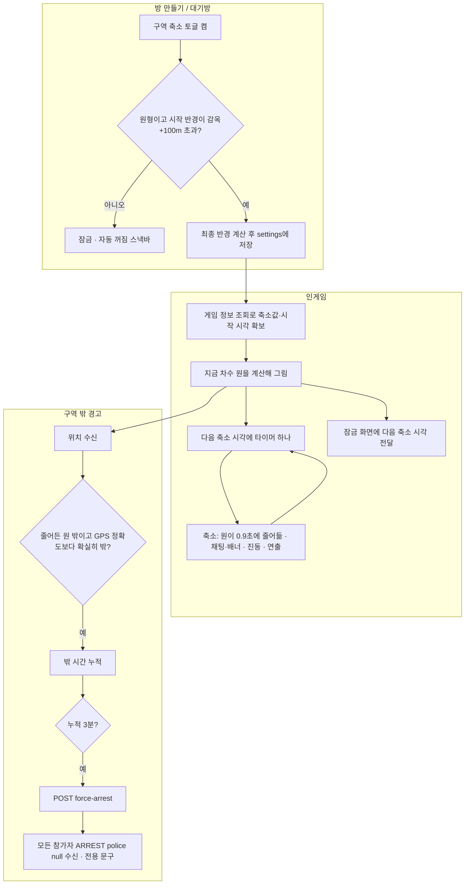

# ⚙️[기능추가][게임] 구역 축소

## 개요

QA에서 "플레이 구역이 너무 크다"는 의견이 나와, 경찰과 도둑 게임에 **구역 축소** 옵션을 넣었습니다(DEC-0120). 켜면 경찰 출발 뒤 일정 간격으로 구역이 4번 줄어듭니다. 줄어들기만 하면 구역 밖에서 버티는 쪽이 유리해지므로, **구역 밖에 누적 3분 있으면 강제 체포**되는 규칙을 같은 배포에 넣었습니다.

- 서버(BE PR #231)는 최종 반경 `shrinkFinalRadiusInMeters` 저장·검증과 강제 체포 API만 맡습니다. 축소 시각·현재 원·이탈 판정은 앱이 매번 계산합니다(DEC-0145·0148·0149).
- 범위: 방 생성 확인 화면, 대기방 게임 설정, 인게임(지도·앱바·연출·경고·강제 체포), 잠금 화면(iOS Live Activity·Android Live Updates).

## 기능 흐름

## 변경 사항

| 구분 | 파일 | 내용 |
|---|---|---|
| 규칙 | `game/domain/shrink_schedule.dart` (신규) | 최종 반경 공식, 잠금 판정, 차수·현재 원·다음 원 계산, 감옥 쪽 중심 이동, 재시작 시 입력 고르기 |
| 규칙 | `game/domain/zone_warning_accumulator.dart`, `zone_warning_flow.dart` (신규) | 구역 밖 시간 누적, 경고 수, 강제 체포 호출 시점·재시도·종결 판단 |
| 저장 | `game/data/datasources/zone_warning_local_datasource.dart` (신규) | 같은 라운드(게임 id + 시작 시각 2초 이내) 누적 복원 |
| 서버 연결 | `game_create_request_model.dart`, `game_settings_response.dart`, `game_system_api_datasource.dart`, `api_endpoints.dart`, `error_message_mapper.dart`, `docs/api-docs.json`(3.1.0) | `shrinkFinalRadiusInMeters`, `force-arrest`, 에러코드 3개 |
| 방 생성 | `session_creation_flow_page.dart`, `setup_playground_page.dart`, `session_creation_draft_model.dart`, `session_repository(_impl).dart`, `session_provider.dart` | 확인 화면 맨 위 축소 카드, 초안 저장, 핀 안내 한 줄, 생성 요청에 최종 반경 |
| 대기방 | `game_settings_page.dart`, `game_settings_edit_page.dart`, `session/domain/shrink_area_save_plan.dart`(신규) | 방장 토글·참가자 비활성, 설정 수정 시 축소 유지, 구역 수정 저장 순서와 되돌리기 |
| 공용 위젯 | `session/presentation/widgets/shrink_toggle_card.dart`(신규) | 축소 카드(잠금·참가자 흐림), 토글 색은 팀 테마 토큰 |
| 인게임 | `game_page.dart`, `google_map_view.dart`, `game_timer_text.dart`, `location_reveal_countdown.dart`, `presentation/helpers/shrink_controller.dart`(신규), `widgets/shrink_pulse_rings.dart`(신규), `domain/shrink_animation_policy.dart`(신규), `qr_display_dialog.dart` | 지금 원·다음 경계 점선·잃은 땅, 앱바 한 줄(위치 공개 \| 구역 축소)·경고 줄, 축소 알림, 원 줄어들기·카메라 연출, 핑 막기, 이탈 판정 |
| 잠금 화면 | `lock_screen_status.dart`, `lock_screen_status_builder.dart`, `lock_screen_status_controller.dart`, `game_participant_provider.dart`(`shrinkEnabled`), `ios/Runner/GameStatusAttributes.swift`, `ios/Runner/AppDelegate.swift`, `ios/LiveActivity/GameStatusCard.swift`, `ios/LiveActivity/GameStatusLiveActivity.swift`, `android/.../GameSessionNotification.kt` | 다음 축소 시각 카운트다운(iOS 카드·아일랜드), Android 알림 본문 |
| 강제 체포 표시 | `game_event_provider.dart`, `game_event_messages.dart` | `police: null` 전용 배너·시스템 채팅 |
| 토큰 | `app_colors.dart`, `vibration_patterns.dart`, `vibration_service.dart` | `redAlpha30`(디자이너 확인 대기), 축소 진동 |
| 문구 | `app_{ko,en,ja}.arb` | 새 문구(모두 초안, 톤 린트 통과) |

## 수정 전후 화면

> 아래는 앱 토큰·글꼴로 그린 **HTML 시안 캡처**입니다(실제 앱 화면이 아닙니다). 지도는 실제 타일 대신 바탕만 깔았습니다. 실기기 수정 전후 영상은 테스트 서버 다기기 QA 때 찍어 덧붙입니다.

| 방 생성 확인 화면 | 대기방 게임 설정 (방장 · 참가자) |
|---|---|
|  |  |

| 앱바 축소 줄 · 잃은 땅 | 잃은 땅 빨강(redAlpha30) | 축소 순간 연출 |
|---|---|---|
|  |  |  |

수정 전에는 방 생성·대기방에 축소 카드가 없고, 인게임 지도는 원래 구역 테두리와 바깥 검정 딤만 있었습니다.

## 주요 구현 내용

### 1. 축소 계산은 앱이, 저장은 하지 않는다
- 최종 반경 = `floor(max(감옥 + 100, min(시작 × 40%, 200)))`. 간격 = (게임 시간 − 경찰 시작) ÷ 5, 1차 = 경찰 출발 + 1간격, 4번 줄고 마지막 한 간격 유지.
- 감옥이 가장자리면 최종 원이 감옥을 품도록 중심을 필요한 만큼만 옮기고 4번에 나눠 옮깁니다.
- 상태는 저장하지 않고 진입·축소 시각·앱 복귀 때마다 다시 계산합니다. 꺼져 있던 사이 지나간 축소는 연출·알림을 되살리지 않습니다(DEC-0149).
- **왜**: 서버 이벤트를 붙여도 다음 경계 표시·재접속·이탈 판정 때문에 앱에 공식이 필요해, 공식이 두 곳에 생깁니다(DEC-0148).

### 2. 축소값은 게임 정보 조회에서 읽는다
- 대기방을 거쳐 들어오면 게임 화면이 설정 조회를 건너뛰어 참가자 상태에 축소값이 없습니다. 그래서 `fetchGameSettingsProvider`(GET /api/games/{id}) 값을 씁니다.
- 앱을 다시 켜면 참가자 상태가 아직 비어 있을 수 있어, 시작 시각·게임 시간·경찰 시작 시간도 조회 응답을 대체값으로 씁니다(`resolveShrinkInputs`).
- 시작 시각을 모르면 축소하지 않고 원래 구역으로 판정합니다(억울한 강제 체포 방지).

### 3. 대기방 구역 수정은 서버 검증 순서에 맞춰 보낸다
- 서버는 `PUT /settings`와 `PUT /area`를 각각 **저장된 다른 쪽 값**과 `감옥 < 최종 < 시작`으로 검사합니다.
- 통과하는 요청부터 보내고, 둘 다 안 되면 껐다가 → 구역 → 다시 켜는 3단계로 보냅니다. 중간 실패면 성공한 단계를 역순으로 되돌립니다.
- `PUT /settings`는 통째로 덮어쓰므로 설정 수정 화면도 켜 둔 축소값을 함께 실어 보냅니다.

### 4. 구역 밖 경고와 강제 체포
- 축소 켠 게임의 도둑만 셉니다(경찰·이벤트 게임 제외). 게임 시작부터 셉니다.
- 밖에 있던 시간을 라운드 내내 누적합니다. 들어오면 멈출 뿐 0이 되지 않습니다(들락날락 방지). GPS 정확도보다 확실히 밖일 때만 셉니다.
- 60초마다 경고 1번, 3번이면 `force-arrest` 한 번. 네트워크 실패는 5초 뒤 재시도, `ALREADY_ARRESTED`·`GAME_NOT_IN_PROGRESS` 등은 다시 부르지 않고 서버 상태로 맞춥니다.
- 수감 중·게임 종료 뒤에는 멈춥니다. 탈옥 직후 수감 시간이 한꺼번에 더해지지 않게 하기 위해서입니다.
- 같은 라운드면 앱을 다시 켜도 누적이 이어집니다(경고 수가 바뀔 때·10초마다 저장).

### 5. 인게임 표시
- 원래 구역 밖은 기존 검정 딤 그대로, **원래 구역과 지금 원 사이(잃은 땅)만** `redAlpha30`. 다음 경계는 `blue500` 점선(Polyline, Polygon은 테두리 패턴이 없음).
- 앱바: 두 줄이면 앱바가 높아져 지도를 가려(실기기 피드백), 축소 켠 게임은 한 줄 "위치 공개 05:42 | 구역 축소 06:30"(en "Reveal | Shrink", ja "位置公開 | 縮小"). 마지막 축소 뒤에는 원래 "다음 도둑 위치 공개까지". 구역 밖이면 그 자리에 빨간 "경고 n/3 · 다음 경고까지 mm:ss"만.
- 축소 순간 원이 한 번에 바뀌지 않고 0.9초에 걸쳐 줄어든다(easeOutCubic). 카메라 연출은 기울이기 1.2초 → 점선 0.6초 → 줄어드는 걸 1.4초 → 복귀 1.2초(약 4.4초), 4차 회전은 90°마다 1.1초. 실기기에서 "너무 빠르다"는 피드백으로 늘렸고, 길이는 `google_map_view.dart` 상수 다섯 개로만 조정한다.
- 축소 순간: 시스템 채팅 + 공지 배너, 백그라운드면 로컬 알림. 1~3차는 58° 기울기, 4차는 360° 회전(90°씩 4번 — +360°를 한 번에 보내면 같은 방향이라 돌지 않음). 연출 중 지도 제스처를 막고 끝나면 원래 카메라·이동 범위로 돌아옵니다.
- 체포 QR·채팅·참가자 목록이 열려 있거나 백그라운드면 연출 없이 원만 바뀝니다. OS 동작 줄이기면 회전하지 않습니다.
- 서버는 원래 구역 밖 핑을 말없이 버리므로, 줄어든 구역 밖 핑은 앱이 롱프레스 단계에서 막습니다.

### 6. 잠금 화면 (Live Activity · Live Updates)
- 축소 켠 게임은 잠금 화면에도 다음 축소 시각을 보낸다. iOS 카드는 "남은 도둑 · 위치 공개" 옆에 "구역 축소" 카운트다운(한 줄에 안 들어가면 아랫줄로 — `ViewThatFits`), 다이내믹 아일랜드 펼침은 아랫줄, Android는 알림 본문에 "· 10:15 구역 축소". 마지막 축소 뒤에는 사라진다.
- 네트워크를 쓰지 않는다(DEC-0089). 게임 화면이 축소 시계를 만들 때 참가자 상태에 `shrinkEnabled`를 남기고, 컨트롤러는 시각만 계산해(`nextShrinkAt`) 위치 공개와 축소 중 먼저 오는 시각에 깨어 갱신한다.
- 라벨은 Live Activity의 attributes가 아니라 **state**에 둔다. 게임 도중 앱을 업데이트하면 기존 Activity를 이어받는데, attributes는 처음 만들 때 고정이라 새 라벨이 안 들어간다(실기기에서 확인한 원인).

### 7. 강제 체포 알림
- 서버가 `ARREST`를 `police: null`로 보냅니다. "[닉네임]님이 구역 밖에 오래 있어서 잡혔어요!" 배너·시스템 채팅으로 띄우고, 시스템 채팅 카운터도 경찰 없이 올립니다.

### 토글 색
- 디자인 시스템 팀 테마 표대로 켜짐 경찰 `blueVer2Basic` / 도둑 `green`, 꺼짐 `black200` / `black800`, 손잡이 흰색. 비활성이어도 머티리얼 회색이 아니라 이 토큰으로 그리고, 참가자·잠금 상태는 위젯째 `Opacity` 0.4(색 투명도 `withValues`는 디자인 시스템 금지).

### 테스트
- 단위·위젯 테스트 추가: 축소 차수(30분·10분 게임, 경계 1ms 전후, 감옥 가장자리), 잠금 반올림, 경고 누적·재시도·수감 제외, 같은 라운드 복원, 대기방 저장 순서·되돌리기, 앱바 줄, 강제 체포 이벤트·API 결과 분류, 토글 색·비활성, 연출 정책, 늦게 깬 타이머.
- 국제화: 375pt 폰 기준 앱바 가운데 칸(230pt)에서 ko·en·ja 앱바 한 줄·경고 줄, 축소 카드 설명 24가지 경우가 모두 한 줄인지 Pretendard로 측정(폭을 줄이면 실패하는 것까지 확인).
- 지도에 다음 경계 점선이 플랫폼까지 넘어가는지(`google_map_boundary_test.dart`), 잠금 화면 축소 시각·갱신(`lock_screen_status_*_test.dart`).
- `flutter analyze` 0건, 전체 `flutter test` 통과.

## 주의사항

- **배포 조건**: 토글·저장·인게임 축소·경고·강제 체포를 한 번에 배포하고, Remote Config 강제 업데이트로 버전을 맞춰야 합니다. 구버전 앱이 대기방 설정을 저장하면 필드 없이 덮어써 축소가 꺼집니다. BE v3.1.0(main) 릴리즈 뒤 배포합니다. 튜토리얼 구역 축소 장면(ISS-0240)도 같은 릴리즈에 맞춥니다.
- **기준 시계는 폰 시계**입니다. 기존 게임 타이머·위치 공개와 같은 조건이라 폰마다 몇 초 차이가 날 수 있습니다.
- **실기기 확인이 남았습니다**: 테스트 서버 다기기(10분 게임·경찰 1분)로 1~4차 축소, 4차 회전 체감, 강제 체포, 앱 재시작 복원, 구역 로드·시작 시각이 겹칠 때 축소 준비가 한 번만 되는지(`_setUpShrink` 세대 번호 — 위젯 테스트 없음).
- **디자이너 확인**: `AppColors.redAlpha30` 값, 새 문구 13개(초안).
- **`..start()` 함정**: `_shrinkController = ShrinkController(...)..start();`처럼 쓰면 `start()`가 대입보다 먼저 돌아 첫 그리기에서 컨트롤러가 안 보이고, 1차 축소 전 다음 경계 점선이 빠진다(실기기에서 확인). 대입한 뒤 `start()`를 부른다.
- **Live Activity**: 게임 중 바뀔 수 있는 값은 attributes가 아니라 state에 둔다. 이어받은 Activity의 attributes는 갱신되지 않는다.
- `_setUpShrink`를 고칠 때는 await 사이에 컨트롤러를 바꾸지 마세요. 두 번 돌면 컨트롤러가 둘 생겨 알림이 두 번 나가고, 카메라 연출이 겹쳐 이동 범위 제한이 풀립니다.
- `shrink_controller`의 "5초 넘게 늦은 타이머는 연출하지 않음"은 iOS가 앱을 멈췄다 깨울 때 지나간 축소를 다시 알리지 않으려는 장치입니다.
- 남은 사소한 항목: 축소 연출 뒤 빨간 링 위치가 카메라 복귀로 어긋날 수 있음, GPS 정확도가 나쁠 때 경고 카운트다운이 멈춘 채 보임, 연출 전 카메라 이동 기록이 없으면 연출 중심으로 복귀.
