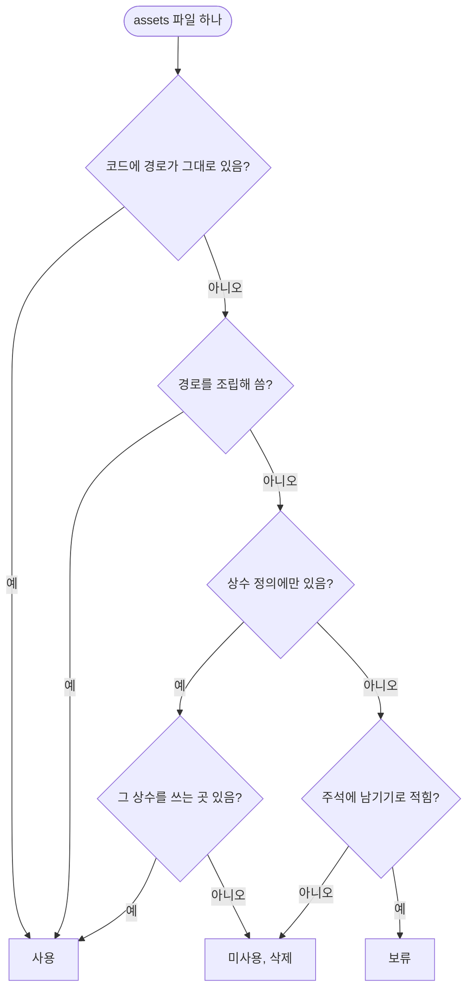

<!-- projectops:report -->
# 문서 체계 일원화 및 미사용 에셋 제거

## 개요

이슈·보고서 문서가 `docs/issues`·`docs/report`와 `docs/projectops/issue`·`docs/projectops/report` 두 곳에 나뉘어 쌓이던 것을 `docs/projectops/` 한 곳으로 모았다. 같은 작업에서 앱이 쓰지 않는 에셋 17개(폰트 5, 아이콘 12)를 지우고 온보딩 일러스트 이름을 내용에 맞게 바꿨다. `assets/` 용량은 28.50MB에서 15.28MB로 13.23MB(약 46%) 줄었고, 대부분 쓰지 않던 Pretendard 굵기 5종(13.21MB)이다.

## 기능 흐름

에셋마다 아래 순서로 "쓰는지"를 판정했다. 파일 이름이 코드에 보인다고 바로 사용으로 보지 않고, 그 이름이 상수 정의에만 있으면 상수를 쓰는 곳까지 따라갔다.

- 경로를 조립해 쓰는 곳: 언어별 로고·스플래시(`locale_brand_assets.dart`), 다크·라이트 핑·팀 아이콘(`AppIcons._theme`), 결과 화면 팔다리·출동 대기 배경·MVP 빛(`character_assets.dart`)
- 보류: 날씨 아이콘 5종. `app_icons.dart` 주석에 "배선 예정이라 정리에서 지우지 않는다(2026-09-01)"로 적혀 있다
- 폰트는 pubspec의 `family` 이름을 코드가 `fontFamily`로 부르는지로 판정했다

## 변경 사항

### 문서 폴더 일원화
- `docs/issues/` 140개 → `docs/projectops/issue/`: git 이동(rename)으로 옮겨 이력이 이어진다. 파일 이름·내용은 그대로
- `docs/report/` 204개 → `docs/projectops/report/`: 같은 방식. 이름이 겹치는 파일은 없었다
- `CLAUDE.md`, `AGENTS.md`: 작업 문서 저장 위치를 새 경로로
- `.claude/commands/` (issue, Issue-Branch, report, rp, pr-description, cr, init-worktree), `.agents/skills/commands/` (issue, report): 문서를 쓰고 읽는 경로를 새 경로로
- `docs/EVENT_GAME_DESIGN.md`, `lib/features/community/domain/entities/community_chat_room_entity.dart`: 옛 경로를 가리키던 참조 한 줄씩

### 미사용 에셋 삭제
- `assets/fonts/Pretendard-{Thin,ExtraLight,Light,ExtraBold,Black}.ttf` + `pubspec.yaml` 폰트 등록: 코드가 부르는 굵기는 Regular·Medium·SemiBold·Bold뿐
- `assets/icons/` 컬러 SNS 7종(`blog`, `discord`, `github`, `instagram`, `linkedin`, `website`, `youtube`): 설정 화면 SNS 바로가기는 `*_black` 단색 글리프만 쓴다
- `assets/icons/icon_arrow.svg`, `icon_exit.svg`, `icon_map.svg`: 상수만 있고 쓰는 곳 없음
- `assets/icons/polygon_pin.svg`: #456 핀 마커 코드가 바뀐 뒤 참조가 사라짐
- `lib/core/constants/app_icons.dart`: 위 아이콘들의 상수 삭제

### 게임 알림 아이콘 통일
- `lib/features/mypage/presentation/pages/my_page.dart`: 마이페이지 "게임 알림" 메뉴 아이콘을 `AppIcons.gameNotification` → `AppIcons.gameConsole`로 바꾸고, `icon_game_notification.svg`와 상수를 지웠다

### 에셋 이름 변경
- `assets/onboarding/onboarding4.svg` → `onboarding_flag.svg`: 번호만 있던 이름을 그림 내용(깃발 든 두 캐릭터)으로. `tutorial_player.dart`, `tutorial_overlays.dart`, `onboarding_assets_bundle_test.dart` 참조 수정

## 수정 전후 자료

| 삭제한 아이콘 10종 (1차) | 정리 후 남은 에셋 154개와 삭제한 17개 |
|---|---|
|  |  |

남은 에셋 장표는 흰색·검은색 아이콘이 모두 보이도록 회색 배경에 그렸다. 빨간 테두리가 삭제, 검은 테두리가 이름 변경이다.

## 주요 구현 내용

- **"이름이 보이면 사용"으로 판정하지 않았다.** 첫 검사에서 이름이 코드에 안 보인 28개는 모두 경로 조립으로 쓰이고 있었고, 반대로 이름이 코드에 있는 아이콘 중 10개는 상수 정의에만 있었다. 그래서 상수 정의 → 상수 사용처까지 따라가 판정했다.
- **이벤트 증거 사진(`assets/events/evidence1·2.png`)은 남겼다.** #657에서 사진을 Remote Config 주소로 받게 됐지만, 주소가 없거나 Remote Config를 못 읽을 때(`EventEvidence.bundled`)와 원격 사진이 늦거나 실패할 때(`event_evidence_image.dart`) 대신 보여 주는 사진으로 쓴다. 지우면 행사 현장처럼 네트워크가 나쁜 곳에서 증거 칸이 빈다.
- **문서 이동은 내용을 고치지 않았다.** 옮긴 문서 본문 안에 옛 경로가 적힌 곳은 당시 기록이라 그대로 두고, 앞으로 문서를 만드는 안내(CLAUDE.md·명령·스킬)만 새 경로로 바꿨다.

## 검증

- 코드·테스트에 문자열로 적힌 `assets/...` 경로 전부가 실제 파일로 있는지 대조: 누락 0
- `flutter test`: 1774개 전부 통과
- `flutter analyze`: `lib`·`test` 문제 0 (남은 11건은 git 제외된 `docs/superpowers/sdd` 연습 파일)
- 옛 문서 경로(`docs/issues`, `docs/report`) 검색: 옮긴 문서 본문 밖에는 남은 곳 0

## 주의사항

- **에셋 이름을 바꾼 직후 테스트가 "Unable to load asset"으로 실패할 수 있다.** 테스트용 에셋 묶음(`build/unit_test_assets`)이 pubspec이 바뀌기 전까지 옛 파일 목록을 들고 있어서다. 이번에도 21개가 그렇게 실패했다가 pubspec 변경 후 다시 돌리자 모두 통과했다. 코드 문제가 아니라 캐시 문제다.
- **경로를 조립해 쓰는 에셋은 파일 이름 검색으로 안 잡힌다.** `icon_ping_{type}_marker_{theme}`, `app_logo_lockup_{lang}_{mode}`, `{result}_{part}` 같은 파일을 "검색해도 안 나온다"는 이유로 지우면 런타임에 빈 화면이 된다. 다음 정리 때도 조립 규칙(`app_icons.dart`, `character_assets.dart`, `locale_brand_assets.dart`)을 먼저 본다.
- **날씨 아이콘 5종은 여전히 쓰지 않는다.** 배선 예정이라 남겼으므로, 배선할 때 `AppIcons`에 상수를 추가하면 된다.
- 이 브랜치 머지 후 외부에서 FE 문서를 `docs/issues`·`docs/report` 경로로 가리키는 곳(팀 지식 볼트 등)은 새 경로로 맞춰야 한다.
