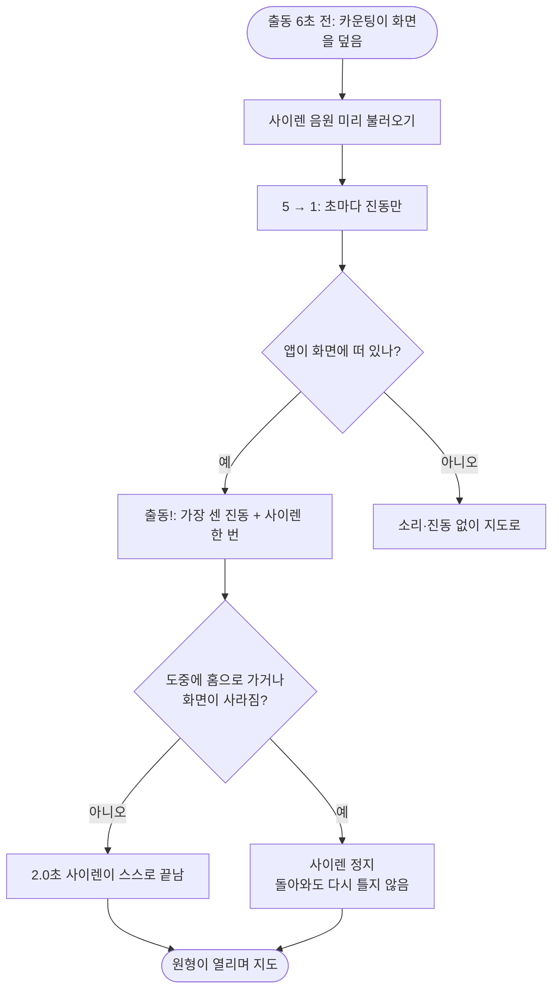

<!-- projectops:report -->
# ⚙️[기능추가][인게임] 출동 사이렌 소리

## 개요

출동 카운팅에서 "출동!"이 뜰 때 사이렌을 한 번 울린다. 5 → 1은 지금처럼 진동만 오고, 사이렌은 원형이 거의 다 열릴 무렵 줄어들며 끝난다. 경찰·도둑 모두 같은 소리가 나고, 시스템 소리 설정을 따른다. iOS는 무음 스위치를 켜면 울리지 않고, Android는 미디어 볼륨을 따른다. 듣던 음악은 끊지 않는다.

## 기능 흐름

## 변경 사항

### 사운드
- `assets/sounds/siren.mp3` (신규): OpenGameArt "Sirens and Alarm Noise"(aquinn, CC0)의 사이렌 앞 2.0초만 잘라 쓰고, 끝 0.3초는 소리를 줄여 끝낸다.
- `lib/core/constants/app_sounds.dart` (신규): `AppSounds.siren` 경로 상수. `AppIcons`처럼 호출부가 경로 문자열을 직접 쓰지 않는다.
- `lib/core/services/sound_service.dart` (신규): 사이렌을 미리 불러오고(`preloadSiren`), 한 번 틀거나 끈다(`siren`). 재생할 때 iOS·Android 소리 설정을 지정한다.
- `pubspec.yaml`: `audioplayers: ^6.7.1`과 `assets/sounds/` 추가. `pubspec.lock`, `ios/Podfile.lock`과 각 플랫폼의 플러그인 등록 파일은 패키지를 추가하면서 자동으로 바뀌었다.

### 출동 카운팅
- `lib/features/game/presentation/widgets/start/dispatch_countdown.dart`: 진동을 내던 `_vibrate`를 `_cue`로 바꾸고, "출동!"일 때 사이렌도 낸다. 화면이 뜰 때 사이렌을 미리 불러오고, 앱이 백그라운드로 가거나 화면이 사라지면 끈다.

### 테스트
- `test/features/game/presentation/widgets/start/dispatch_countdown_test.dart`: 실제 게임 상황 3개.
  - 출동 6초 전부터 보면 5 → 1은 조용하고 "출동!"에서 한 번만 울린다.
  - "출동!" 때 홈으로 가면 끄고, 돌아와도 다시 틀지 않는다.
  - "출동!" 직후 화면이 사라지면 같이 끊긴다.
- `test/core/constants/app_sounds_test.dart` (신규): 사이렌이 앱 번들에 실제로 들어가는지 확인한다.

## 수정 전후 화면

화면은 바뀌지 않았다. 바뀐 것은 소리뿐이라 영상 대신 아래로 갈음한다.

| | 수정 전 | 수정 후 |
|---|---|---|
| 5 → 1 | 진동 | 진동 (그대로) |
| 출동! | 가장 센 진동 | 가장 센 진동 + 사이렌 2.0초 |
| iOS 무음 스위치 켬 | — | 진동만 |
| Android 미디어 볼륨 0 | — | 진동만 |

## 주요 구현 내용

- **"출동!"에서 한 번만 울린다.** 처음에는 5부터 반복 재생했지만, 숫자 구간은 진동으로 충분하고 "출동!"에 맞춰 터지는 쪽이 낫다고 실기기로 듣고 판단했다. 그래서 반복 없이 한 번만 튼다.
- **길이를 화면에 맞췄다.** "출동!" 1.2초 + 원형 열기 1초 = 2.2초다. 원본은 4.3초라 열림 끝에서 끊으면 소리가 중간에 잘린다. 화면 시간(DEC-0143)을 늘리는 대신 음원을 잘랐다. 처음에는 2.2초로 잘랐고, 실기기로 들어 본 뒤 0.2초를 더 줄여 2.0초로 정했다.
- **미리 불러온다.** 처음 재생할 때는 에셋을 꺼내느라 늦을 수 있다. 그러면 "출동!"보다 소리가 밀리므로, 카운팅이 화면을 덮는 1초 동안 미리 불러 둔다.
- **시스템 소리 설정을 따른다.** iOS는 `ambient`라 무음 스위치를 따르고 다른 앱 음악과 섞인다. Android는 `game` 용도에 오디오 포커스를 요청하지 않아서, 미디어 볼륨을 따르고 듣던 음악을 멈추지 않는다. 라이브러리의 `respectSilence` 옵션은 쓰지 않았다. 이 옵션을 켜면 Android에서 벨소리 볼륨을 따르게 된다.
- **끄라는 요청이 재생보다 먼저 올 때.** 재생 준비 중에 끄라는 요청이 오면, 준비가 끝난 뒤 바로 끈다. 앱이 백그라운드로 갔는데 소리가 남는 일을 막는다.

## 주의사항

- **음원 길이는 출동 타이밍에 묶여 있다.** `start_flow.dart`의 `dispatchGoHold`나 `dispatchIrisDuration`을 바꾸면 사이렌 파일도 다시 잘라야 한다(`AppSounds.siren` 주석에 적어 둠).
- **실기기 확인 범위:** iPhone(iOS 26.6) release 빌드로 "출동!" 사이렌과 길이를 확인했다. iOS 무음 스위치, Android 실기기, 음악을 튼 채 재생하는 경우는 아직 확인하지 않았다.
- 카운팅 도중 홈으로 갔다가 "출동!" 뒤에 돌아오면 사이렌은 다시 나지 않는다. 한 번만 트는 소리라서 의도한 동작이다.
- 테스트는 사이렌을 켜고 끈 순서만 확인한다. 실제 소리가 나는지는 실기기에서만 확인할 수 있다.
- 전체 테스트 1936개 통과, `flutter analyze` 문제 없음. 커밋 `4766bd3e`.
