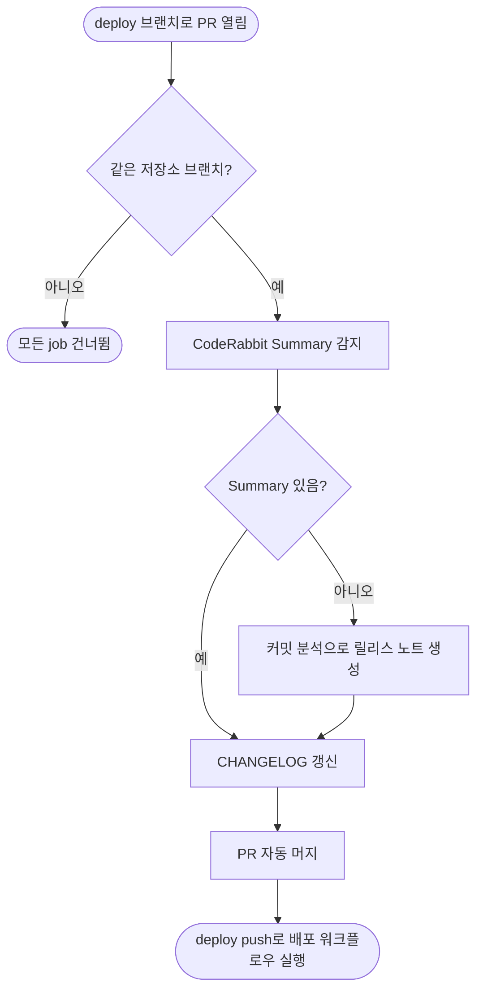

<!-- projectops:report -->
# ❗[버그][CI] 체인지로그 워크플로우 트리거 변경

## 개요

GitHub이 2026-12-02부터 공개 저장소의 `pull_request_target` 트리거를 기본으로 제한한다. FE 저장소는 공개이고, 체인지로그 자동화와 연결 이슈 자동 완료 워크플로우가 이 트리거를 쓰고 있었다. 그냥 두면 12/2 이후 deploy PR을 열어도 체인지로그 갱신, 자동 머지, 배포 트리거가 돌지 않는다. 두 워크플로우를 `pull_request`로 바꾸고, 같은 저장소에서 연 PR에서만 실행되게 조건을 넣었다. 실행 로그에 함께 나오던 Node.js 20 지원 종료 경고도 액션 버전을 올려 정리했다.

## 기능 흐름

## 변경 사항

### 체인지로그 자동화
- `.github/workflows/PROJECT-COMMON-AUTO-CHANGELOG-CONTROL.yaml`
  - 트리거 `pull_request_target` → `pull_request` (대상 브랜치 `deploy`, `opened` 그대로)
  - 첫 job `detect-and-parse`에 `if: github.event.pull_request.head.repo.full_name == github.repository` 추가
  - `actions/upload-artifact` v4 → v7, `actions/download-artifact` v4 → v8

### 연결 이슈 자동 완료
- `.github/workflows/PROJECT-COMMON-COMPLETE-LINKED-ISSUES.yaml`
  - 트리거 `pull_request_target` → `pull_request` (`closed` 그대로)
  - `actions/github-script` v7 → v8

## 수정 전후 화면

UI 변경 없음 (CI 워크플로우만 수정).

## 주요 구현 내용

- **조건은 첫 job 하나에만 넣었다.** 뒤 job(`fallback-summary`, `update-changelog`, `merge-and-deploy`)은 모두 `needs`로 첫 job에 묶여 있다. `update-changelog`와 `merge-and-deploy`에는 `always()`가 붙어 있지만, 각각 앞 job의 `summary_found == 'true'`, `update-changelog` 성공을 함께 요구한다. 그래서 첫 job이 건너뛰어지면 끝까지 실행되지 않는다.
- **배포 흐름은 그대로다.** `main → deploy` 배포 PR은 같은 저장소 안에서 열리므로 `pull_request`에서도 `_GITHUB_PAT_TOKEN`과 `permissions`(contents, pull-requests write)가 지금처럼 적용된다. checkout도 PR head가 아니라 기본 브랜치를 받고 있어 동작이 달라지지 않는다.
- **액션 버전은 breaking change를 확인하고 올렸다.**
  - artifact는 `name: pr-content`로 올리고 받는다. 그래서 download-artifact v5의 "ID 다운로드 경로 변경"과 v8의 "해시 불일치 시 실패 기본값"에 걸리지 않는다.
  - upload-artifact v7의 직접 업로드는 `archive: false`일 때만 동작해서 기존 zip 방식은 그대로다.
  - github-script v8은 Node 24 전환만 있는 버전이다.
- **검증**
  - actionlint: 변경한 줄에서 오류 없음. 기존 셸 따옴표 info만 남았다.
  - PR #695 머지 직후 `Complete Linked Issues`가 `pull_request` 이벤트로 실행되어 성공했다 ([실행 로그](https://github.com/cops-and-robbers/cops-and-robbers-FE/actions/runs/42500721814)).

## 주의사항

- **체인지로그 워크플로우는 아직 실제 실행으로 확인하지 못했다.** 다음 `main → deploy` 배포 PR에서 체인지로그 갱신, 자동 머지, 배포 트리거까지 이어지는지 Actions 로그로 확인해야 한다.
- **포크 PR에서는 두 워크플로우가 돌지 않는다.**
  - 체인지로그 워크플로우는 조건 때문에 건너뛴다.
  - 연결 이슈 자동 완료는 포크 PR에서 쓰기 권한이 없어 라벨 변경이 실패한다.
  - 팀 PR은 모두 저장소 안 브랜치에서 열기 때문에 지금 운영에는 영향이 없다.
- **템플릿 동기화 때 덮어써질 수 있다.** 두 파일은 공통 템플릿에서 동기화되는 파일이다. 동기화 후 트리거가 `pull_request_target`으로 돌아가 있으면 다시 바꿔야 한다.
- **트리거를 `pull_request_target`으로 되돌리지 말 것.** 이 트리거는 포크 PR에서도 저장소 시크릿으로 실행된다. 위 저장소 조건을 지우는 것도 마찬가지로 위험하다.
