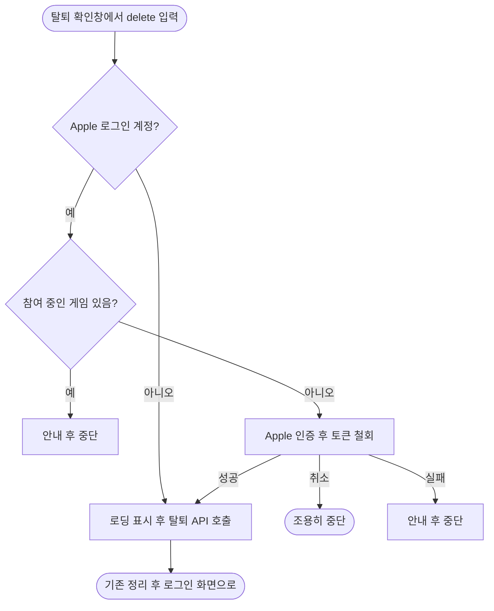

<!-- projectops:report -->
# 🚀[기능개선][회원탈퇴] Apple 로그인 사용자 탈퇴 시 Apple 토큰 철회

## 개요

Apple 로그인 사용자가 회원 탈퇴할 때 Apple 토큰을 철회한다. 지금까지는 백엔드가 Firebase 사용자만 지워서, 탈퇴 후에도 Apple 계정의 "Apple로 로그인" 목록에 앱이 남았다. Google 로그인 사용자와 Android의 탈퇴 흐름은 바뀌지 않는다.

## 기능 흐름

## 변경 사항

### 인증
- `lib/features/auth/data/datasources/firebase_auth_datasource.dart`: Apple 계정 판별(`isAppleUser`)과 토큰 철회(`revokeAppleToken`) 추가. 로그인 때 받은 `authorizationCode`는 저장하지 않으므로 철회 시점에 Apple 인증을 한 번 더 받는다.
- `lib/features/auth/domain/repositories/auth_repository.dart`, `lib/features/auth/data/repositories/auth_repository_impl.dart`: 철회 인터페이스 추가. 인증 취소는 `AuthCancelledException`, 그 밖의 실패는 `errorAppleTokenRevokeFailed` 문구의 `AuthException`으로 바꾼다.

### 회원 탈퇴
- `lib/features/user/domain/usecases/prepare_account_deletion_usecase.dart` (신규): 게임 확인과 철회 순서를 담당한다.
- `lib/features/user/presentation/providers/user_provider.dart`: UseCase provider 추가.
- `lib/features/mypage/presentation/pages/my_page.dart`: 탈퇴 API 호출 전에 준비 단계를 실행한다.

### 문구
- `lib/l10n/app_{ko,en,ja}.arb`, `lib/core/i18n/error_message_mapper.dart`: 철회 실패 안내 추가.

### 테스트
- `test/features/auth/data/datasources/firebase_auth_datasource_revoke_test.dart` (신규): Apple 계정 판별, 철회 호출, 취소 변환.
- `test/features/auth/data/repositories/auth_repository_impl_revoke_test.dart` (신규): 취소와 실패의 예외 변환.
- `test/features/user/domain/usecases/prepare_account_deletion_usecase_test.dart` (신규): Apple 외 계정은 아무것도 하지 않고, 게임이 있으면 철회하지 않는다.

## 주요 구현 내용

- **철회는 탈퇴 API보다 먼저 한다.** 백엔드가 Firebase 사용자를 지우면 철회할 수 없다.
- **철회 전에 게임을 확인한다.** 철회 뒤 탈퇴가 409로 막히면 Apple 연결만 끊기고 계정이 남는다.
- **로딩은 철회가 끝난 뒤 띄운다.** Apple 인증 창이 로딩에 가려지지 않게 한다.
- **철회에 실패하면 탈퇴하지 않는다.** 안내를 띄우고 다시 시도할 수 있게 둔다.

## 주의사항

- **출시 전 iOS 실기기 확인이 필요하다.** 탈퇴 후 설정 > Apple 계정 > Apple로 로그인 목록에서 앱이 사라지는지 본다. 철회에 실패하면 Apple 사용자가 앱에서 탈퇴할 수 없으므로, Firebase Apple 제공업체의 철회 설정도 이때 함께 확인한다.
- 웹 계정 삭제 페이지는 이 작업과 별개로 진행하며 서로 기다리지 않는다.
- 전체 테스트 1947개 통과, `flutter analyze` 문제 없음.
