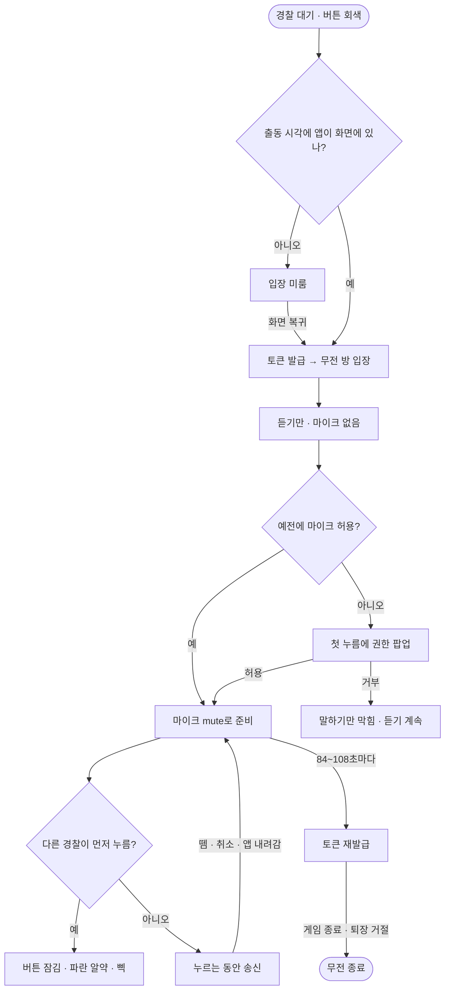

<!-- projectops:report -->
# ⚙️[기능추가][인게임] 경찰 팀 무전(PTT)

## 개요

경찰끼리 게임 안에서 말할 수 있게 누르는 동안만 말하는 무전(PTT)을 붙였다. 서버(BE PR #239)는 무전 서버 접속 토큰만 발급하고, 음성은 앱과 LiveKit이 직접 주고받는다. 무전 켜진 일반 게임의 경찰만 쓰며(DEC-0114), 도둑·이벤트 게임 화면은 그대로다. 방 생성 최대 인원도 서버에 맞춰 150명에서 50명으로 내렸다.

## 기능 흐름

## 변경 사항

### 무전 연결 (`lib/features/radio/`)
- `data/datasources/radio_api_datasource.dart` — `POST /api/games/{gameId}/radio/token`
- `data/models/radio_token_model.dart` — 응답 모델, JWT `exp - iat`로 토큰 수명 계산
- `data/datasources/radio_room_port.dart` — LiveKit 경계(접속·마이크 준비·mute·이벤트). 테스트는 이 인터페이스를 가짜로 바꾼다
- `domain/radio_rules.dart` — 노출 조건, 재발급 시각(수명 × 70~90%), 발언권(mute 해제 순서 줄)
- `presentation/providers/radio_session_provider.dart` — 출동 대기 → 입장 → 마이크 준비 → 송신, 재발급·거절·재접속·백그라운드 처리
- `presentation/widgets/radio_ptt_button.dart`, `radio_speaker_pill.dart` — 무전 버튼, "~ 무전 중" 알약

### 게임 화면
- `game_page.dart` — 무전 켜진 경찰은 오른쪽 아래 채팅 자리에 무전 버튼, 알약 표시, 앱 일시정지 시 mute, 화면 복귀 시 미룬 입장, 게임 종료·화면 이탈 시 무전 정리
- `game_menu_entries.dart` — `hasRadioButton`이면 지도 메뉴 끝에 채팅
- 참가자 목록 화면은 메뉴가 없어 채팅을 남기고 맨 아래에 무전(QR·채팅·무전)

### 플랫폼
- Android: `RECORD_AUDIO`, `FOREGROUND_SERVICE_MICROPHONE`, 위치 서비스와 분리된 `RadioForegroundService`(microphone 타입), MethodChannel `startRadio`/`stopRadio`
- iOS: `UIBackgroundModes`에 `audio`, `NSMicrophoneUsageDescription` (ko·en·ja)
- `pubspec.yaml`: `livekit_client: ^2.4.9` (lock 2.5.4), `device_info_plus: ^11.5.0` (LiveKit 2.3.2 이상이 11 이상을 요구)

### 소리·문구
- `SoundService.radioBeep()` + `assets/sounds/radio_beep.mp3`(임시 1.2kHz 0.12초)
- 에러코드 3개 매핑: `RADIO_NOT_ALLOWED_IN_EVENT_GAME`, `ONLY_POLICE_CAN_USE_RADIO`, `RADIO_POLICE_WAITING_TIME`
- ARB: `radioSpeaking`, `radioSpeakerFallback`, `radioPttLabel`, `dialogMicPermissionTitle`, `dialogMicPermissionMessage` (ko·en·ja), 용어집에 무전 = Radio = 無線

### 인원
- `game_setting_values_editor.dart` — 참여 인원 2~150 → 2~50 (BE#235)

## 수정 전후 화면

HTML 시안이다. 버튼 크기·색은 앱 코드 값(`SvgIconButton` 56·radius 16, `AppColors.blue`)을 옮겼다. 실제 앱 캡처는 실기기 테스트 때 붙인다.

**배치** — 지금(무전 꺼진 방) / A안 채택 / B안

**다른 경찰 송신 중** — ko · en · ja

## 주요 구현 내용

### 무전 버튼을 메뉴 밖에 둔 이유
누르고 있는 동안 말하는 버튼이라 플로팅 메뉴 안에 둘 수 없다. 메뉴는 항목을 탭하면 닫히고 실행되는 구조라 "누르고 있기"를 받지 못한다. 그래서 무전 켜진 경찰만 채팅 버튼 자리를 무전이 가져가고 채팅을 메뉴로 옮겼다. 무전 꺼진 방·도둑·이벤트 게임은 바뀌지 않는다.

### 알약을 채팅과 다르게 한 이유
처음엔 채팅 미리보기 말풍선과 같은 모양으로 그렸는데 진짜 채팅과 헷갈린다는 판단으로 바꿨다. 흰 말풍선 + 본문(채팅)과 달리 파란 알약 + "~ 무전 중" 한 줄 + 깜박이는 점이다. 화면을 안 봐도 알도록 발언권이 바뀔 때 삑 소리를 낸다.

### 트랙은 미리 올리고 mute만 토글
누를 때마다 publish하면 협상 지연으로 첫 음절이 잘린다. 입장(또는 첫 허용) 때 mute로 올려 두고 누르는 동안만 mute를 푼다. mute 때 캡처도 멈추지 않는다(`stopAudioCaptureOnMute: false`) — 멈추면 unmute마다 마이크를 다시 열어 또 잘린다.

### 마이크 권한은 첫 누름에
출동 순간(사이렌·뛰기 시작)에 팝업이 뜨면 게임을 방해해서, 출동 때는 듣기만 하고 처음 누를 때 권한을 묻는다. 허용하고 그대로 누르고 있으면 바로 말이 나간다. 한 번 허용한 기기는 `radio_mic_granted`를 기억해 다음 게임부터 입장 때 마이크를 준비한다. 거부해도 방에서 나가지 않고 듣기는 계속된다. 거부한 뒤 버튼을 다시 누르면 마이크 준비를 한 번 더 시도한다 — 설정에서 허용하고 돌아왔으면 바로 말이 나가고, 여전히 안 되면 QR 스캐너와 같은 "설정으로 이동" 다이얼로그를 띄운다.

### 토큰 재발급
수명(2분)은 토큰의 `exp - iat`에서 꺼내고, 응답 받은 시각 + 수명 × U(0.70, 0.90)에 다시 받는다. `expiresAt`과 폰 시계를 비교하지 않아 시계가 틀어진 기기에서도 맞다. 경찰이 같이 출동해 재발급이 한꺼번에 몰리지 않게 흩는다. 게임 종료·퇴장 거절이면 방을 나가고, 끊겼다가 붙을 때는 만료 토큰 대신 새 토큰부터 받는다.

### 발언권
`TrackMuted`/`TrackUnmuted`로만 판정한다(`ActiveSpeakers`는 늦고 조용한 사람을 놓친다). mute를 푼 순서대로 줄을 세워 맨 앞이 발언권을 갖고, 내 누름도 줄에 넣는다. 그래서 내가 먼저 누르면 바로 뒤에 누른 경찰의 알약·삑이 뜨지 않고, 먼저 사람이 떼면 아직 말하는 사람에게 넘어간다.

### 백그라운드
Android 14+는 microphone 타입 포그라운드 서비스를 백그라운드에서 시작하면 거절한다. 출동 시각이 화면 꺼진 채 지나면 입장을 미루고 화면에 돌아왔을 때 들어간다. 마이크 서비스는 마이크를 받은 뒤에만 띄우고, 위치 서비스와 분리해 마이크 문제가 위치 추적을 멈추지 않게 했다.

### iOS 오디오 세션
iOS 오디오 세션은 앱 전체에 하나라, 효과음(사이렌·삑)이 `ambient`로 바꾸면 무전 마이크와 상대 목소리가 끊긴다. 무전 방에 있는 동안은 효과음도 `playAndRecord`(+ mixWithOthers, defaultToSpeaker)로 낸다.

## 테스트

- `flutter test` 전체 1986개 통과, `flutter analyze` 0건
- `flutter build apk --debug`, `flutter build ios --debug --no-codesign` 성공
- 새 테스트: 토큰 수명, 노출 조건, 재발급 84~108초, 발언권 줄, 출동 대기·입장·첫 누름 권한·거부 시 듣기 유지·거부 뒤 다시 눌러 복구, 재발급 거절 시 퇴장, 재접속 전 새 토큰, 화면 이탈·요청 중 이탈 시 정리, 백그라운드 입장 미룸, 포인터 취소·앱 일시정지 시 mute, 에러 문구, 알약 문구 3개 언어·긴 닉네임
- **실기기 테스트 전**: BE PR #239 테스트 서버 배포 후 경찰 2명 이상으로 확인 필요

## 주의사항

- **실기기 미검증** — 화면 끈 상태 듣기·말하기, 동시 누름, 마이크 거부, 출동 시 자동 입장, WiFi ↔ LTE 전환, 첫 누름 팝업 직후 송신은 아직 기기에서 보지 않았다 (iPhone · Pixel · 삼성)
- **LiveKit은 2.6.1까지만 올릴 수 있다** (현재 lock 2.5.4) — 2.6.2부터는 protobuf 6 → `retrofit_generator` 10이 필요해 `retrofit` 4.7.3 고정과 부딪힌다. 2.4.8 이하는 protobuf 3이라 `retrofit_generator`가 9.7.0 → 9.1.9로 내려가고, 그 생성기로 코드 생성을 다시 돌리면 retrofit 파일 전체에 analyze 경고가 난다. 그래서 `^2.4.9`가 하한이고, 이 때문에 `device_info_plus`를 10 → 11로, `flutter_webrtc`가 0.12 → 1.2로 같이 올라갔다
- **동시 누름** — 서버 판정이 없어 거의 같은 순간에 누르면 잠깐 둘 다 송신될 수 있다
- **무전 방에 있는 동안 OS 마이크 표시가 켜져 있다** — 첫 음절을 지키려고 캡처를 유지하는 대가. 권한 문구도 이에 맞춰 적었다
- **입장 순간 약 0.1초 마이크가 실제로 나갈 수 있다** — 마이크를 켜서 올린 뒤 바로 mute하는 방식이라서다 (LiveKit 2.3.1에서 본 동작, 2.5.4에서는 아직 확인 전). 입장마다 삑 두 번·알약 깜박임이 보이면 이것
- **임시 에셋** — 마이크 아이콘(`icon_mic.svg`)과 삑 소리(`radio_beep.mp3`)는 임시. 디자인 오면 파일만 바꾼다
- **방 설정 "무전 켜기"는 아직 없다** — `kRadioEnabledDefault = true` 한 곳에 고정. 서버에 방 설정이 생기면 그 줄만 바꾼다
- **기존 테스트 2개 수정** — `chat_preview_sits_above…`, `chat_stays_readable…`의 경찰 변형은 경찰에게 채팅 버튼이 있다고 가정했다. 새 배치(무전 버튼 + 메뉴 채팅)에 맞췄다
- 남은 작은 문제: 두 번째 손가락을 떼면 mute됨, 설정에서 권한을 준 뒤 그 게임에서 재시도 안 함, 토큰 해석 실패 시 재발급이 조용히 멈춤, 같은 계정 두 기기 접속 시 재접속 반복
