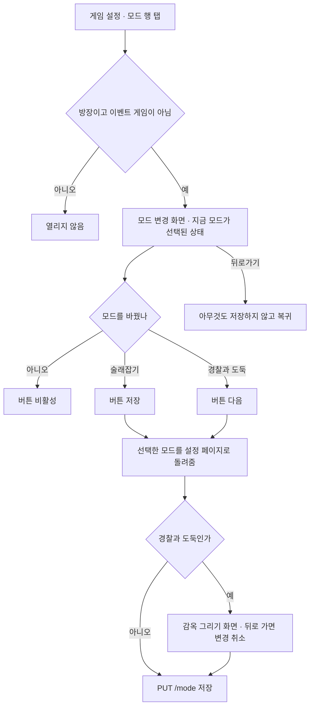

## 개요

대기실 게임 설정에서 방장이 모드를 바꾸는 창을 **바텀시트에서 전체 화면**으로 바꿨습니다. 구역·설정 수정처럼 오른쪽에서 들어오는 화면이고, 새로 만든 부품 없이 기존 `AppTopBar`와 방 만들기의 `ModeSelectStep`(모드 카드 + `AppButton`)을 그대로 씁니다.

## 기능 흐름

## 변경 사항

| 파일 | 내용 |
|---|---|
| `pages/mode_change_page.dart` (신규) | 전체 화면. 고른 모드를 pop 값으로 돌려준다 |
| `widgets/mode_select_step.dart` | 버튼 문구(`buttonText`)와 비활성(`onNext: null`)을 바깥에서 정할 수 있게 함. 방 만들기 쪽 동작은 그대로 |
| `pages/game_settings_page.dart` | 바텀시트 대신 모드 변경 라우트를 띄움. 이후 감옥 그리기·저장은 기존 코드 그대로 |
| `router/app_router.dart`, `route_paths.dart` | `game-settings/mode` 라우트, 설정 수정과 같은 전환 애니메이션 |
| `l10n/app_*.arb` | `pageModeChangeTitle` 추가: 모드 변경 / Change mode / モード変更 (말투 검사 통과) |
| `game_settings_page_shrink_test.dart` | 새 흐름에 맞게 수정 + 테스트 2개 추가 |

## 수정 전후 화면

| 수정 전 (바텀시트) | 수정 후 (전체 화면, 지금 모드 그대로) |
|---|---|
|  |  |

| 경찰과 도둑 선택 (버튼 "다음") | English |
|---|---|
|  |  |

수정 후 화면은 실제 위젯을 테스트 환경에서 그려 찍은 것이고, 시뮬레이터·실기기 확인은 아직 하지 않았다. 일본어는 테스트 환경에 한자 글꼴이 없어 글자가 깨져 찍혀서 싣지 않았다.

## 주요 구현 내용

- **버튼이 모드에 따라 달라진다.** 경찰과 도둑은 감옥을 그려야 끝나므로 "다음", 술래잡기는 바로 저장되므로 "저장"이다. 지금 모드 그대로면 눌러도 할 일이 없어 비활성이다.
- **저장은 화면이 하지 않는다.** 화면은 고른 모드만 돌려주고, 감옥 그리기와 `PUT /mode`는 기존 `GameSettingsPage._changeMode`가 그대로 맡는다. 서버 요청과 구역 축소 저장 순서(#668)는 건드리지 않았다.
- **밝은 화면으로 고정.** 모드 카드가 라이트 전용이라 역할 테마와 무관하게 밝다. 이전 바텀시트도 같았다.
- 새 API와 새 컴포넌트는 없다.

## 주의사항

- 이전에 같은 워크트리에 바텀시트(`ModeSelectSheet`, 카드를 누르면 바로 저장) 작업이 커밋 전 상태로 있었는데 이 작업으로 대체했다. 카드를 누르자마자 저장되는 동작은 없어졌고, 이제 버튼을 눌러야 저장된다.
- 라우트의 `extra`가 비면(딥링크 등) 경찰과 도둑을 지금 모드로 보고 시작한다. 정상 흐름에서는 설정 페이지가 항상 현재 모드를 넘긴다.
- 문구 "모드 변경"은 초안이다. 팀 확인 후 바꿔도 `pageModeChangeTitle` 한 곳만 고치면 된다.
- 테스트: `flutter test` 2061개 통과, `flutter analyze` 문제 없음.
