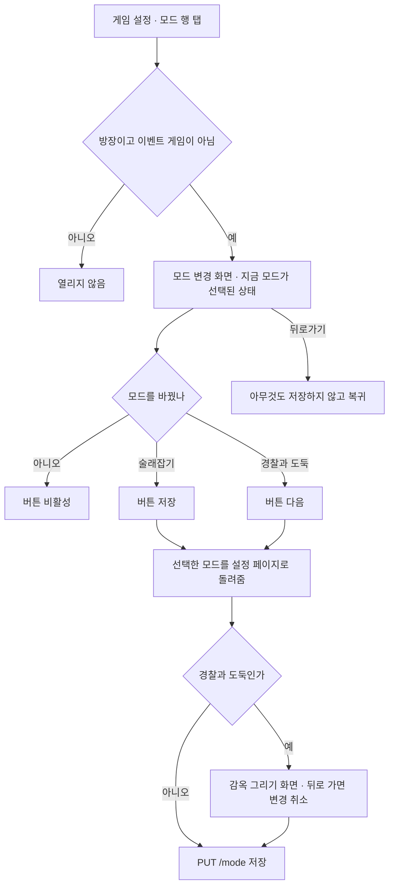

## 개요

대기실 게임 설정에서 방장이 모드를 바꾸는 창을 **바텀시트에서 전체 화면**으로 바꿨습니다. 구역·설정 수정처럼 오른쪽에서 들어오는 화면이고, 새로 만든 부품 없이 기존 `AppTopBar`와 방 만들기의 `ModeSelectStep`(모드 카드 + `AppButton`)을 그대로 씁니다.

## 기능 흐름

## 변경 사항

| 파일 | 내용 |
|---|---|
| `pages/mode_change_page.dart` (신규) | 전체 화면. 고른 모드를 pop 값으로 돌려준다 |
| `widgets/mode_select_step.dart` | 버튼 문구(`buttonText`)와 비활성(`onNext: null`)을 바깥에서 정할 수 있게 함. 방 만들기 쪽 동작은 그대로 |
| `pages/game_settings_page.dart` | 바텀시트 대신 모드 변경 라우트를 띄움. 이후 감옥 그리기·저장은 기존 코드 그대로 |
| `router/app_router.dart`, `route_paths.dart` | `game-settings/mode` 라우트, 설정 수정과 같은 전환 애니메이션 |
| `l10n/app_*.arb` | `pageModeChangeTitle` 추가: 모드 변경 / Change mode / モード変更 (말투 검사 통과) |
| `game_settings_page_shrink_test.dart` | 새 흐름에 맞게 수정 + 테스트 2개 추가 |

## 수정 전후 화면

| 수정 전 (바텀시트) | 수정 후 (전체 화면, 지금 모드 그대로) |
|---|---|
|  |  |

| 경찰과 도둑 선택 (버튼 "다음") | English |
|---|---|
|  |  |

수정 후 화면은 실제 위젯을 테스트 환경에서 그려 찍은 것이고, 시뮬레이터·실기기 확인은 아직 하지 않았다. 일본어는 테스트 환경에 한자 글꼴이 없어 글자가 깨져 찍혀서 싣지 않았다.

## 주요 구현 내용

- **버튼이 모드에 따라 달라진다.** 경찰과 도둑은 감옥을 그려야 끝나므로 "다음", 술래잡기는 바로 저장되므로 "저장"이다. 지금 모드 그대로면 눌러도 할 일이 없어 비활성이다.
- **저장은 화면이 하지 않는다.** 화면은 고른 모드만 돌려주고, 감옥 그리기와 `PUT /mode`는 기존 `GameSettingsPage._changeMode`가 그대로 맡는다. 서버 요청과 구역 축소 저장 순서(#668)는 건드리지 않았다.
- **밝은 화면으로 고정.** 모드 카드가 라이트 전용이라 역할 테마와 무관하게 밝다. 이전 바텀시트도 같았다.
- 새 API와 새 컴포넌트는 없다.

## 주의사항

- 이전에 같은 워크트리에 바텀시트(`ModeSelectSheet`, 카드를 누르면 바로 저장) 작업이 커밋 전 상태로 있었는데 이 작업으로 대체했다. 카드를 누르자마자 저장되는 동작은 없어졌고, 이제 버튼을 눌러야 저장된다.
- 라우트의 `extra`가 비면(딥링크 등) 경찰과 도둑을 지금 모드로 보고 시작한다. 정상 흐름에서는 설정 페이지가 항상 현재 모드를 넘긴다.
- 문구 "모드 변경"은 초안이다. 팀 확인 후 바꿔도 `pageModeChangeTitle` 한 곳만 고치면 된다.
- 테스트: `flutter test` 2061개 통과, `flutter analyze` 문제 없음.

---

## 추가 작업: 모드 카드에 캐릭터 그림 (2026-11-15)

### 개요

모드 카드가 글자만 있어 두 모드가 한눈에 구분되지 않았습니다. 카드 왼쪽에 모드를 나타내는 캐릭터 그림을 넣었습니다. 경찰과 도둑에는 **철창 속 도둑**, 술래잡기에는 **달아나는 도둑**을 넣었습니다. 방 만들기 첫 단계와 대기실 모드 변경 화면이 같은 `ModeSelectStep`을 쓰므로 카드 하나만 고쳐서 두 화면이 함께 바뀝니다.

### 변경 사항

| 파일 | 내용 |
|---|---|
| `widgets/mode_select_step.dart` | `_ModeCard`를 세로 글자 배치에서 `그림 64 + 글자` 가로 배치로 바꿈. 제목은 `subHeading_18`, 설명은 줄 간격 140%인 `paragraph_14`로 바꿈. 선택 색·테두리·반지름은 그대로 둠 |
| `core/constants/character_assets.dart` | `startChaseCharacterAssetPath` 추가. 게임 시작 장면의 달아나는 캐릭터(`start/default/chase.svg`) 경로 |
| `test/.../mode_select_step_test.dart` (신규) | 카드마다 맞는 그림이 나오는지, 술래잡기 카드를 누르면 술래잡기가 선택되는지 확인 |

새 에셋, 새 문구, 새 API는 없습니다. 그림은 앱에 이미 있는 `robber/default/jailed.svg`, `robber/start/default/chase.svg`를 그대로 씁니다.

### 수정 전후 화면

| 수정 전 | 수정 후 (경찰과 도둑 선택) |
|---|---|
|  |  |

| 술래잡기 선택 | English (설명이 두 줄일 때) |
|---|---|
|  |  |

화면은 실제 위젯을 테스트 환경에서 Pretendard 글꼴로 그려 찍었습니다. 시뮬레이터와 실기기 확인은 아직 하지 않았습니다.

### 주요 구현 내용

- **그림 칸을 64×64로 고정했습니다.** 두 그림의 가로세로 비율이 달라서(철창 140×116, 달아나는 쥐 248×243) `SvgPicture`에 크기만 주면 철창 그림이 가로로 더 넓게 그려졌습니다. 그 결과 경찰과 도둑 카드의 제목만 오른쪽으로 밀렸습니다. `SizedBox.square`로 칸을 고정하고 그림은 `BoxFit.contain`으로 그 안에 맞춰서 두 카드의 제목이 같은 줄에서 시작합니다.
- **설명 줄 간격을 140%로 바꿨습니다.** 그림 때문에 글 칸이 좁아져서 영어 설명("No jail, getting caught ends it right away")이 두 줄로 넘어갑니다. 기존 `paragraph_14_100`(줄 간격 100%)이면 두 줄이 붙어 보여서 `paragraph_14`로 바꾸고, 늘어난 만큼 제목과 설명 사이 간격을 8에서 4로 줄였습니다. 한국어는 한 줄이라 보이는 간격이 거의 같습니다.
- **그림은 화면 읽기에서 뺐습니다**(`excludeFromSemantics`). 모드 이름과 설명이 바로 옆에 있어서 그림까지 읽어 주면 같은 정보가 반복됩니다.

### 주의사항

- 술래잡기 그림은 게임 시작 대기 장면과 같은 파일(`robber/start/default/chase.svg`)입니다. 디자이너가 시작 장면 그림을 바꾸면 이 카드 그림도 함께 바뀝니다. 따로 두려면 전용 에셋 폴더를 만들고 경로 함수만 바꾸면 됩니다.
- 카드 높이가 그림 때문에 커졌습니다(약 81 → 107). 모드가 셋 이상으로 늘면 작은 화면에서 버튼과 겹치지 않는지 다시 확인해야 합니다. 지금은 카드 두 장이 화면 위쪽 절반 안에 들어갑니다.
- 테스트: `flutter analyze` 문제 없음, `flutter test` 2061개 통과. 실패 2건(`app_icons_test` 경로 리터럴 가드, `device_location_fallback_test` 좌표 가드)은 main에서도 윈도우에서 실패하는 기존 문제이고 이번 변경과 관계없습니다.
