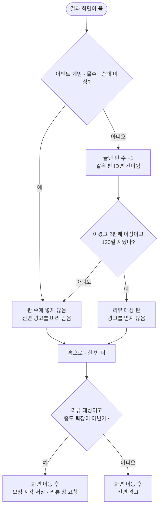

<!-- projectops:report -->
# ⚙️ [기능추가][게임][리뷰] 게임 종료 후 스토어 리뷰 요청

## 개요

게임을 이기고 나갈 때 스토어 기본 리뷰 창(`requestReview()`)을 띄운다. 조건은 이긴 판이고, 정상 종료한 판이 2판째 이상이며, 마지막 요청 후 120일이 지났을 때다. 리뷰를 요청하는 판은 전면 광고를 받지 않고 리뷰 창만 띄운다. 이전에는 게임을 나갈 때 전면 광고만 있었고 리뷰를 받을 방법이 없었다. 판 수와 마지막 요청 시각은 이 기기의 `SharedPreferences`에 저장하고 서버는 쓰지 않는다.

## 기능 흐름

## 변경 사항

### 리뷰 요청 서비스 (새 파일)
- `lib/core/services/review/review_prompt_service.dart`: 판 수·마지막 요청 시각·마지막으로 센 판 ID를 저장하고 대상 판정. `in_app_review`는 `StoreReviewRequester` 함수 하나로 감싸 테스트에서 바꿔 끼운다
- `test/core/services/review/review_prompt_service_test.dart`: 테스트 10개

### 게임 화면
- `lib/features/game/presentation/pages/game_page.dart`
  - `_prepareExitAdOrReview()`: 결과 화면이 뜰 때 판정하고, 리뷰 대상이 아니면 전면 광고를 미리 받는다
  - `_exitGameAfterAd()`: 리뷰 대상이고 중도 퇴장이 아니면 광고 대신 리뷰 창을 요청한다. 화면 이동이 먼저인 기존 순서는 그대로다

### 계측·의존성
- `analytics_service.dart`: `review_request` 이벤트 (요청을 보낸 횟수만 센다)
- `pubspec.yaml`, `pubspec.lock`: `in_app_review: ^2.0.12`
- `macos/Flutter/GeneratedPluginRegistrant.swift`: 플러그인 등록이 자동으로 추가됨 (앱은 macOS로 출시하지 않는다)

## 수정 전후 화면

화면 변경은 없다. 리뷰 창은 앱이 그리지 않고 Google Play와 iOS가 직접 그리는 시스템 창이다. 이 환경에서 실기기로 창을 띄워 보지 못해 캡처가 없다.

## 주요 구현 내용

### 값마다의 근거 (이슈 #706에도 같은 표)

| 값 | 근거 | 레퍼런스에서 바로 나온 값인가 |
|---|---|---|
| 스토어 기본 창만 사용 | Google: 리뷰 전에 의견·예측 질문을 하면 안 되고 카드를 수정하면 안 됨. Apple: 직접 만든 리뷰 창 금지 | 예. 공식 규정 |
| 간격 120일 | Apple "365일에 3번까지"를 나눈 약 122일. Google "한 달 안 재요청은 안 뜰 수 있음"도 넘김 | 예. 공식 수치에서 계산 |
| 이긴 판만 | Apple "가장 만족할 때", CyberAgent 사례. 진 판에 낮은 점수가 몰린 사례 | 원칙과 사례에서 나옴 |
| 2판째 이상 | Google "충분히 써 본 뒤", Water Sort Puzzle의 "두 번째로 켰을 때부터" | 유추. 숫자를 정한 문서는 없음 |
| 리뷰 판은 광고 건너뛰기 | Apple "활동을 끊지 말 것". 우리 앱은 결과와 리뷰 창 사이에 광고가 낌 | 아니요. 팀 판단 |

`minFinishedGames`(2)와 `minInterval`(120일)은 상수라 출시 뒤 리뷰 수를 보고 조정할 수 있다.

### 상태
- 화면의 새 상태는 `_reviewDue` 하나이고, 기기 저장소의 값은 3개다. 한 판에서 판정은 한 번만 일어난다 (기존 `_gameOverDialogShown` 가드)
- 판 수는 버튼이 아니라 결과 화면이 뜰 때 올린다. 버튼을 누르지 않고 앱을 꺼도 판 수는 남고, 요청 시각이 없어서 다음에 이긴 판에서 다시 대상이 된다
- 리뷰 대상 판은 광고를 아예 미리 받지 않는다. 받아 두고 안 쓰면 다음 판까지 남아 만료된 광고를 띄우려다 실패할 수 있다

### 예외 경로 (검증에서 찾아 고침)
- 한 팀이 모두 나가 몰수로 끝난 판(`POLICE_FORFEITED`, `ROBBER_FORFEITED`)은 세지도 띄우지도 않는다
- 퇴장 확인창과 게임 종료가 겹쳐도 중도 퇴장 경로에서는 리뷰 창을 띄우지 않는다
- 같은 판 결과 ID가 다시 들어오면 판 수를 올리지 않는다
- 저장된 요청 시각이 미래(기기 시계 오류)면 영영 막히지 않게 대상으로 본다
- 요청 시각 저장이 실패해도 흐름을 막지 않는다 (fail-open)

### 테스트
- 서비스 가드 5개(중복 판, 미래 시각, 120일 경계, 진 판, 2판째)를 하나씩 일부러 망가뜨려 보고 매번 테스트가 실패하는 것을 확인했다
- `flutter test` 2,073개 통과, `flutter analyze` 문제 없음

## 주의사항

- **실기기 미확인.** 리뷰 창이 실제로 뜨는지는 확인하지 않았다. iOS는 TestFlight에서 아무것도 하지 않고 개발 빌드(시뮬레이터)에서만 뜨며 제출 버튼은 눌리지 않는다. Android는 Play 내부 테스트 트랙으로 설치해야 뜨고, 그 계정이 아직 리뷰를 남기지 않았어야 한다 (내부 앱 공유는 제출 불가). 효과는 출시 뒤 어드민 리뷰 받은편지함(웹 #255)의 리뷰 수와 평점으로 본다
- **`game_page.dart`의 가드(몰수, 중도 퇴장, 이벤트 게임 제외)는 단위 테스트가 없다.** 3,000줄 넘는 화면이라 이 부분만 떼려면 판정 로직을 밖으로 빼야 한다
- **앱을 지웠다 깔면:** iOS는 초기화된다. Android는 `AndroidManifest.xml`에 백업 설정이 없어 기본값(백업 켜짐)이라 저장값이 복원될 수 있다. 초기화돼도 스토어 쪽 제한(Apple 365일 3회, 이미 리뷰를 남긴 계정)은 계정에 묶여 우회되지 않는다. 최악은 광고만 빠지고 창이 안 뜨는 판 하나다
- **퇴장 확인창을 띄울 때 미리 받아 둔 광고**가 리뷰 대상 판에서 쓰이지 않고 다음 판까지 남을 수 있다. 드문 경우라 그대로 두었다
- **진영별 승률은 확인하지 않았다.** 이긴 판만 대상이라 한쪽 진영이 거의 못 이기면 그 진영은 요청을 못 받는다
- 앱을 켤 때는 리뷰를 묻지 않는다. 앱을 끄면 그 판은 넘어가고 다음에 이긴 판에서 다시 시도한다
