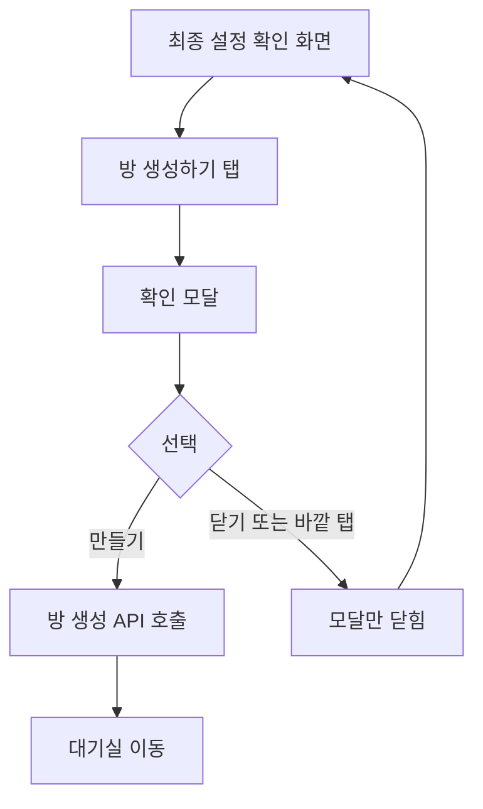

### 📌 작업 개요

방 생성 마지막 단계를 다듬으면서, 앱의 모든 다이얼로그·모달을 디자인 `모달_GUI` 규격 하나로 통일했다. 다이얼로그 카드 틀은 공용 위젯 `DialogCard` 하나로 모았고, 공용 다이얼로그(`AppDialog`)와 따로 만든 모달 7개가 모두 이 틀을 쓴다.

> 이 댓글은 앞선 리포트 댓글을 대신한다. 앞 댓글의 "모달은 공용 기본 모양(모서리 16) 그대로"는 더 이상 맞지 않는다.

### 🎯 구현 목표

| # | 항목 | 수정 전 | 수정 후 |
|---|---|---|---|
| 1 | 다이얼로그 규격 | 위치마다 제각각 (모서리 16·24, 제목 20·24, 버튼 글자 18) | 모달_GUI 하나로 통일 (아래 표) |
| 2 | 방 생성 확인 | 버튼을 누르면 바로 생성 | 확인 모달 → `만들기`를 눌러야 생성 |
| 3 | 방 생성 마지막 단계 문구 | 추천값으로 채워 뒀어요. 바꿀 항목만 눌러요 / 게임 생성하기 | 추천 설정을 적용했어요. 원하는 대로 변경할 수 있어요 / 방 생성하기 |
| 4 | 플레이그라운드 이탈 확인 | 핀으로 그린 뒤 뒤로 가면 "방 만들기를 그만할까요?" | 묻지 않고 모드 선택으로 돌아감 |
| 5 | 토글 꺼짐 손잡이 | 작아짐 | 켜짐과 같은 크기 |
| 6 | 안전 안내·만 14세 확인 문구 | 설명 마지막 글자가 혼자 줄바꿈 | 두 줄에 들어가게 정리 |
| 7 | 안 쓰는 코드 | 어디서도 안 쓰는 파일 3개 | 삭제 |

### 📐 다이얼로그 규격 (모달_GUI)

| 항목 | 값 |
|---|---|
| 화면 좌우 여백 (카드 바깥) | 36 |
| 카드 모서리 | 24 |
| 카드 안쪽 여백 (위·아래·좌우) | 24 |
| 제목 | 18 (도둑 화면은 Moneygraphy 18) |
| 제목 → 설명 / 내용 | 8 |
| 설명 | 14 |
| 설명 → 버튼 | 24 |
| 버튼 | 높이 48 · 모서리 12 · 사이 8 · 글자 16 |

### 🖼️ 방 생성 화면 수정 전후

| | 수정 전 | 수정 후 |
|---|---|---|
| 최종 설정 확인 화면 |  |  |
| `방 생성하기`를 누른 직후 |  바로 생성 로딩 |  확인 모달 |

### 🖼️ 다이얼로그·모달 전체 수정 전후 (45개 화면)

수정 전은 `main`, 수정 후는 이 브랜치 작업본이다. 위젯 테스트 환경(393×852, ko, 실제 글꼴)에서 같은 샘플 값으로 렌더링했다. 공개 함수가 있는 모달은 실제 함수를 불렀고, 큰 화면 안의 비공개 함수에서 띄우는 다이얼로그는 그 버전 소스의 인자를 그대로 넘겨 다시 띄웠다. 게임·대기방 다이얼로그는 대부분 경찰(라이트) 화면 기준이다.

<b>공용 다이얼로그 (AppDialog) — 36곳</b>

| id | 화면 | 수정 전 | 수정 후 |
|---|---|---|---|
| A01 | 방 입장 전 — 위치 권한 필요 |  |  |
| A02 | 앱 시작 — 새 버전 안내(업데이트 권장) |  |  |
| A03 | 앱 시작 — 업데이트 안내 |  |  |
| A04 | 점검 화면 — 점검 시작 안내 |  |  |
| A05 | 로그인 — 만 14세 이상 확인 |  |  |
| A06 | 채팅방 공지 — 공지 삭제 확인 |  |  |
| A07 | 채팅방 정보 — 멤버 내보내기 확인 |  |  |
| A08 | 채팅방 정보 — 채팅방 나가기 확인 |  |  |
| A09 | 모집글 상세 — 글 삭제 확인 |  |  |
| A10 | 채팅 초대 카드 — 게임 초대 입장 확인 |  |  |
| A11 | 모집 피드 — 글 삭제 확인 |  |  |
| A12 | 게임 중 — 위치 권한 필요 |  |  |
| A13 | 게임 중 — 게임 나가기 확인 |  |  |
| A14 | 게임 종료 — 간이 결과(결과 ID 없을 때) |  |  |
| A15 | 게임 중 — 개발자 도구 |  |  |
| A16 | 게임 중 — 마이크 권한 필요 |  |  |
| A17a | 게임 중 — 체포 확인(경찰) |  |  |
| A17b | 게임 중 — 탈옥 확인(도둑, 다크) |  |  |
| A18 | 게임 결과 — 이미지 저장/공유 선택 |  |  |
| A19 | QR 스캐너 — 카메라 권한 필요 |  |  |
| A20 | 마이페이지 — 로그아웃 확인 |  |  |
| A21 | 마이페이지 — 회원 탈퇴(delete 입력) |  |  |
| A22 | 홈 — 주변 확인 안전 안내 |  |  |
| A23 | 홈 — 개발자 도구 |  |  |
| A24 | 홈 — 방 참여하기(참여코드 입력) |  |  |
| A25 | 방 만들기 마지막 단계 — 방 생성 확인 (신규) | — |  |
| A26 | 플레이 구역 설정 — 방 만들기 그만두기 확인 (삭제) |  | — |
| A27 | 감옥 구역 설정 — 방 만들기 그만두기 확인 |  |  |
| A28 | 대기방 — 위치 권한 필요 |  |  |
| A29 | 대기방 — 방에 참여할 수 없음 |  |  |
| A30 | 대기방 — 개발자 도구 |  |  |
| A31 | 대기방 — 참가자 내보내기 확인 |  |  |
| A32 | 대기방 — 내보내짐 안내 |  |  |
| A33 | 대기방 — 게임 시작 확인(팀 인원) |  |  |
| A34 | 대기방 — 방 나가기 확인 |  |  |
| A35 | 대기방 — 초대코드 생성(QR) |  |  |
| A36a | 게임 규칙 (경찰, 라이트) |  |  |
| A36b | 게임 규칙 (도둑, 다크) |  |  |

<b>따로 만든 모달 — 7개</b>

| id | 화면 | 수정 전 | 수정 후 |
|---|---|---|---|
| B01 | 게임·대기방 — 연결 끊김 재연결 모달 |  |  |
| B02 | 게임 시작 — 도둑 도망 카운트다운 팝업 |  |  |
| B03 | 게임 종료 — "게임 종료!" 첫 카드 |  |  |
| B04a | 게임 결과 — 경찰 승리(라이트) |  |  |
| B04b | 게임 결과 — 도둑 패배(다크) |  |  |
| B05 | 게임 중 — 도둑 수배 QR |  |  |
| B06 | 이벤트 게임 — 운영진 검거 성공 |  |  |
| B07 | 이벤트 게임 — 수사 종료 결과 보드 |  |  |

### 🖼️ 문구 정리 전후

규격을 바꾼 뒤 안쪽 여백이 24로 늘어 설명 마지막 글자가 혼자 줄바꿈되던 두 다이얼로그의 문구를 줄였다. 수정 전은 새 규격 + 예전 문구, 수정 후는 새 규격 + 새 문구다.

| | 수정 전 | 수정 후 (ko) | 수정 후 (en) |
|---|---|---|---|
| 홈 — 주변 확인 안전 안내 |  |  |  |
| 로그인 — 만 14세 이상 확인 |  |  |  |

| 키 | 수정 전 (ko) | 수정 후 (ko) |
|---|---|---|
| `dialogSafetyWarningMessage` | 게임 중 화면에만 집중하면 위험할 수 있어요 도로 및 보행 환경을 확인하며 안전하게 이용해 주세요 | 게임 중 화면만 보면 위험할 수 있어요 도로와 주변을 살피며 안전하게 이용해 주세요 |
| `dialogAge14ConfirmMessage` | 경찰과 도둑은 만 14세 미만 회원가입이 불가능해요. 해당 정보는 가입 금지 확인 용도로만 사용하고 있어요 | 경찰과 도둑은 만 14세 이상만 가입할 수 있어요 입력한 정보는 나이 확인에만 써요 |

en·ja도 같은 뜻으로 줄였고, 393 폭에서 세 언어 모두 두 줄인 것을 확인했다(ja는 테스트 글꼴에 한자가 없어 줄 폭만 확인).

### 🔄 방 생성 확인 흐름

### ✅ 구현 내용

#### 공용 카드 틀 `DialogCard`
- **파일**: `lib/core/widgets/dialogs/dialog_card.dart` (신규)
- **변경 내용**: 화면 좌우 36 · 모서리 24 · 안쪽 24 · 배경색만 정하는 카드. `AppDialog`, `AppPopup`, 재연결 모달, 게임 종료 인트로, 게임 결과, QR, 이벤트 검거 성공, 이벤트 결과 보드가 모두 이 카드를 쓴다
- **이유**: 모달마다 같은 카드 코드(여백·모서리·배경)를 따로 들고 있어 값이 조금씩 달랐다. 한 곳에서 정하면 다음 규격 변경도 한 줄로 끝난다

#### 공용 다이얼로그 기본값
- **파일**: `lib/core/widgets/dialogs/app_dialog.dart`, `dialog_spacing.dart`
- **변경 내용**: 제목 20 → 18, 제목-설명 12 → 8, 설명-버튼 20 → 24, 커스텀 내용 위 간격 12·20 → 8, 버튼 글자 18 → 16. 제목·내용·버튼에 따로 있던 안쪽 4 여백을 없애 모두 카드 안쪽 24 선에 맞췄다

#### 따로 지정하던 값 정리
| 위치 | 수정 전 | 수정 후 |
|---|---|---|
| 게임 종료 간이 결과 (`game_page.dart`) | 제목 24·20 | 18, 승패 색만 유지 |
| 체포·탈옥 확인 (`game_action_modal.dart`) | 도둑 화면 제목 20 | 기본값 |
| 게임 규칙 (`game_rules_content.dart`) | 도둑 화면 제목 20, 간격 12 | 기본값 |
| 채팅 초대장 (`community_chat_invite_card.dart`) | 제목을 12 캡션으로 | 기본 제목 18 |
| 재연결 모달 | 카드 폭 320 · 높이 182 고정 | 화면 좌우 36, 높이는 내용대로 |
| 게임 결과 | 카드 폭 320 고정, 버튼 글자 18 | 화면 좌우 36(캐릭터 팔이 카드 가장자리 기준이라 카드 바깥에서 띄움), 버튼 16 |
| 게임 종료 인트로 · 공용 팝업 | 안쪽 위아래 42 · 좌우 16, 제목 20 | 안쪽 24, 제목 18 |
| QR · 이벤트 검거 성공 · 이벤트 결과 보드 | 바깥 40·36, 안쪽 20·24/28, 제목 20 | 바깥 36, 안쪽 24, 제목 18, 버튼 16 |

#### 방 생성 확인 모달
- **파일**: `lib/features/session/presentation/pages/session_creation_flow_page.dart`, `lib/l10n/app_*.arb`
- **변경 내용**: `방 생성하기`가 바로 생성하지 않고 확인 모달을 먼저 띄운다. 문구는 `docs/i18n/UX_WRITING.md`(토스 보이스톤) 기준 — 왼쪽 버튼은 공용 기본값 `닫기`, 오른쪽은 `만들기`
- 하단 버튼 키 `buttonCreateRoom`은 홈 메인 버튼과 같이 써서 홈 버튼도 `방 생성하기`로 바뀐다

#### 플레이그라운드 이탈 확인 제거
- **파일**: `lib/features/session/presentation/pages/setup_playground_page.dart`
- **변경 내용**: 핀으로 그리던 중 뒤로 가도 묻지 않고 바로 나간다. 감옥 단계의 같은 확인은 그대로 둔다

#### 토글 손잡이 크기 통일
- **파일**: `lib/features/mypage/presentation/pages/my_page.dart`, `lib/features/session/presentation/widgets/shrink_toggle_card.dart`
- **변경 내용**: `thumbIcon: WidgetStatePropertyAll(Icon(null))` — Material 3 `Switch`는 손잡이 아이콘이 없으면 꺼짐에서 손잡이를 줄인다. 그림 없는 빈 아이콘으로 크기만 켜짐과 같게 둔다

#### 안전 안내·만 14세 확인 문구
- **파일**: `lib/l10n/app_ko.arb`, `app_en.arb`, `app_ja.arb`
- **변경 내용**: 위 「문구 정리 전후」 표. 가이드의 긍정형(불가능해요 → 이상만 가입할 수 있어요)·쉬운 말 기준

#### 안 쓰는 코드 삭제
- `lib/core/widgets/map/models/zone_shape_type.dart`, `lib/features/chat/domain/input_focus_guard.dart`, `lib/features/game/domain/recede.dart`와 뒤의 두 파일만 검사하던 테스트 2개

### 🧪 테스트 및 검증
- 추가: 다이얼로그 규격(모서리 24, 안쪽 24, 제목 18, 간격 8·24, 버튼 글자 16), 방 생성 확인 모달(뜨는지 / 닫기를 누르면 생성 안 됨), 플레이그라운드 뒤로 가기 시 확인 없음
- `flutter test` 전체 통과, `flutter analyze` 문제 없음
- iPhone 17 Pro 시뮬레이터: 새 빌드로 방 생성 확인 모달이 새 규격으로 뜨는 것 확인

### ⚠️ 주의사항
- **문구 줄바꿈**: 위 45개 화면 표의 A05·A22 "수정 후"는 문구 정리 전 상태다. 최종 모습은 「문구 정리 전후」 표를 본다. 이 확인은 ko 기준이고, 다른 다이얼로그의 en·ja 줄바꿈은 따로 확인하지 않았다
- **게임 결과 카드**: 안쪽 여백이 16 → 24로 늘어 통계 영역이 좌우로 조금 좁아졌다
- **공용 팝업·게임 종료 인트로**: 위아래 42 → 24로 카드가 낮아졌다
- **이벤트 결과 보드**: "운영진 N명 검거"는 제목이 아니라 강조 내용이라 20 그대로 뒀다
- 커스텀 내용(홈 방 참여, 대기방 게임 시작·초대코드, 회원 탈퇴 등)은 카드 틀·간격만 규격을 따르고, 안쪽 구성은 그대로다

### 📦 커밋

| 커밋 | 내용 |
|---|---|
| `40d148d6` | style: 토글 스위치 꺼짐 손잡이를 켜짐과 같은 크기로 |
| `9292e8d6` | chore: 어디서도 쓰지 않는 파일 삭제 |
| `b2a03b5e` | style: 모든 다이얼로그·모달을 모달_GUI 규격으로 통일 |
| `a856ccb2` | feat: 방 생성 전 확인 모달 추가와 마지막 단계 문구 정리 |
| `def225d8` | refactor: 플레이그라운드에서 뒤로 갈 때 이탈 확인 다이얼로그 제거 |
| `23ae6bb2` | fix: 안전 안내·만 14세 확인 문구를 두 줄에 맞게 정리 |
| `26f7fdcd` | style: 다이얼로그 카드 안쪽 여백을 all24 하나로 |
