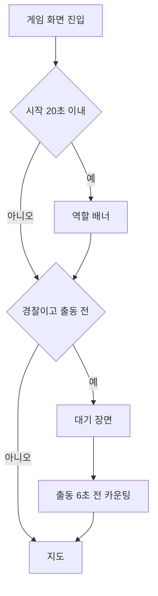

### 📌 작업 개요

이벤트 게임도 일반 게임과 같은 시작 연출(역할 배너 → 대기 장면 → 출동 카운팅)을 쓰게 바꿨다. 이벤트 게임 한 곳에서만 쓰던 경찰 대기 카운트다운 팝업, 홈의 개발자 도구(라이프사이클 테스트·테스트 위젯), 호출 없는 함수를 지웠다.

### 🎯 구현 목표

| # | 항목 | 수정 전 | 수정 후 |
|---|---|---|---|
| 1 | 이벤트 게임 시작 연출 | 경찰 대기 카운트다운 팝업 | 역할 배너 → 대기 장면 → 출동 카운팅 |
| 2 | 이벤트 게임 ⓘ 버튼 | 규칙 다이얼로그 | 시작 장면 다시 보기 |
| 3 | 홈 개발자 도구 | 디버그 빌드에서 벌레 버튼 → 라이프사이클 테스트·테스트 위젯 | 삭제 |
| 4 | 호출 없는 코드 | 함수 7개, 팝업 전용 문구 키 2개 | 삭제 |

### 🖼️ 수정 전후 화면 (이벤트 게임 경찰, 대기 1분)

| 수정 전 | 수정 후 ① 역할 배너 | 수정 후 ② 대기 장면 | 수정 후 ③ 출동 카운팅 |
|---|---|---|---|
|  |  |  |  |

수정 전은 `main`, 수정 후는 이 브랜치다. 게임 화면 위젯 테스트 환경(393×852, ko)에서 같은 조건으로 렌더링했다. 지도는 테스트용 빈 지도이고, 오른쪽 위 검은 네모는 테스트 환경에 아이콘 글꼴이 없어 생긴 것이다.

### 🔄 이벤트 게임 시작 흐름

일반 게임과 같은 계산(`startIntroSteps`)이다. 서버 시작 시각 기준이라 이벤트 게임에 중간 입장해도 그 시점에 맞는 단계부터 보인다.

### ✅ 구현 내용

#### 이벤트 게임 시작 연출 통일
- **파일**: `lib/features/game/presentation/pages/game_page.dart`, `lib/features/game/domain/start_flow.dart`
- **변경 내용**: `_startIntro()`의 이벤트 게임 분기(팝업 호출)와 `_showPoliceTimerIfNeeded()` 삭제. `startIntroSteps`의 `isEventGame` 인자 삭제. ⓘ 버튼(`_showGameRulesDialog`)은 이벤트 게임에서도 장면을 띄우고, 시작 시각을 모를 때만 예전 다이얼로그를 쓴다
- **이유**: 이벤트 게임만 예전 팝업을 써서 시작 화면이 달랐다. 분기를 없애 한 흐름만 유지한다

#### 카운트다운 팝업 삭제
- **파일**: `lib/core/widgets/dialogs/app_popup.dart`, `countdown_timer_content.dart`, `test/core/widgets/dialogs/app_popup_auto_close_test.dart`
- **변경 내용**: 위 분기가 유일한 사용처라 통째로 삭제. 팝업 전용 문구 키 `gameRobberOnTheRunBanner`·`gameRobberOnTheRunBannerTag`(ko/en/ja)도 삭제

#### 홈 개발자 도구 삭제
- **파일**: `lib/test_widget_page.dart`, `lib/features/lifecycle_test/`, `home_page.dart`, `lib/router/app_router.dart`, `route_paths.dart`, `lib/core/services/lifecycle/`
- **변경 내용**: 테스트 위젯 페이지, 라이프사이클 테스트 화면·경로, 홈의 개발자 도구 버튼·메뉴 삭제. 테스트 화면만 읽던 생명주기 로그 기록(`LifecycleLogsNotifier`, `LifecycleLog`, 서비스의 로그 저장)도 삭제
- 게임·대기방의 개발자 도구(끊김·재연결 시뮬레이션)는 남겼다

#### 호출 없는 함수 삭제
- `topLiftThemed`, `clearDeviceId`, `updateMaxParticipants`, `playerJoinLeave`(진동 상수 포함), `MarqueeAlertBanner.heightFor`, `projectPoint`, `waitProgress`
- `projectPoint`를 쓰던 카메라 테스트는 실제 계산(`CameraFrame.project`)을 직접 부르게 고쳤다

### 🧪 테스트 및 검증
- 추가: 이벤트 게임 경찰이 역할 배너 → 대기 장면 → 출동 카운팅을 보는지, 이벤트 게임에서 ⓘ가 장면을 여는지
- 삭제: "이벤트 게임은 팝업 유지"를 확인하던 테스트, 팝업 자동 닫힘 테스트, `waitProgress` 테스트
- `flutter test` 전체 통과, `flutter analyze` 문제 없음
- 시뮬레이터·실기기에서 이벤트 게임을 직접 돌려 보지는 않았다

### ⚠️ 주의사항
- 이벤트 게임의 운영진(도둑)도 일반 게임 도둑과 같은 역할 배너·설명 장면을 본다. 장면의 규칙 문구는 일반 게임용 그대로라, 이벤트 규칙과 어긋나는 문장이 있는지 확인이 필요하다
- `ApiEndpoints`의 주소 상수는 호출이 없어도 목록으로 유지하는 패턴이라 지우지 않았다
- PR #714(#713)도 `app_popup.dart`를 고친다. 먼저 머지된 쪽 다음에 오는 PR에서 이 파일은 삭제로 정리한다

### 📦 커밋

| 커밋 | 내용 |
|---|---|
| `5abe3a2e` | feat: 이벤트 게임도 일반 게임과 같은 시작 연출 사용 |
| `1ccb3685` | chore: 홈 개발자 도구와 라이프사이클 테스트·테스트 위젯 삭제 |
| `13236e4b` | chore: 호출 없는 함수 삭제 |
