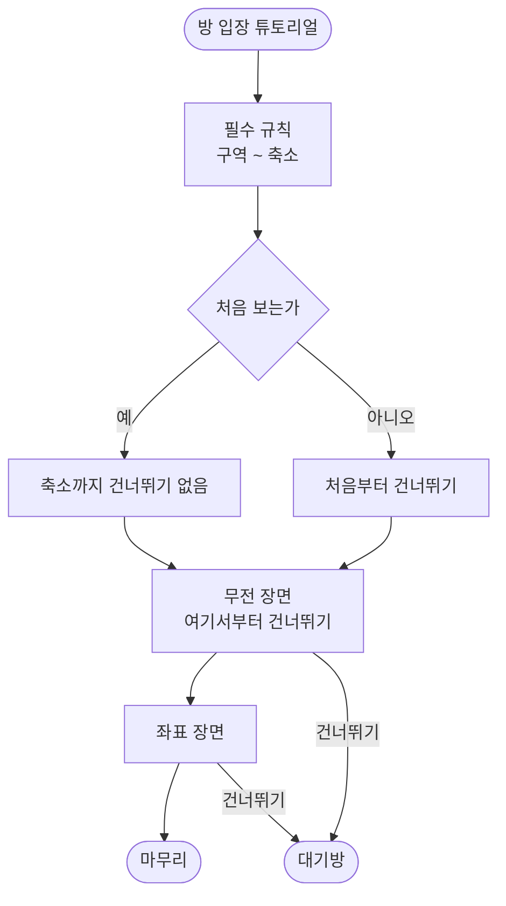

<!-- projectops:report -->
### 📌 작업 개요

방 입장 튜토리얼에 무전과 좌표 장면을 추가했다. 무전은 누르는 동안만 말하고 한 번에 한 명만 말할 수 있다는 것, 좌표는 + 메뉴에서 켜고 칸을 길게 눌러 핑을 찍으면 칸 이름이 팀 채팅으로도 간다는 것을 보여 준다. 두 기능 모두 앱 어디에도 사용법 안내가 없었다. 처음 볼 때는 필수 규칙(축소 장면까지)을 다 본 뒤부터 건너뛸 수 있다.

### 🎯 구현 목표

| # | 항목 | 수정 전 | 수정 후 |
|---|---|---|---|
| 1 | 장면 구성 | 축소 → 마무리 (경찰과 도둑 10장, 술래잡기 8장) | 축소 → **무전 → 좌표** → 마무리 (12장 / 10장) |
| 2 | 무전 안내 | 없음 | "경찰만 무전기를 쓸 수 있어요" 장면 (누르는 중 → 동료가 말하면 잠김) |
| 3 | 좌표 안내 | 없음 (핑만 시작 장면 규칙 카드에 있음) | + 메뉴 → 좌표 → 길게 눌러 발견 핑 → 팀 채팅 장면 |
| 4 | 처음 볼 때 건너뛰기 | 끝까지 없음 | 무전 장면부터 보임 (필수 장면은 끝까지) |

### 🖼️ 수정 전후 화면 (경찰과 도둑, ko, 처음 볼 때)

| 수정 전 | 수정 후 |
|---|---|
|  |  |
| 축소 다음 바로 마무리, 건너뛰기 없음 | 축소(건너뛰기 없음) → 무전(건너뛰기 나타남) → 좌표 |

수정 후는 이 브랜치의 `GameTutorialPage`를, 수정 전은 같은 코드에서 장면 목록을 `main`과 같게(무전·좌표 제외, 건너뛰기 없음) 두고 위젯 테스트 환경(393×852)에서 렌더링했다.

#### 장면별 화면

| 축소 (9장) | 무전 (10장) | 좌표 ① 메뉴 | 좌표 ② 핑 카드 | 좌표 ③ 팀 채팅 |
|---|---|---|---|---|
|  |  |  |  |  |

#### 언어·모드별 화면

| | 무전 | 좌표 ① 메뉴 | 좌표 ③ 팀 채팅 |
|---|---|---|---|
| English |  |  |  |
| 日本語 |  |  |  |
| 술래잡기 (ko) |  | |  |

일본어 화면은 앱 글꼴에 한자가 없어 테스트 렌더에서만 기기 대체 글꼴(히라기노)로 그렸다. 실기기에서는 iOS가 한자를 같은 글꼴로 채운다.

### 🔄 튜토리얼 흐름

### ✅ 구현 내용

#### 장면 순서와 건너뛰기
- **파일**: `lib/core/widgets/tutorial/tutorial_script.dart`, `tutorial_player.dart`, `lib/features/session/presentation/pages/game_tutorial_page.dart`
- **변경 내용**: `TutorialScene`에 `radio`·`grid`를 추가하고 두 모드 모두 축소 다음에 넣었다. `tutorialFirstExtraIndex(mode)`가 추가 기능이 시작되는 장면 번호를 준다. `TutorialPlayer`에 `skipFrom`을 추가해 그 장면부터 건너뛰기를 보인다. `GameTutorialPage`는 처음이면 `tutorialFirstExtraIndex`, 다시 보면 0을 넘긴다
- **이유**: 장면이 10장에서 12장으로 늘었다. 무전·좌표는 몰라도 게임은 되는 기능이라 원하는 사람은 넘길 수 있어야 한다. 대신 "튜토리얼 더 보기" 같은 선택형으로 두면 모르는 사람이 계속 모르므로, 자동으로 이어서 보여 주고 건너뛰기만 연다

#### 무전 장면
- **파일**: `tutorial_script.dart`(`_radio`), `tutorial_team_overlays.dart`
- **변경 내용**: 축소된 구역을 위에서 내려다보는 시점으로 바꾸고 오른쪽 아래에 무전 버튼을 띄운다. 버튼이 1.2초 눌렸다(파랗게 차고 커짐) 떨어진 뒤, "의민 무전 중" 알약이 뜨고 버튼이 잠긴다(회색 아이콘). 게임 화면의 `RadioPttButton`·`RadioSpeakerPill`과 같은 크기·색이다
- **문구**: "경찰만 무전기를 쓸 수 있어요"(술래잡기는 "술래만"). 튜토리얼은 역할을 모르고 열려 도둑도 같은 장면을 보므로 문구로 경찰 전용임을 알린다

#### 좌표 장면
- **파일**: `tutorial_script.dart`(`_grid`, `tutorialPingPoint`), `tutorial_team_overlays.dart`, `tutorial_overlays.dart`
- **변경 내용**: QR 체포 장면의 + 메뉴 연출을 그대로 따른다. + 버튼 → 메뉴(좌표·참가자·체포·채팅, 경찰이 무전을 켠 지도 메뉴와 같은 순서) → "좌표"를 누름 → 5×5 격자와 칸 이름(A1~E5) → C3를 길게 누르면 핑 카드 → "발견" → 핑 표시와 팀 채팅 미리보기 "C3에서 도둑을 봤어요"(실제 자동 채팅 문구 `pingChatFoundRobber`)
- 메뉴의 + 버튼은 경찰 장면에서 파란 원에 흰 +, 도둑 장면(QR)에서는 기존대로 검정 원에 초록 +다(`GameFabMenu`와 같음)

#### 문구 (ko·en·ja)
- `tutorialRadioTitle`·`tutorialRadioTitleTag`·`tutorialRadioBody`·`tutorialGridTitle`·`tutorialGridBody`·`tutorialRadioSampleName`(의민 / Euimin / ウィミン)
- 용어는 용어집을 따랐다(Cops / Seekers / Grid, 警察 / 鬼 / 座標)

### 🧪 테스트 및 검증
- 추가: 축소 다음 무전 → 좌표 순서(두 모드), 무전 장면이 "누름 → 동료 무전 중 + 잠김"으로 끝나는지, 좌표 장면이 "메뉴 열기 → 좌표 누름 → 핑 카드 → 핑 + 팀 채팅"으로 끝나는지, 다음 장면에서 무전·좌표 표시가 지워지는지, 처음 볼 때 9번째 장면까지 건너뛰기가 없고 무전 장면부터 건너뛰면 대기방으로 돌아가는지
- 수정: 마지막 장면까지 넘기는 테스트를 9번 → 11번으로. `map_keeps_its_angle_when_zone_circle_grows_into_the_last_scene`은 마지막 장면 지도 각도를 58°로 고정해 두고 있었는데, 이제 앞 장면(좌표)이 위에서 내려다보는 시점이라 "마지막 장면 동안 각도가 바뀌지 않는다"로 고쳤다. 원이 커지는 동안 지도가 눕는 문제는 그대로 잡는다
- `flutter test` 전체 통과(2,075개), `flutter analyze` 이번 변경분 문제 없음(남은 11건은 `docs/superpowers/`의 기존 경고)
- 시뮬레이터·실기기에서 직접 넘겨 보지는 않았다

### ⚠️ 주의사항
- **"의민"이 모든 사용자에게 예시 이름으로 보인다.** 동료 경찰 이름 자리에 쓰는 `tutorialRadioSampleName` 값이다. 바꾸려면 ARB 값만 고치면 된다
- 무전·좌표 장면에서는 감옥 원을 숨긴다. 축소가 감옥 쪽으로 끝나 감옥 원이 격자 한가운데를 가리기 때문이다
- 게임의 좌표 격자는 지도 북쪽 기준이지만, 튜토리얼 지도는 돌아가 있어 격자를 화면 기준으로 놓았다(읽기 쉽게)
- 무전 버튼·알약·핑 카드·채팅 미리보기는 실제 위젯을 쓰지 않고 같은 값으로 따라 그렸다. 실제 위젯은 `.w`로 크기를 잡는데 튜토리얼 무대는 통째로 늘어나 크기가 두 번 커지기 때문이다(QR 장면 + 메뉴와 같은 방식). 게임 화면의 무전 버튼 모양이 바뀌면 `tutorial_team_overlays.dart`도 같이 고쳐야 한다
- 마지막 장면은 이제 위에서 내려다본 지도 위에서 원이 커진다(전에는 비스듬한 3D 지도)
- 방 설정에 "무전 켜기"가 생기면, 무전을 끈 방에서 무전 장면을 뺄지 정해야 한다(지금은 모든 일반 게임에서 켜져 있다)

### 📦 커밋

| 커밋 | 내용 |
|---|---|
| `6abf996c` | feat : 튜토리얼에 무전, 좌표 장면 추가 #719 |
