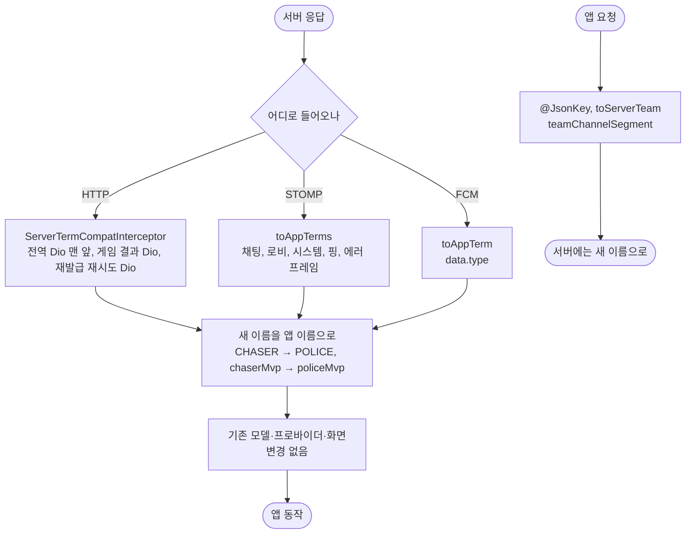

<!-- projectops:report -->
### 📌 작업 개요

서버가 경찰(`POLICE`)·도둑(`ROBBER`)을 쫓는 쪽(`CHASER`)·쫓기는 쪽(`RUNNER`)으로 바꾸고 있다(BE #254, PR #255, dev v4.5.0). 앱이 옛 이름과 새 이름을 모두 읽고, 새 이름으로 보내게 했다. 서버 응답이 앱에 들어오는 경계에서 새 이름을 앱이 쓰는 이름으로 한 번만 맞추는 방식이라, 모델·프로바이더·화면 코드는 바꾸지 않았다. 바뀐 화면은 없다.

 

### 🎯 구현 목표

| # | 항목 | 수정 전 | 수정 후 |
|---|---|---|---|
| 1 | 받는 값 (팀·상태·종료 사유·이벤트 `type`·에러 코드) | 옛 값만 안다 | 옛 값·새 값 모두 |
| 2 | 받는 필드 (`policeMvp`, `robberLocations` 등) | 옛 키만 읽는다 | 새 키 먼저, 없으면 옛 키 |
| 3 | 보내는 필드·팀 값 | `policeWaitMinutes`, `robberParticipantId`, `POLICE`/`ROBBER` | `chaserWaitMinutes`, `runnerParticipantId`, `CHASER`/`RUNNER` |
| 4 | 팀 채팅·핑 구독 경로 | `/chat/police`, `/ping/robber` 등 | `/chat/chaser`, `/ping/runner` 등 |

서버는 세 모습으로 응답한다. 세 모습 모두에서 앱이 같은 값을 보도록 했다.

| 서버 | 응답 값·이벤트 `type`·에러 코드 | 응답 필드 | 팀 경로 발행 |
|---|---|---|---|
| 옛 서버 (운영 v3.13.0) | 옛 이름 | 옛 키 | 옛 경로 |
| 1단계 서버 (dev v4.5.0) | 옛 이름 | 옛 키 + 새 키 | 옛 경로 + 새 경로 |
| 4단계 서버 (강제 업데이트 뒤) | 새 이름 | 새 키 | 새 경로 |

 

### 🔀 기능 흐름

 

### 🖼️ 수정 전후 화면

화면 변경이 없어 캡처를 붙이지 않았다. 문구·레이아웃·에셋은 그대로다.

 

### ✅ 구현 내용

#### 변환 규칙 — `lib/core/network/server_term_compat.dart` (새 파일)
- **값 15개**: 팀 2, 참가자 상태 1, 종료 사유 2, 시스템 이벤트 `type` 2, 에러 코드 8. 예: `CHASER` → `POLICE`, `ONLY_CHASER_CAN_ARREST` → `ONLY_POLICE_CAN_ARREST`.
- **키 12개**: `chaserWaitMinutes` → `policeWaitMinutes`, `chasers`/`runners` → `police`/`robbers`, `runnerLocations` → `robberLocations`, 시스템 `ARREST`·`ESCAPE`의 `chaser`·`runner`·`escapedRunner`·`remainingRunners` 등.
- 값은 서버 enum이 실리는 키(`team`, `status`, `winnerTeam`, `reason`, `type`, `errorCode`)에서만 바꾼다. 닉네임이나 채팅 본문이 "RUNNER"여도 그대로 둔다.
- 새 키와 옛 키가 함께 오면 새 키 값이 이긴다. 원본 JSON은 바꾸지 않고 새 값을 돌려준다. 바이트 응답(`Uint8List`)은 건드리지 않는다.
- **이유**: 앱 안의 팀 값은 비교 40여 곳, 소문자로 바꿔 에셋·경로를 만드는 곳 10여 곳에 퍼져 있다. 각 위치에 두 이름을 넣으면 한 곳만 빠져도 어긋나므로, 들어오는 길목에서 한 번 맞췄다.

#### 받는 쪽 연결
- `lib/core/network/dio_client.dart`: 전역 Dio 인터셉터 맨 앞에 등록. 토큰 재발급 뒤 재시도에 쓰는 `plainDio`에도 등록했다(재시도 응답은 바깥 Dio의 응답 인터셉터를 다시 타지 않는다).
- `lib/features/game/presentation/providers/game_result_provider.dart`: 전역 Dio를 쓰지 않는 게임 결과 Dio에 별도 등록.
- STOMP 디코드 5곳: `chat_stomp_datasource.dart`, `lobby_stomp_datasource.dart`, `game_event_stomp_datasource.dart`(시스템·핑), `base_stomp_datasource.dart`(에러 프레임).
- `lib/core/services/fcm/firebase_messaging_service.dart`: `data.type`을 읽는 3곳을 `_messageType()`으로 모았다.

#### 보내는 쪽
- `game_create_request_model.dart`: `@JsonKey(name: 'chaserWaitMinutes')`
- `arrest_request_model.dart`: `@JsonKey(name: 'runnerParticipantId')`
- `team_change_request.dart`: `@JsonKey(toJson: toServerTeam)` — `POLICE` → `CHASER`
- 팀 채팅·핑 구독 경로: `teamChannelSegment()` — 앱의 팀 키 `police` → 경로 `chaser`

#### 정본
- `docs/api-docs.json`: 개발 서버에서 받아 v4.4.0 → v4.5.0.

 

### 🧪 테스트 및 검증

`flutter analyze` 지적 0건, `flutter test` 전체 2,176개 통과. 새 테스트는 31개다.

| 시나리오 | 결과 |
|---|---|
| 4단계 서버 게임 결과(`winnerTeam: CHASER`, `chaserMvp`) → 승리 팀·MVP를 앱 이름으로 읽음 | 통과 |
| 1단계 서버가 두 키에 다른 값을 실음 → 새 키 값을 읽음 | 통과 |
| 옛 서버 응답 → 그대로 읽음 | 통과 |
| 4단계 참가자 목록, 시스템 `ARREST`·`ESCAPE`·`GAME_OVER`, 새 이벤트 `type` 2개 | 통과 |
| 닉네임·채팅 본문이 "RUNNER" → 바뀌지 않음 | 통과 |
| 에러 코드 8개 전부, 바뀌지 않은 코드(`RADIO_SERVER_BUSY`) 통과 | 통과 |
| 앱이 실제로 쓰는 `DioClient.create`를 로컬 서버에 붙여 4단계 응답 수신 | 통과 |
| 같은 클라이언트로 401 → 토큰 재발급 → 재시도 응답 수신 | 통과 (수정 전 실패 확인) |
| 팀 채팅 구독 `/chat/chaser`, 핑 구독 `/ping/runner`, 4단계 채팅·이벤트 프레임 수신 | 통과 |
| 보내는 키 2개, 팀 변경 값, 구독 경로 조각 | 통과 |

- 연결 코드 다섯 곳(전역 인터셉터 등록, 채팅·이벤트 디코드, 구독 경로 2곳)을 하나씩 빼 보면 해당 테스트가 실패하는 것을 확인했다.
- 변환 표의 목표 값 15개와 키 12개가 앱 코드에 실제로 있는지, 앱 응답 모델이 읽는 옛 키가 모두 표에 있는지 대조했다. 빠진 것은 없었다.
- 변환 표는 BE PR #255 머지 코드(`55528c85`)의 옛 이름 지원 지점과 대조했다.
- **확인하지 못한 것**
  - 개발 서버에서 실제 한 판(경찰과 도둑, 술래잡기). 팀 채팅·핑 구독과 방 생성 요청은 실제 서버로 확인하지 않았다.
  - 로비·핑·STOMP 에러 프레임 디코드와 게임 결과 Dio 등록은 같은 방식의 코드지만 전용 테스트가 없다.
  - FCM `_messageType()`은 private이라 테스트할 틈이 없다. 변환 함수만 검증했다.

 

### ⚠️ 주의사항

> [!WARNING]
> **운영 서버에 BE PR #255가 나가기 전에 이 앱을 출시하면 안 된다.** 옛 서버는 `chaserWaitMinutes`를 몰라 방 생성 값이 빠지고, `/chat/chaser`·`/ping/runner`에 발행하지 않아 팀 채팅·핑이 오지 않는다.

- **이슈 원안과 다른 점**: 이슈는 받는 값·받는 필드(1·2)와 보내는 이름(3)을 나눠 출시할 수 있게 적었다. 이 브랜치는 셋을 함께 담았으므로 브랜치 전체가 BE 운영 배포에 묶인다. 1·2만 먼저 내야 하면 보내는 쪽 커밋을 떼야 한다.
- **BE 4단계(옛 이름 제거) 전 강제 업데이트 최소 버전은 이 브랜치가 들어간 버전 이상**이어야 한다.
- **서버에 새 enum 키가 생기면** `_valueKeys`에 추가해야 변환된다. 지금 목록 밖 키의 값은 바꾸지 않는다(닉네임·본문 보호).
- **인터셉터 순서**: 호환 인터셉터는 맨 앞이어야 한다. 뒤의 인증·약관 인터셉터가 에러 코드를 앱 이름으로 본다. 재시도용 `plainDio`에서 빼면 토큰 만료 직후 요청만 새 이름으로 들어온다.
- 좀비 모드(BE #258)의 새 팀 값은 표에 없어 그대로 통과한다. 그 작업 때 따로 본다.
- 앱 안의 이름(`GameTeam.police`, `isPolice`, 에셋명)은 그대로 두었다. 언젠가 앱 이름을 바꾸면 이 파일도 같이 정리한다.

 

### 📦 커밋

- `1684c1c4` feat : 서버 팀 용어 CHASER, RUNNER 대응 #734
- `ea854827` chore : api-docs 서버 v4.5.0 동기화 #734
- `e91b1224` style : dart format 정리 #734 (저장소 규칙대로 전체 포맷을 돌리다 걸린 무관한 파일 14개, 줄바꿈·들여쓰기만 바뀜)
