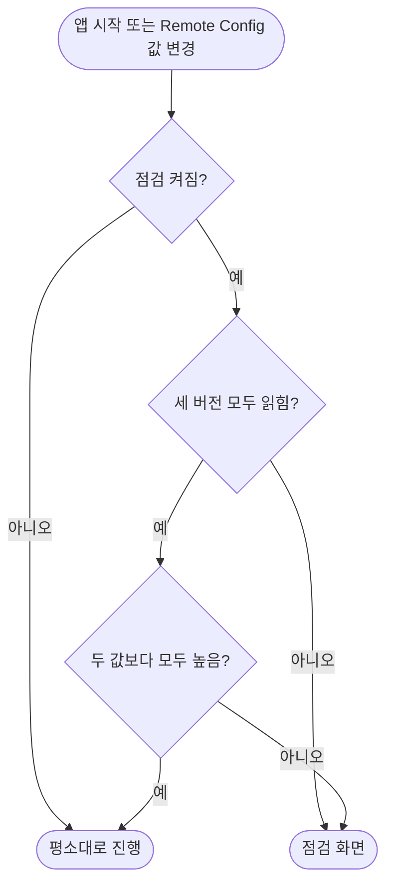

<!-- projectops:report -->
# 🚀 [기능개선][점검] 출시 전 버전은 점검 건너뛰기

## 개요

점검(`maintenance`)을 켜도 스토어에 아직 없는 버전(심사 빌드, 테스트플라이트·내부 테스트 빌드)은 평소처럼 열린다. 지금까지는 판정이 `maintenance` 값만 봐서 심사 빌드도 점검 화면에 막혔고, 이는 리젝 사유가 된다. 점검은 서버를 내리지 않고 진입만 막으므로 심사 빌드는 점검 화면만 건너뛰면 정상 동작한다. 스토어에 나간 버전의 사용자는 지금과 같다. 새 Remote Config 키, 어드민·백엔드 변경은 없다.

## 기능 흐름

"두 값"은 `minimum_version`과 `latest_version`이다. 스토어 4.1.2, 심사 4.1.12인 경우:

| 상황 | minimum | latest | 앱 버전 | 결과 |
|---|---|---|---|---|
| 심사 중 점검 | 4.1.2 | 4.1.2 | 4.1.12 (심사 빌드) | 통과 |
| 심사 중 점검 | 4.1.2 | 4.1.2 | 4.1.2 (사용자) | 점검 |
| 출시 후 최소 버전만 올림 | 4.1.12 | 4.1.2 | 4.1.12 | 점검 |
| 출시 후 최신 버전만 올림 | 4.1.2 | 4.1.12 | 4.1.12 | 점검 |

## 변경 사항

### 점검 판정
- `lib/core/services/remote_config/unreleased_version.dart` (신규): `isUnreleasedVersion`. 앱 버전이 `minimum_version`과 `latest_version` 둘 다보다 높은지 본다. 셋 중 하나라도 `숫자.숫자.숫자`(칸마다 1~9자리)로 읽지 못하면 false다.
- `lib/core/services/remote_config/remote_config_service.dart`: 초기화 때 앱 버전을 한 번 읽어 두고, `maintenance` getter가 위 판정을 함께 본다.
- `lib/core/services/remote_config/app_version_checker.dart`: 체크 순서 주석만 갱신했다.

### 테스트
- `test/core/services/remote_config/unreleased_version_test.dart` (신규, 8개): 심사 빌드 통과, 스토어 버전·구버전은 점검, 한쪽 값만 올린 출시, 4.1.9 대 4.1.10, 앞자리 비교(4.2.0 대 4.1.99, 5.0.0 대 4.9.9), 읽을 수 없는 값.
- `test/core/services/remote_config/remote_config_service_test.dart` (6개 추가): 서비스 단에서 심사 빌드·스토어 버전·점검 꺼짐·초기화 전, 최소 버전만 또는 최신 버전만 올린 출시.

## 주요 구현 내용

- **판정을 getter 한 곳에 뒀다.** 스플래시(`AppVersionChecker.check`)와 실행 중 가드(`MaintenanceGuard`)가 모두 `RemoteConfigService.maintenance` 하나만 읽으므로 호출부는 고치지 않았다. 한쪽만 바뀌면 스플래시를 통과한 심사 빌드를 가드가 다시 점검 화면으로 보낸다.
- **두 값을 모두 본다.** 출시 때는 강제 업데이트로 `minimum_version`만 올리고 `latest_version`은 빠질 때가 있다. 어느 한쪽만 올려도 출시된 버전은 점검에 걸린다.
- **비교 함수를 새로 썼다.** 기존 `_isVersionLower`는 읽지 못한 칸을 0으로 보므로, 콘솔에 값을 잘못 넣으면 모든 사용자가 점검을 건너뛴다. 새 함수는 읽지 못하면 점검을 유지한다. 글자가 아니라 숫자로 비교하므로 4.1.12가 4.1.2보다 높다.
- **앱 버전은 초기화 때 미리 읽는다.** 가드의 판정 함수가 동기라서다. 읽기에 실패하면 빈 값으로 남아 점검이 유지된다.

## 주의사항

- **심사 때는 아무 값도 바꾸지 않는다.** 출시 후에는 `minimum_version`이나 `latest_version` 중 하나를 반드시 새 버전으로 올린다. 둘 다 그대로 두면 새 버전 사용자가 점검을 건너뛴다.
- **배포 전에 콘솔 값을 확인한다.** 두 값이 모두 현재 스토어 버전보다 낮으면, 배포 직후 일반 사용자가 점검을 건너뛴다.
- **iOS와 Android를 같은 버전으로 함께 배포한다는 전제다.** 두 스토어가 같은 값을 쓰므로 한쪽만 먼저 나간 구간은 다루지 않는다.
- 팀 테스트 빌드도 스토어 버전보다 높으면 점검 중에 열린다.
- 이 코드가 들어간 배포부터 적용된다. 지금 심사 중인 빌드와 이미 깔린 구버전은 기존대로 점검에 걸린다.
- 웹 어드민 앱 설정의 버전별 미리보기(`appVersionOutcome`)는 아직 옛 규칙으로 그려진다. 동작에는 영향이 없고 웹 담당에게 따로 전달한다.
- 디버그 로그의 `maintenance:` 줄은 이제 콘솔 값이 아니라 이 앱에 적용되는지를 찍는다.
- 전체 테스트 2159개 통과, `dart format` 통과, `flutter analyze`에서 이번 파일 지적 없음. 최소·최신 값을 바꿔 넘기도록 일부러 틀리게 고치면 새 테스트가 실패하는 것도 확인했다. 릴리스 빌드에서만 도는 코드라 실기기 확인은 하지 않았다.
