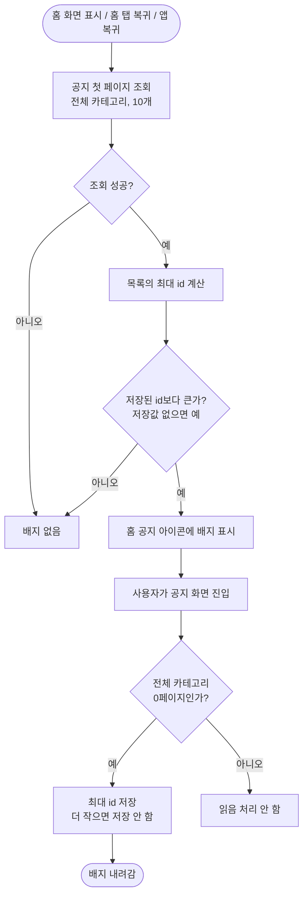

<!-- projectops:report -->
# 🚀[기능개선][홈] 새 공지 등록 시 홈 공지 아이콘에 배지 표시

## 개요

새 공지가 올라와도 홈 상단 공지 아이콘이 그대로여서, 공지 화면에 직접 들어가 보기 전에는 새 공지를 알 수 없었다. 이제 새 공지가 있으면 홈 공지 아이콘에 빨간 점 배지가 뜨고, 공지 화면을 보면 내려간다. 서버는 바꾸지 않았다. 공지는 모든 사용자에게 같은 내용이라, 앱이 마지막으로 본 공지 id만 기기에 저장해 비교한다.

## 기능 흐름

## 변경 사항

### 새 공지 판정
- `lib/features/notice/domain/new_notice.dart` (신규): 목록의 최대 공지 id를 구하는 함수와, 저장된 id와 비교해 새 공지인지 판단하는 함수.
- `lib/features/notice/presentation/providers/notice_provider.dart`: `HasNewNotice` provider 추가. 공지 첫 페이지를 받아 배지 여부를 정하고, `markSeen`으로 본 공지 id를 저장한다.

### 배지 위젯
- `lib/core/widgets/badge_dot.dart` (신규): 아이콘 우상단에 얹는 빨간 점 배지. 커뮤니티 종 아이콘에 있던 코드를 그대로 옮겼다.
- `lib/features/community/presentation/pages/community_page.dart`: 직접 그리던 배지를 `BadgeDot`으로 교체. 모양은 그대로다.
- `lib/core/widgets/buttons/flat_icon_button.dart`: `showBadge` 인자 추가(기본값 false라 다른 사용처는 영향 없음).

### 화면 연결
- `lib/features/session/presentation/pages/home_page.dart`: 공지 아이콘에 배지를 연결하고, 홈 탭 복귀·앱 복귀 때 다시 확인한다.
- `lib/router/route_paths.dart`: 홈 탭 번호 상수 `homeBranchIndex` 추가.
- `lib/features/notice/presentation/pages/notices_page.dart`: 전체 카테고리 0페이지가 표시되면 읽음 처리.

### 테스트
- `test/features/notice/domain/new_notice_test.dart` (신규, 7개): 고정 공지가 맨 위일 때, 처음 설치, 최신 공지 삭제, 공지 0개.
- `test/features/notice/presentation/providers/has_new_notice_test.dart` (신규, 4개): 배지 판정, 읽음 처리 후 해제, 저장값을 내리지 않음, 오프라인.

## 수정 전후 화면

| 수정 전 | 수정 후 |
|---|---|
| (촬영 예정) | (촬영 예정) |

## 주요 구현 내용

- **맨 위 공지가 아니라 최대 id로 비교한다.** 서버는 고정 공지를 먼저, 그다음 최신순으로 보낸다(`pinned DESC, createdAt DESC`). 고정 공지가 하나라도 있으면 맨 위 공지는 늘 그 고정 공지라서, 맨 위 id만 비교하면 새 일반 공지가 올라와도 배지가 뜨지 않는다. 공지 id는 DB가 순서대로 매기는 번호라 가장 큰 id가 가장 최근 공지다.
- **읽음 상태는 서버가 아니라 기기에 둔다.** 커뮤니티 알림은 사용자마다 내용이 달라 서버가 읽음 위치를 들지만, 공지는 모두에게 같다. 그래서 SharedPreferences에 마지막으로 본 공지 id 하나만 저장한다.
- **읽음 처리는 공지 화면에 들어온 순간 한다.** 커뮤니티는 알림함을 나갈 때(`PopScope`) 서버에 읽음 요청을 보내지만, 공지는 기기에 저장만 하면 돼서 화면이 사라지는 시점을 다룰 필요가 없다.
- **전체 카테고리 0페이지일 때만 읽음 처리한다.** 칩으로 거른 목록이나 뒤 페이지에는 최신 공지가 없을 수 있다.
- **저장된 id는 내리지 않는다.** 최신 공지가 삭제돼 목록의 최대 id가 작아져도 이미 본 기록은 그대로 둔다.
- **언어를 바꿔도 다시 받지 않는다.** 공지 id는 언어와 관계가 없다.

## 검증

- `flutter test`: 전체 1563개 통과
- `flutter analyze lib test`: 문제 없음 (커밋 네 개 각각 따로 확인)

## 주의사항

- **고정 공지가 10개 이상이면** 첫 페이지에 일반 공지가 안 들어와 새 공지를 놓친다. 지금은 그럴 일이 거의 없어 그대로 두고 코드 주석에 적어 두었다.
- **앱을 처음 설치하거나 다시 설치하면** 이미 있던 공지에도 배지가 한 번 뜬다. 저장값이 없기 때문이며 의도한 동작이다.
- **공지 화면을 연 사이 새 공지가 올라오면** 홈 탭으로 다시 돌아오거나 앱을 다시 열 때까지 배지가 안 보일 수 있다. 공지 화면에서 나올 때는 다시 확인하지 않는다(커뮤니티 배지와 같은 방식).
- **"전체 카테고리 0페이지일 때만 읽음 처리"는 자동 테스트가 없다.** 지금은 Riverpod이 카테고리 전환 중에 로딩 상태를 알려 주는 방식 덕분에 맞게 동작한다. 이 부분을 리팩터할 때는 칩 전환과 페이지 이동 후 배지가 잘못 내려가지 않는지 직접 확인해야 한다.
- 공지 수정은 id가 바뀌지 않아 배지가 뜨지 않는다.
